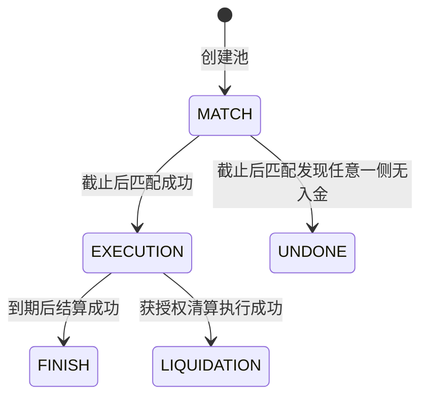

# Pledge 产品需求文档（PRD）

> 版本：v0.3（正文逐节编写）  
> 创建日期：2026-11-02  
> 状态：第一至九章正文已完成，待评审；第十至十七章为提纲。  
> 研究对象：本地 ProjectBreakdown-Pledge 仓库。本文不代表线上网站的当前产品规格。

## 编写约定

- 本文用于明确产品范围、业务规则、用户交互及验收要求，供产品、开发和测试协作使用。
- 先定义产品行为和验收条件，再映射代码。技术选型与目录结构作为实现参考，不代替产品需求。
- 已支持的行为与计划功能分别说明；未确定的规则列入产品决策清单，不作为已实现能力。
- 以正式 PledgePool 合约为实现核对依据；Mock 合约和已有测试仅作为辅助材料。
- 产品统一使用 ETH 作为抵押资产。示例价格、利率、期限不代表真实市场参数；计算注明单位、精度和忽略项。ETH 与 WETH 的技术处理在后续章节定义。
- 每章完成后补充来源、结论及待解决问题；有关资金的章节补充公式、边界场景和验收条件。
- 正文按最小小节逐次编写，每完成一个小节立即保存并检查，再继续下一节。

## 章节进度

| 章节 | 主题 | 状态 |
|---|---|---|
| 1 | 业务名词解释 | 正文已完成，待评审 |
| 2 | 产品定位与业务边界 | 正文已完成，待评审 |
| 3 | 用户角色与使用场景 | 正文已完成，待评审 |
| 4 | 资产权益模型 | 正文已完成，待评审 |
| 5 | 产品全流程与状态机 | 正文已完成，待评审 |
| 6 | 借贷池创建与参数管理 | 正文已完成，待评审 |
| 7 | 募集、资金匹配与退款 | 正文已完成，待评审 |
| 8 | 借款、凭证领取与权益转移 | 正文已完成，待评审 |
| 9 | 到期结算、计息与费用 | 正文已完成，待评审 |
| 10 | 风险监控、提前清算与异常退出 | 待编写 |
| 11 | 用户端页面与交互需求 | 待编写 |
| 12 | 管理后台与运营流程 | 待编写 |
| 13 | 链上链下职责、数据与接口 | 待编写 |
| 14 | DEX 与流动性功能 | 待编写 |
| 15 | 非功能需求与运行保障 | 待编写 |
| 16 | 验收场景与交付里程碑 | 待编写 |
| 17 | 文档实现差异与产品决策清单 | 待编写 |

## 1. 业务名词解释

本章统一产品中的业务名词。示例假设 1 ETH 价值 2,000 单位稳定币，仅说明数量关系，不代表实时价格。借款稳定币及部署网络另行确定。

### 1.1 参与角色与资产

| 名词 | 含义 | 例子与易混淆点 |
|---|---|---|
| Lend / 出借 | 把资金借给借款方 | Alice 存入 1,000 单位稳定币，准备赚取利息 |
| Lender / 出借人 | 提供借款资金的一方 | 领取 SP，结算后按份额赎回稳定币 |
| Borrow / 借入 | 用抵押资产取得借款资金 | Bob 抵押 ETH，匹配后领取稳定币 |
| Borrower / 借款人 | 提供抵押物、取得借款的一方 | depositBorrow 是存抵押物，claimBorrow 才是领取借款 |
| 凭证持有人 | 当前持有 SP 或 JP 的账户 | 可以是最初参与者，也可以是收到转账的受让人 |
| 管理者 / 执行者 | 按权限配置或推进业务的一方 | 后台登录权限与合约执行权限分别校验 |
| ETH | 本产品的抵押资产，也是以太坊原生资产 | ETH 数量与稳定币计价价值分别展示 |
| WETH | 以 ERC20 形式表示的包装 ETH | 通常按 1:1 数量包装与解包；与原生 ETH 的地址、接口和入金方式不同 |
| 稳定币 | 以跟踪法定货币等资产价格为目标的代币类别 | 锚定目标不是始终等值的保证；本产品以池内指定稳定币计价和偿付 |
| 借款资产 / lendToken | 出借方存入、借款方领取的资产 | 本产品为稳定币；lendToken 从出借方视角命名 |
| 抵押物 / borrowToken | 为借款提供偿付保障的资产 | 本产品为 ETH；字段名含 Borrow 不代表它是借到的币 |
| 借贷池 / Pool | 使用同一组资产、利率、期限和抵押要求组织的交易集合 | 同池分别按双方入金比例分配，不逐一配对借贷双方 |
| Pool ID / 池编号 | 区分池子的标识 | 与网络、合约地址一起识别业务对象；展示编号和合约索引可能不同 |

### 1.2 金额、比例与利率

| 名词 | 含义 | 例子与易混淆点 |
|---|---|---|
| 本金 | 实际参与借贷的稳定币金额 | 提交 1,500、成交 1,000，则计息本金为 1,000 |
| 抵押物价值 | 抵押物数量乘其相对借款资产的价格 | 1 ETH × 2,000 = 2,000 单位稳定币，不是 2,000 ETH |
| 抵押率 | 抵押物价值除以借款价值 | 200% 表示每借 1 单位稳定币，需要匹配价值 2 单位的 ETH |
| 池设定抵押率 | 匹配时限制借款额度的参数 | 1 ETH 值 2,000，要求 200%，最多支持借款 1,000 |
| 当前抵押率 | 以当前价格衡量的抵押覆盖比例 | 本金 1,000，抵押物价值跌到 1,500，按本金计算为 150%；若含利息则比例更低 |
| LTV | 债务价值除以抵押物价值 | 相同债务口径下，抵押率 200% 对应 LTV 50%；不可直接混用含息与不含息指标 |
| 固定年利率 / Fixed Rate | 池预先约定的年化计息参数 | 年利率 10% 不表示借 90 天也收本金的 10% |
| 利息 / Interest | 根据本金、利率和期限计算的应付金额 | 本金 1,000、年利率 10%、90 天，按 365 天简单计息约 24.66 |
| 本息 | 本金与利息之和 | 上例为约 1,024.66，未含费用 |
| Fee / 费用 | 产品按约定另外收取的金额 | 必须明确收取资产、费率、计算基数和时间 |
| Share / 份额 | 某项权益占对应总权益的比例 | 25% 的 JP 权益对应剩余 ETH 的 25%，不是原始抵押物的 25% |

可借金额 = 抵押物价值 ÷ 抵押率。因此除以 200% 等于除以 2，也就是乘以 50%。

APR 通常表示年化利率，APY 通常包含复利效果。本产品按期限简单计息，不应将年利率直接表述为复利收益率。上述算例忽略费用和整数舍入。

### 1.3 业务阶段与操作

| 名词 | 含义 | 例子与易混淆点 |
|---|---|---|
| 募集 / MATCH | 收集双方资产、等待确定最终成交规模的阶段 | 入金不表示已借到钱，也不保证全部成交 |
| Deposit / 入金 | 把资产转入合约并记录参与金额 | 出借人存稳定币，借款人存 ETH |
| 匹配 / settle | 根据资金、价格、抵押要求确定实际成交结果 | 成交借款取出借总额与抵押能力中的较小值；不进行利率竞价 |
| 实际参与额 | 最终进入借贷关系的资金或抵押物数量 | 出借只有 600，抵押率 200%、ETH 价格 2,000，则匹配 0.6 ETH |
| Refund / 退款 | 退回未参与匹配的原始资产 | 存入 1 ETH，成交抵押 0.6 ETH，其余 0.4 ETH 可退款 |
| Claim / 领取 | 匹配后领取借款或凭证 | 借款人与 JP 同笔交付；出借人此时领取 SP，不是收回本金 |
| EXECUTION / 执行期 | 匹配成功、尚未完成到期结算或清算的阶段 | ETH 继续锁定，借款可被用户领走 |
| 到期结算 / finish | 到期兑换部分 ETH，确定双方最终可领取资产 | 结算不自动向所有用户转账 |
| Liquidation / 清算 | 为处理风险处置抵押物并结束执行期 | 阈值、权限、实际交易分别确认；不等于清算一定成功 |
| Withdraw / 赎回 | 销毁凭证、按份额领取最终资产 | SP 领取稳定币，JP 领取剩余 ETH |
| UNDONE / 募集失败 | 任一侧无入金而无法形成借贷的终态 | 已参与用户走失败退出流程领取原始资产 |
| FINISH / LIQUIDATION | 分别表示到期结算和清算完成的状态 | 池级处理完成不表示所有凭证都已赎回 |

代码中的 settle 有时被称为“结算”，本文统一称为“匹配”，与 finish 对应的“到期结算”区分。

### 1.4 SP 与 JP

**SP（Senior p_token，优先级凭证）是出借方的稳定币赎回凭证。** 匹配后领取，结算后销毁，按份额领取池内为出借方准备的稳定币。SP 不是已到账的本金，也不承诺固定交易价格。

**JP（Junior p_token，次级凭证）是借款方的剩余 ETH 赎回凭证。** 借款人领取借款时同时领取 JP。部分 ETH 用于偿债后，JP 持有人按份额领取剩余 ETH。

例如池子最终剩余 0.4 ETH，你持有该池 JP 权益的 25%，可领取 0.1 ETH。JP 数量不等于 ETH 数量，也不代表固定稳定币金额。转出 JP，也就转出了相应的剩余 ETH 赎回权。

Senior 与 Junior 表示偿付顺序：先准备出借方应付资产，再确定借款方剩余抵押物。抵押物价值下降会先压缩 JP 的剩余权益，SP 的优先地位不构成保本保证。命名依据：[Pledge 官方资料](https://medium.com/pledge-finance/pledge-finance-community-trivia-quiz-7-9c03042a3049)。

赎回分母使用池子确定的权益总基数，不能因为其他人先销毁凭证，就放大后来赎回者的比例。实际数量、精度和迟领处理见资产权益及领取章节。

### 1.5 时间与风险指标

| 名词 | 含义 | 例子与易混淆点 |
|---|---|---|
| settleTime / 匹配时间 | 预设募集截止与计息期限起点 | 当前入金要求早于该时间，匹配要求晚于该时间；等值边界单独验收 |
| endTime / 到期时间 | 预设借贷期限终点 | 时间到达不表示结算交易已经执行 |
| Length / 约定期限 | 到期时间减预设匹配时间 | 当前计息不以用户实际领取借款时刻为起点 |
| 结算延迟 | 实际结算完成晚于到期时间 | 当前期限公式不包含额外等待时间 |
| 清算阈值参数 | 计算抵押价值边界的增量比例 | 参数 20% 时，边界为本金 × 120% |
| Margin Ratio | 页面显示的清算价值边界比例 | 展示的 120% 与增量参数 20% 必须区分 |
| 穿仓 / 资产不足 | 抵押资产不足以覆盖债务及适用成本 | 损失分配和执行失败恢复需要独立规则 |
| Pause / 暂停 | 管理方限制特定业务操作的状态 | 当前暂停限制也覆盖用户领取和退出，不能假设只禁止入金 |

本金 1,000、清算参数 20%、实际抵押 1 ETH 时，检查边界为 1,200 单位稳定币。ETH 价值低于 1,200 时检查成立，恰好等于时不成立。当前清算入口未强制调用该价格检查，具体差异见第十章。

### 1.6 价格、兑换与钱包交易

| 名词 | 含义 | 例子与易混淆点 |
|---|---|---|
| Oracle / 预言机 | 向合约提供价格的数据机制 | 匹配和风险判断使用的价格，不保证等于实际兑换价格 |
| DEX / 去中心化交易所 | 通过链上合约兑换资产的系统 | 到期将 ETH 兑换为借款稳定币 |
| Swap / 兑换 | 用一种资产换取另一种资产 | 必须记录实际卖出 ETH 与实际收到稳定币的数量 |
| Router / 路由器 | 按兑换路径调用交易池的入口合约 | 借贷合约可直接调用，不要求用户操作独立交易页面 |
| Liquidity / 流动性 | 可供借贷或交易的资金和成交能力 | 持有 ETH 不表示借贷池有足够稳定币，也不保证 DEX 足够深 |
| Quote / 报价 | 按给定数量和市场状态预估的结果 | 市场或数量变化后报价可能变化 |
| Price Impact / 价格影响 | 本笔交易对成交价格的影响 | 大额卖出会改变池内储备，不能直接按小额价格线性估算 |
| Slippage / 滑点 | 预期与实际执行价格或数量的偏差 | 与价格影响相关但不同，需要明确可接受范围 |
| Connect Wallet / 连接钱包 | 网站获取钱包授权公开的账户信息 | 不表示已转账或批准代币；显示账户必须与实际授权一致 |
| Approve / 代币授权 | 允许指定合约在额度内转移 ERC20 | 稳定币通常先授权；原生 ETH 入金不用 ERC20 approve |
| Transaction / 交易 | 提交到区块链执行并改变状态的请求 | 点击、签名、提交和确认是不同阶段 |
| Gas | 链上执行消耗的资源及相应费用 | 回滚交易也可能产生 Gas 费用 |
| Revert / 回滚 | 交易失败，撤销该交易中的状态和资产变更 | 借款或 JP 交付失败时，整笔领取不能留下部分成功结果 |
| Confirmation / 确认 | 交易被链上收录并达到要求的确认程度 | 页面和数据服务使用一致的确认规则 |
| Multi-signature / 多签 | 多个授权参与者达到门槛后批准操作 | 仍需定义批准范围、参数绑定和有效性 |
| 链上 / 链下 | 合约内与外部服务中的处理 | 合约保证权益，页面和 Go 服务负责查询、展示、监控和任务发起 |

### 1.7 常见混淆与依据

| 常见误解 | 正确含义 |
|---|---|
| 借到 1,000 稳定币，另外 1,000 用 JP 替代 | JP 表示剩余 ETH 权益，其价值随价格与结算结果变化 |
| Refund 与 JP 赎回相同 | 前者退回未成交资产，后者领取已成交抵押物偿债后的剩余部分 |
| Claim 与 Withdraw 都是取回本金 | Claim 领取借款或凭证；Withdraw 销毁凭证领取最终资产 |
| 固定利率保证实际收益 | 固定的是计息规则，兑付仍受资产及结算结果影响 |
| 抵押 ETH 就是 Staking | 本产品的抵押用于担保借款，不包含验证者质押收益 |
| 自动清算就是合约自己定时运行 | 需要外部发起交易，并通过权限和业务条件检查 |

依据：正式 PledgePool 合约的参数、状态和业务函数，DebtToken 凭证接口，BscPledgeOracle 价格接口，以及前端市场、钱包调用。业务词义以本章统一，操作约束和计算规则在相应需求章节展开。

## 2. 产品定位与业务边界

### 2.1 产品解决的问题

#### 2.1.1 产品定位

Pledge 是一个按借贷池组织交易的固定年利率、固定期限抵押借贷产品。出借人提供稳定币，借款人提供抵押资产；募集结束后统一确定成交规模，未成交部分由用户领取退款。

产品统一使用 ETH 作为抵押资产，借款资产使用池子指定的稳定币。具体稳定币及部署网络在后续参数章节确定。

匹配成功后，借款人领取稳定币借款和 JP，出借人领取 SP。正常到期时，系统通过 DEX 卖出部分抵押资产，准备出借人的本金与利息；借款方凭 JP 领取结算后的剩余抵押资产。正式合约目前没有主动归还借款、取回全部抵押物的用户还款入口。

#### 2.1.2 参与者要解决的问题

| 参与者 | 需求 | 产品提供的能力 | 需要接受的约束 |
|---|---|---|---|
| 出借人 | 在约定期限内按已知利率出借稳定币 | 查看池参数，参与募集，获得结算赎回凭证 | 提交资金不保证全部成交；实际兑付受抵押资产和结算结果影响 |
| 借款人 | 使用 ETH 获得稳定币流动资金 | 提交 ETH，匹配后领取借款，持有剩余抵押物权益凭证 | ETH 受到锁定和处置规则约束，到期或清算时可能被部分卖出 |
| 管理与执行方 | 将双方资金按统一规则组织成借贷交易 | 配置池参数、推进匹配和结算、处理异常 | 状态推进需要交易执行；运营职责及授权范围必须明确 |

项目定位强调融资成本和收益计算的可预期性。

初期聚焦能够理解抵押借贷及钱包交易的用户，先完成单一 ETH 抵押资产的借贷闭环，再扩展资产种类和独立交易功能。

#### 2.1.3 固定利率与固定期限的产品含义

- 固定年利率：池子预先约定年化计息参数；本金与约定计息期限确定后，可计算目标本息。年利率 10% 不等于借款 90 天也收取本金的 10%。
- 固定期限：池子预设匹配时间和到期时间。募集阶段与计息期限分开；现有合约使用预设的到期时间减匹配时间计算期限。
- 成交数量：受出借资金和 ETH 抵押能力共同限制，在匹配执行时确定；募集页面只能提供预估。
- 执行时间：到达时间边界不代表交易自动发生；匹配和结算仍需有人发起交易并成功执行。
- 收益边界：固定利率确定应计金额的规则，不构成保本或无条件足额兑付承诺。

#### 2.1.4 最小示例

假设只有一位出借人和一位借款人：出借人提供 1,000 单位稳定币；借款人提供 1 ETH，匹配时该 ETH 价值 2,000 单位稳定币；抵押率为 200%。

```text
抵押能力 = 2,000 ÷ 200% = 1,000 单位稳定币
实际成交 = min（出借资金 1,000，抵押能力 1,000）= 1,000
```

双方可以全部成交。借款人领取 1,000 单位稳定币和 JP，出借人领取 SP，1 ETH 留在合约内。到期后，卖出部分 ETH 准备应付本息及适用费用，剩余 ETH 由 JP 持有人按份额赎回。

本例仅说明产品关系，忽略费用、兑换成本和整数舍入；JP 的具体数量、清算规则和最终兑付公式分别在后续章节定义。

#### 2.1.5 本节验收与依据

- 产品说明明确区分借款资产与抵押资产，列出双方分别存入、领取的资产。
- 产品说明明确展示到期处置 ETH 的规则，不能描述为到期默认返还全部原始 ETH。
- 产品说明区分年利率、实际期限、预估成交额和实际成交额。
- 抵押资产为 ETH；具体稳定币、网络及资产技术形态仍需后续定义。

依据：仓库 `README.md` 的系统概述；正式 `PledgePool.sol` 中的 `settle()`、`claimLend()`、`claimBorrow()`、`finish()`、`withdrawLend()`、`withdrawBorrow()`。本节描述依据静态代码核对，运行验证结果在验收章节记录。

### 2.2 产品核心机制

#### 2.2.1 交易组织方式

借贷池是交易组织和结算的基本单位。每个池指定一组借款资产、抵押资产、时间、年利率、抵押率和凭证地址。同池用户接受共同参数，双方资金汇总后分别按入金占比分配成交结果，不建立出借人与借款人之间的一对一债权记录。

抵押资产统一为 ETH。不同期限或不同稳定币可以形成不同池子；首期支持范围见 2.3。

#### 2.2.2 生命周期中的资产与权益

| 阶段 | 业务行为 | 用户可见结果 |
|---|---|---|
| 创建 | 管理者配置池参数及依赖 | 用户可查看资产、年利率、期限、抵押要求和费用信息 |
| 募集 | 出借人存稳定币，借款人存 ETH | 显示已提交金额及预计成交情况；此时尚未最终成交 |
| 匹配 | 授权执行者触发匹配，根据价格和资金确定实际成交额 | 展示实际参与额、可退款额；任一侧无入金时按失败退出流程处理 |
| 领取 | 用户分别领取凭证、借款和未匹配退款 | 出借人得到 SP；借款人得到稳定币和 JP；未匹配资产可单独领取 |
| 执行期 | ETH 留在合约内，外部监控时间与风险 | 展示期限、风险指标、当前凭证余额及可执行操作 |
| 到期或清算 | 授权执行者兑换部分 ETH，确定最终分配资产 | 展示实际兑换、费用和双方可赎回金额；失败则展示未完成原因 |
| 赎回 | 用户销毁 SP 或 JP，按份额领取相应资产 | SP 换取稳定币，JP 换取剩余 ETH；更新余额与赎回记录 |

状态推进、领取、退款和赎回由不同交易完成。到达日期、后端显示结果或用户点击按钮，都不能代替成功的链上交易。

#### 2.2.3 凭证与权益转移

SP 代表出借方对该池最终准备的稳定币的按份额赎回权；JP 代表借款方对该池结算后剩余 ETH 的按份额赎回权。两者都不直接等同于某个固定美元价格。

凭证基于 ERC20，支持转让。赎回时依据调用者持有并销毁的凭证数量计算权益，因此受让人也可以获得相应赎回权。产品需要同时展示原始参与记录和当前凭证余额。

第一章独立解释 SP、JP、份额、退款、结算和清算等业务名词，统一使用 ETH 示例。

#### 2.2.4 与相邻产品的边界

| 维度 | 本次研究的 Pledge 机制 | 需求含义 |
|---|---|---|
| 流动性获得 | 募集后统一匹配，匹配成功后自行领取 | 入金不保证立即借到钱，也不保证全部成交 |
| 正常偿付 | 到期兑换部分抵押物准备本息 | 借款人必须事先理解 ETH 会被按规则处置 |
| 期限 | 池子预设匹配和结束时间 | 不提供可随时结束借贷的活期承诺 |
| 资金执行 | 钱包发起交易，合约执行资金规则 | 后端登录不代替钱包授权，多签仍对关键操作有控制权 |
| 收益来源 | 通过抵押物兑换取得偿付资产 | 本业务中的“抵押”不表示将 ETH 用于验证网络赚取 Staking 收益 |

如果未来增加主动还款、补充抵押、展期或提前退出，需要重新定义权益和资金分配规则；这些能力不能从当前借贷入口自动推导为已有功能。

#### 2.2.5 本节验收与依据

- 能从任一阶段说明资产在哪里、谁持有何种权利、下一笔交易由谁发起。
- 不把“匹配成功”“领取成功”“结算成功”“赎回成功”合并为同一个状态。
- 凭证转让后，产品仍能识别当前持有人权益。
- 募集失败与风险清算具有不同原因、状态和退出路径。

依据：正式 `PledgePool.sol` 的状态枚举及用户、匹配、结算、清算函数；`DebtToken.sol` 的 ERC20 继承及铸销接口；`multiSignatureClient.sol` 的调用授权机制。

### 2.3 目标、范围与非目标

#### 2.3.1 产品目标

| 编号 | 目标 | 交付结果 |
|---|---|---|
| OBJ-01 | 明确交易条件 | 用户入金前可查看资产、年利率、时间、抵押率、费用与资产处置规则 |
| OBJ-02 | 完成借贷流程 | 支持募集、比例匹配、领取、退款、到期结算和凭证赎回 |
| OBJ-03 | 明确异常处理 | 募集失败可退出；价格或兑换异常可识别；失败交易不错误改变权益 |
| OBJ-04 | 保持资产与权益一致 | 每笔资金转移和凭证变动可追溯，不能重复领取或挪用其他池的待付资产 |
| OBJ-05 | 明确执行责任 | 匹配、到期结算、清算及任务重试有确定的权限和执行责任 |

#### 2.3.2 首期功能范围

以下为首期范围安排，表示交付要求，不表示仓库中所有功能均已通过验证。涉及资金和权限的未决规则，应在相应章节明确后再进入验收。

| 模块 | 首期范围 | 依赖与边界 |
|---|---|---|
| 资产与网络 | 单一部署网络、ETH 抵押、一种稳定币借款 | 网络和稳定币地址待确定；测试环境使用明确标识的测试资产 |
| 借贷池 | 创建池、查看参数、按期限组织多个池 | 每池分别核算资产和权益，凭证必须能识别所属池 |
| 用户入金 | 存稳定币、存 ETH、累计参与、检查额度与时间 | 不提供募集期间任意撤回的承诺 |
| 匹配与退款 | 按价格和抵押率计算成交规模，按比例分配，退回未匹配资产 | 募集失败使用全额退出流程 |
| 借款与凭证 | 领取借款、SP 和 JP；凭证转让及余额查询 | SP、JP 为权益凭证，不提供官方回购价格承诺 |
| 结算与清算 | 到期结算、风险检查、清算、最终赎回 | 阈值、计息、损失分配及兑换保护规则在第九、十章确定 |
| 用户页面 | 钱包连接、市场列表、池详情、仓位及交易反馈 | 显示真实账户和网络；查询异常不能伪装成正常零余额 |
| 管理功能 | 创建、授权、参数配置、状态推进、暂停恢复及操作记录 | 后台登录与链上执行权限分别校验 |
| 数据服务 | 同步池信息、提供查询、记录更新时间 | 链上状态为资金与权益依据，缓存不决定提款额度 |

#### 2.3.3 DEX 范围

借贷结算依赖 ETH 与借款稳定币之间的可执行兑换。兑换能力属于借贷闭环的必要依赖，需要明确价格、实际卖出数量、费用、成交限制和失败处理。

仓库包含独立 Swap、流动性池发现、添加与移除流动性页面。独立交易页面不作为首期借贷闭环的完成条件，其具体需求及交付优先级在第十四章定义。

产品层面使用 ETH 表述抵押资产；兑换涉及的 WETH 包装与解包属于资产处理细节，必须保证与用户看到的存取资产一致。

#### 2.3.4 本期不包含的能力

- 主动偿还借款后取回全部原始抵押物。
- 执行期追加抵押、追加借款、展期或自动续借。
- 凭证二级交易市场、自动做市和官方流动性支持。
- 治理代币发行、投票、挖矿激励或 ETH 验证者质押收益。
- 法币出入金、信用借款、跨链借贷和中心化托管账户体系。
- 保本、固定实际兑付金额及无条件随时退出承诺。

上述能力不作为现有核心借贷流程的默认组成部分。未来如需纳入，必须明确新增规则、对存量权益的影响及独立验收条件。

#### 2.3.5 范围验收

- 每项交付需求能归属到明确模块、负责角色及后续详细章节。
- 首期无需依赖独立 DEX 页面即可完成借贷和兑换结算。
- ETH 之外的抵押资产不会出现在首期池创建选项或示例流程中。
- 计划功能和已支持能力分别记录，不因文档描述或页面文件存在而判定已完成。

### 2.4 产品效果与完成标准

#### 2.4.1 业务完成标准

| 编号 | 验收要求 | 通过条件 |
|---|---|---|
| AC-01-01 | 交易条件清晰 | 池页面明确标示借款稳定币、ETH 抵押、年利率、匹配时间、到期时间、抵押率与费用；时间统一展示时区 |
| AC-01-02 | 入金与成交分开 | 提交资金后显示待匹配；匹配成功后展示实际成交和未匹配金额，不能将预估显示为已成交 |
| AC-01-03 | 正常借贷可完成 | 多名双方用户可以完成入金、匹配、领取、退款、到期结算和分次赎回，金额可与业务公式核对 |
| AC-01-04 | 匹配失败可退出 | 任一侧无入金时，池进入失败状态，已入金用户可以按规则全额领取原始资产且不能重复领取 |
| AC-01-05 | 凭证权益可转移 | SP、JP 转让后，受让人可按持有量赎回；原持有人不能赎回已转出的权益 |
| AC-01-06 | 资产核算完整 | 未领取借款、未领退款及未赎回资产均有对应余额；同币种多个池不能相互消耗待付资产 |
| AC-01-07 | 失败反馈准确 | 用户拒签、链上回滚、网络不支持、价格不可用或兑换失败时，页面给出原因，不显示为成功 |
| AC-01-08 | 执行进度可追踪 | 已到期未结算、执行中、成功和失败分别可识别；每笔成功操作可关联到交易记录 |

资金公式、价格条件、暂停策略和费用规则的详细验收在对应章节定义。未决规则不以“沿用现状”代替产品决策。

#### 2.4.2 运行指标

以下指标用于观察交付后的运行情况。目标值、确认区块数、观察窗口和告警阈值在第十五章确定，本章不填写未经测试的性能承诺。

| 指标 | 统计口径 | 用途 |
|---|---|---|
| 交易执行成功率 | 已确认成功交易数 / 已确认成功及失败交易总数，按操作类型统计 | 识别入金、匹配、领取、结算和赎回中的异常；拒签及待确认单独记录 |
| 到期结算延迟 | 成功结算区块时间减池到期时间；未结算池另列等待时长 | 监控状态推进和运营响应 |
| 数据同步延迟 | 链上最新区块时间与最近已同步区块时间的差值，并记录区块高度差 | 识别查询数据滞后 |
| 查询可用率 | 观察窗口内成功返回有效结构的查询数 / 总查询数 | 评估市场和仓位查询服务可用性；数据新鲜度另行判断 |
| 待处理异常数 | 尚未恢复的匹配、结算、清算和同步异常，按原因及持续时间统计 | 支持告警、重试与人工处理 |

#### 2.4.3 对外说明要求

- 页面使用“固定年利率”和“预计本息”，明确年化参数与实际期限的关系。
- 显著说明到期或清算将兑换部分 ETH，最终返还的是剩余抵押物。
- 明确借款领取、未匹配退款和最终赎回需要分别操作。
- 显示价格来源、更新时间及预估标识；预估兑换结果不能作为实际成交承诺。
- 页面显示的钱包地址必须来自实际连接账户，演示数据和测试环境必须有明确标识。
- 固定利率不表述为保本、无风险或任何市场条件下必定足额兑付。

#### 2.4.4 待确定事项

| 编号 | 事项 | 影响 | 详细定义位置 |
|---|---|---|---|
| DEC-01 | 部署网络、借款稳定币、ETH 与 WETH 处理方式 | 地址配置、精度、授权与兑换路径 | 第四、六、十三章 |
| DEC-02 | 清算入口是否强制校验阈值、价格有效性 | 借款方资产处置边界 | 第十章 |
| DEC-03 | 提前清算计息及资产不足的损失分配 | 双方最终权益 | 第九、十章 |
| DEC-04 | 费用是否允许影响已募集或执行中的池 | 用户入金前后条件一致性 | 第六、九章 |
| DEC-05 | 暂停期间可执行操作与恢复责任 | 用户退出能力及故障恢复 | 第十、十二章 |
| DEC-06 | 兑换保护、迟领资产预留与舍入残余 | 结算可执行性及资产核算 | 第八、九、十五章 |
| DEC-07 | 自动执行责任、确认规则与运行指标目标 | 调度、同步及告警验收 | 第十二、十三、十五章 |

#### 2.4.5 本章资料依据

| 来源 | 本章使用范围 |
|---|---|
| `README.md`、`Pledge/README.md` | 固定利率、固定期限的定位及角色描述 |
| `Pledge/pledge智能合约部分/1.pledge智能合约需求清单.md` | 池管理、入金、领取、退款和退出需求 |
| `pledgev2/contracts/pledge/PledgePool.sol` | 状态、匹配、本息、兑换、费用和赎回行为 |
| `pledgev2/contracts/pledge/DebtToken.sol` | SP、JP 凭证能力 |
| `pledgev2/contracts/multiSignature/multiSignatureClient.sol` | 状态推进和管理操作的授权依赖 |
| `pledge-fe/src/pages/Dapp/` | 借贷市场、仓位和 DEX 页面范围 |
| `pledge-backend/api/`、`pledge-backend/schedule/` | 查询、管理和同步任务职责 |

上述路径相对项目仓库根目录。ETH 抵押范围由本产品约定；其余未决事项按决策清单继续完善。第二章完成表示定位、边界和验收框架已写明，不代表实现已经通过测试。

## 3. 用户角色与使用场景

### 3.1 出借人（Lender）

#### 3.1.1 角色目标与参与条件

出借人持有池子支持的稳定币，希望按事先可知的年利率和期限出借资金。参与前需连接正确网络的钱包，持有足够稳定币和 Gas，并完成必要的代币授权。

产品不要求用户用后台账号代替钱包参与。连接钱包仅公开授权账户，不代表资金已入池；授权代币也不代表入金成功。

#### 3.1.2 主要场景

| 场景编号 | 用户目标 | 操作与结果 | 验收条件 |
|---|---|---|---|
| L-01 | 选择借贷池 | 比较稳定币、年利率、期限、抵押要求、费用和募集进度 | 入金前可查看完整交易条件，预计收益注明成交假设 |
| L-02 | 提交出借资金 | 输入金额，授权并发送入金交易 | 余额、额度、最低金额、时间和状态校验通过后记录入金；失败不增加参与金额 |
| L-03 | 查询实际成交 | 匹配后查看实际出借金额与未匹配金额 | 原始入金、实际成交和可退款分别展示 |
| L-04 | 领取 SP 和退款 | 分别领取凭证、未匹配稳定币 | 领取状态独立记录，不允许重复领取；无退款时明确提示 |
| L-05 | 查看执行中权益 | 查看原始参与记录、SP 余额、到期时间和风险状态 | 转入或转出 SP 后，当前权益随余额更新 |
| L-06 | 领取最终资产 | 到期结算或清算成功后销毁全部或部分 SP | 按固定权益基数计算对应稳定币，交易成功后更新余额和赎回记录 |
| L-07 | 募集失败退出 | 池进入 UNDONE 后领取原始稳定币 | 依权限及暂停规则允许时，可全额退出，不能重复领取 |

#### 3.1.3 算例与产品边界

Alice 提交 1,500 单位稳定币，池内 ETH 只支持成交 1,000，则其实际出借本金为 1,000，未匹配退款为 500。她通过 claim 领取 SP，通过 refund 领取 500；两个操作不合并解释为收回全部本金。

假设她持有该池全部 SP，结算后池为出借方准备了 1,024.66 单位稳定币，她销毁全部 SP 可领取该金额。该数值只是结算示例，不表示所有情况下都能足额实现约定收益。

募集期间没有任意撤回已入金稳定币的现有入口；执行期没有随时销毁 SP 提前领取本金的现有入口。凭证可以转让，但产品不承诺有人接盘、存在交易市场或按面值回购。

暂停可能限制领取和退出；到期时间已到但尚未结算时，不能显示为已可赎回。

依据：PledgePool 的 depositLend、refundLend、claimLend、withdrawLend、emergencyLendWithdrawal，以及状态和暂停限制。


### 3.2 借款人（Borrower）

#### 3.2.1 角色目标与参与条件

借款人持有 ETH，希望以 ETH 取得稳定币流动资金，并接受约定期限内锁定及处置抵押物的规则。参与前需了解实际借款受池内稳定币供给与匹配时价格限制，提交 ETH 不保证立即或足额获得借款。

首期以 ETH 抵押，不提供通过主动归还借款取回全部原始 ETH 的流程。入金确认页必须解释到期兑换部分 ETH、通过 JP 领取剩余部分的机制。

#### 3.2.2 主要场景

| 场景编号 | 用户目标 | 操作与结果 | 验收条件 |
|---|---|---|---|
| B-01 | 评估融资条件 | 查看抵押率、年利率、期限、费用、清算要求及预计可借额度 | 明确预估价格和更新时间，预估不能显示为已承诺的借款金额 |
| B-02 | 提交 ETH | 输入 ETH 数量，确认抵押及处置规则后发送交易 | 账户、网络、余额、Gas、时间及状态校验通过后记录参与额 |
| B-03 | 查询成交 | 匹配后查看实际抵押、可借金额和未匹配 ETH | 三项金额分别展示，能说明实际采用的成交结果 |
| B-04 | 领取借款与 JP | 一笔交易交付稳定币和对应 JP | 全部成功或全部回滚，不得出现已领标记与资产不一致 |
| B-05 | 领取未匹配 ETH | 独立领取未参与借贷的 ETH | 与借款领取顺序无关，不可重复领取 |
| B-06 | 监控剩余权益 | 查看 JP 余额、当前抵押覆盖、期限及清算状态 | 风险指标注明口径；暂不可获取价格时显示异常而非零风险 |
| B-07 | 赎回剩余 ETH | 结算或清算成功后销毁 JP | 以实际剩余 ETH 和凭证份额计算，不使用原始抵押额作为固定承诺 |
| B-08 | 募集失败退出 | UNDONE 时领取原始 ETH | 按权限及暂停规则处理，不收取不存在借贷关系的利息 |

#### 3.2.3 算例与风险认知

Bob 存入 1 ETH，匹配时价格为 2,000 单位稳定币，池要求抵押率 200%。抵押能力为 1,000，但池只提供 600，则实际借款为 600、实际参与抵押为 0.6 ETH、未匹配退款为 0.4 ETH。

Bob 可分别领取 600 稳定币及 JP、0.4 ETH 退款。参与抵押的 0.6 ETH 继续留在合约内。假设最终卖出 0.31 ETH 用于偿付及费用，且无其他扣减，剩余 0.29 ETH 由对应 JP 持有人领取。实际兑换数量以结算结果为准。

借款人需要确认：价格下跌会减少剩余 ETH，可能触发清算；出售 JP 会转出相应剩余权益；完整约定期限计息与提前清算计息的规则在第九、十章明示。产品不能使用“借款后始终保有全部 ETH”作为宣传文案。

暂停可能限制退出；兑换失败或无人执行时，终态和赎回可能延迟，需要显示实际状态及处理进度。

依据：PledgePool 的 depositBorrow、refundBorrow、claimBorrow、withdrawBorrow、emergencyBorrowWithdrawal、finish、liquidate。


### 3.3 SP / JP 受让人

#### 3.3.1 权益归属

受让人通过转账取得该池 SP 或 JP，可以没有该池原始入金记录。受让的是凭证对应的赎回权益，不包括转出人的未匹配退款、尚未领取的借款或其他池权益。

凭证领取仍依据原始参与记录；最终赎回依据当前持有凭证。原参与人转出凭证后，其历史参与额不能继续作为可赎回额度。

#### 3.3.2 场景与验收

| 场景编号 | 场景 | 验收条件 |
|---|---|---|
| T-01 | 接收 SP | 未参与募集的账户可发现持有仓位，识别网络、池、凭证合约、终态和可赎回稳定币 |
| T-02 | 接收 JP | 页面说明接收的是剩余 ETH 份额，不显示为固定数量 ETH 或固定美元债权 |
| T-03 | 部分转出后赎回 | 转出方只能按剩余余额赎回，受让方按收到的余额赎回，两者总额受池权益约束 |
| T-04 | 分次销毁凭证 | 每次按确定的总权益基数计算，其他人先赎回不会放大本人的份额 |
| T-05 | 终态前接收凭证 | 显示持仓及不可赎回原因，不能因持币而绕过池状态限制 |

例如该池 JP 总权益基数为 2,000，Bob 转出 500 JP 给 Dana，Dana 对应 25% 的剩余 ETH 权益。若最终剩余 0.4 ETH，Dana 可赎回 0.1 ETH。Bob 的原始退款记录不会随这次转账转移。

转账能力不等于产品已提供买卖市场，受让价格由交易双方自行约定，平台不保证流动性或回购。

依据：DebtToken 的 ERC20 转账机制，PledgePool 的凭证销毁、赎回份额和按原参与地址记录的领取、退款信息。


### 3.4 管理者、多签审批者与任务执行者

#### 3.4.1 角色分工

| 角色 | 职责 | 权限边界 |
|---|---|---|
| 产品运营者 | 准备池参数，检查资产、期限、价格源和兑换路径，跟进异常 | 后台可见或可编辑不代表可直接执行链上操作 |
| 多签审批者 | 按门槛审批或撤销调用授权 | 不直接取得用户 SP、JP 或提款权；实际授权粒度见第十二章 |
| 链上执行者 | 在授权范围内创建池、修改配置、匹配、结算和清算 | 必须受合约权限与业务条件约束，不能以运营需要绕过用户权益规则 |
| 自动任务服务 | 同步数据、检查时间和风险、按配置提交与跟踪交易 | 查询与发交易权限分离；发送能力不表示业务条件已经满足 |
| 异常处理人员 | 分析失败、处理告警、按授权恢复流程 | 记录原因、操作、交易及结果，不能通过改数据库伪造成功 |

上述为职责划分，不表示现有系统已经实现独立的后台角色权限模型，也不强制由不同人员担任。自动执行匹配、结算和清算是待明确的服务能力；当前调度入口主要包含数据与价格同步，不能直接视为完整自动执行系统。

#### 3.4.2 管理场景与验收

| 场景编号 | 场景 | 验收条件 |
|---|---|---|
| M-01 | 发布池 | 校验参数与外部依赖，记录审批及创建交易，确认后才展示为已发布 |
| M-02 | 募集结束后匹配 | 区分待执行、执行中、失败、成功，按交易结果更新池状态 |
| M-03 | 到期结算 | 跟踪待结算池与执行延迟，失败时保留原因和处理责任 |
| M-04 | 风险清算 | 明确价格口径、阈值、授权及执行检查，禁止把查询返回值当成已完成清算 |
| M-05 | 调整费用或依赖 | 展示影响范围、审批及变更记录；存量池影响按明确规则处理 |
| M-06 | 暂停与恢复 | 明示受影响操作、原因、执行人及交易；恢复前检查依赖和资产状态 |
| M-07 | 处理失败任务 | 查询交易实际结果后再重试，避免重复发送造成错误记账 |

#### 3.4.3 执行依赖与待确定事项

匹配、到期结算和清算需要交易推进，必须指定负责人或任务服务。若执行者离线、权限失效或兑换失败，页面应显示等待或失败，不能仅按日期显示业务完成。

现有清算入口未强制检查价格阈值，多签授权摘要也不等同于逐笔参数绑定审批。这些权限边界在第十、十二及十七章记录和决策，不在本章假设其已满足交付要求。

依据：multiSignature、multiSignatureClient、AddressPrivileges；PledgePool 的 validCall 管理入口；后台路由及 schedule/tasks/task.go。


### 3.5 用户故事与场景优先级

#### 3.5.1 优先级定义

P0 为首期交付的必要能力，包括资金安全、用户权益、借贷闭环和异常反馈；P1 为提升查询和运营效率的能力；P2 为可独立排期的扩展功能。优先级表示交付次序，不表示已有代码通过验收。

| 故事编号 | 用户故事 | 关联场景 | 优先级 | 完成标准 |
|---|---|---|---|---|
| US-01 | 作为参与者，我希望入金前理解条件和资产处置规则 | L-01、B-01 | P0 | 年利率、期限、匹配、费用、ETH 处置及退出限制清晰可见 |
| US-02 | 作为出借人，我希望按实际成交出借并取回未成交资金 | L-02 至 L-04 | P0 | 入金、匹配、SP 和退款金额可核对，不能重复领取 |
| US-03 | 作为借款人，我希望知道实际借到多少并领取未匹配 ETH | B-02 至 B-05 | P0 | 借款与 JP 同笔交付，退款独立，失败不留下部分状态 |
| US-04 | 作为参与者，我希望募集失败后按规则退出 | L-07、B-08 | P0 | 失败状态、退出条件和原始应退资产可核对 |
| US-05 | 作为持有人，我希望权益随凭证转移并能分次赎回 | L-06、B-07、T-01 至 T-05 | P0 | 受让人可赎回，总额不因转账和先后顺序而增加 |
| US-06 | 作为参与者，我希望账户和网络变化后显示正确权益 | L-05、B-06、T-01 | P0 | 不复用旧账户余额，不把数据错误显示为无仓位 |
| US-07 | 作为运营者，我希望及时推进匹配、结算并处理风险 | M-01 至 M-07 | P0 | 每步有责任、权限、实际交易及失败处理记录 |
| US-08 | 作为参与者，我希望价格、兑换或任务异常时看到真实状态 | B-06、M-03、M-04、M-07 | P0 | 不虚报成功，记录异常来源及可用操作 |
| US-09 | 作为运营者，我希望通过筛选和统计定位待处理池 | M-02、M-03、M-07 | P1 | 可按状态、时间、失败原因和持续时长查询 |
| US-10 | 作为参与者，我希望收到募集结果和到期提醒 | L-03、B-03、L-06、B-07 | P1 | 提醒与实际状态一致，通知故障不改变链上权益 |
| US-11 | 作为用户，我希望在独立页面兑换和管理流动性 | 第十四章功能 | P2 | 单独定义依赖和验收，不阻塞借贷闭环 |

#### 3.5.2 共同行为要求

- 一个钱包可以同时是不同池的出借人和借款人，也可以同时持有同池 SP、JP；页面不得使用单一账户角色限制其全部操作。
- 我的仓位同时覆盖原始参与记录和当前凭证持仓。无入金记录但有凭证的账户不能被过滤掉。
- 用户拒签、授权成功、入金成功、等待匹配、匹配成功及可赎回是不同状态，分别显示。
- 未领取退款、未领取借款和未赎回凭证分别计算，不混合为一个含糊的余额。
- 钱包连接、后台登录、代币授权和多签审批各自独立，任何一个都不自动取得其他权限。

#### 3.5.3 本章验收与衔接

测试应覆盖出借人、借款人、仅接收凭证的账户，以及分别承担审批、执行、查询职责的账户。多角色账户、账户切换、凭证部分转让、分次赎回和管理调用失败均需单独验证。

角色和场景编号作为后续需求与验收追踪依据。下一章定义资产、参与记录、凭证份额及待领取金额之间的关系，确保上述用户权利能够被准确记录和计算。


## 4. 资产权益模型

### 4.1 资产与数据对象

#### 4.1.1 资产与标识

每个池使用一种稳定币作为借款资产，使用 ETH 作为抵押资产。资产由网络和地址共同识别，名称与符号仅用于展示。原生 ETH 使用明确的资产类型，不能当作 ERC20 调用；兑换涉及的 WETH 必须与原生 ETH 数量及存取记录衔接。

池的完整标识由网络、池合约地址、池索引组成。用户以钱包地址识别，凭证以网络及凭证合约地址识别。接口和页面不得仅按名称合并不同池、不同网络的记录。

首期稳定币地址和精度待定。文中 USDT 数量仅用于业务算例，不代表已确定具体部署资产。

#### 4.1.2 数据对象

| 对象 | 关键内容 | 业务用途 |
|---|---|---|
| 池参数 | 资产、最大出借额、匹配时间、到期时间、年利率、抵押率、清算参数、SP/JP 地址 | 描述参与条件和权益边界 |
| 池募集记录 | 累计稳定币入金、累计 ETH 入金 | 计算双方占比；不是当前合约实时余额 |
| 出借参与记录 | 用户累计入金、SP 是否领取、退款是否领取及已退金额 | 支持原参与人的领取与退款 |
| 借款参与记录 | 用户累计 ETH 入金、借款与 JP 是否领取、退款是否领取及已退金额 | 支持借款交付和抵押退款 |
| 匹配结果 | 实际成交本金、实际匹配 ETH、双方可退款总额 | 固定本次借贷规模与凭证权益基数 |
| 凭证持仓 | SP/JP 当前余额、转账与销毁记录 | 确定当前持有人的最终赎回权 |
| 最终分配结果 | 为 SP 准备的稳定币、为 JP 准备的剩余 ETH、费用及兑换结果 | 确定终态资产分配总额 |
| 已履行与待履行权益 | 已退、已交付借款、已赎回资产及对应待付金额 | 对账、保留待领资产、避免重复支付 |

当前合约使用 PoolBaseInfo、PoolDataInfo、userLendInfo 和 userBorrowInfo 记录主要数据；部分退款和待付金额需要结合结果、标记及交易记录计算，不是每项都已有独立存储字段。

#### 4.1.3 金额分层

原始入金、实际参与金额、待领金额和最终赎回金额分别保存或可验证推导，不覆盖彼此。

```text
出借方：累计入金 = 实际成交本金份额 + 未匹配退款权益
借款方：累计 ETH 入金 = 实际匹配 ETH 份额 + 未匹配 ETH 退款权益
```

假设用户投入 1,000 USDT，匹配比例为 60%，则实际出借为 600、退款为 400。退款领取后，原始入金仍为 1,000，已领退款为 400，待领退款为零。不能把原始入金改成 600 而丢失历史。

终态下的 ETH 剩余金额是实际匹配 ETH 减实际用于结算的 ETH 及相应费用。未匹配退款不属于可被结算消耗的抵押物。

#### 4.1.4 生命周期中的权益确认

| 时点 | 已确定的内容 | 尚未完成的内容 |
|---|---|---|
| 创建池 | 最大出借额、参数、SP/JP 合约地址 | 实际成交、用户份额和代币发行均未确定 |
| 募集入金 | 各用户累计参与金额 | 不发 SP/JP，不承诺最终成交数量 |
| 募集截止 | 不再接受新入金 | 需执行匹配交易，不自动形成成交结果 |
| 匹配成功 | 实际成交、退款权益及凭证总权益基数 | 借款、退款和凭证仍需用户领取 |
| 用户领取 | 对应资产交付或凭证铸造 | 其他未领权益继续保留 |
| 结算或清算成功 | 双方最终可分配资产总额 | 用户仍需销毁凭证赎回 |

最大出借额是上限，当前没有必须足额募集才成交的条件。双方有资金且可形成有效成交额时可部分成交；任意一侧无入金则按募集失败处理。极小金额被整数舍入为零的情况需在匹配验收中单独处理，不能仅以双方余额非零判断有效成交。

依据：PledgePool 的 PoolBaseInfo、PoolDataInfo、用户参与映射，以及 createPoolInfo、depositLend、depositBorrow、settle 和领取、退款接口。


### 4.2 SP / JP 权益定义

#### 4.2.1 池级凭证边界

每个池的 SP 与 JP 必须分别使用独立的凭证合约，不能与其他池共用。跨池凭证不能互相赎回；名称相同或底层资产相同不能作为兼容依据。创建时应拒绝复用其他池的凭证地址及同池 SP/JP 使用同一地址。

上述为交付约束。当前 createPoolInfo 接收 SP、JP 地址并校验非零，但没有校验地址复用或两者相同，需在差异清单记录。

#### 4.2.2 总权益、发行量与余额

必须分别识别三个数量：

| 数量 | 含义 | 变化时点 |
|---|---|---|
| 总权益基数 | 本池所有参与人合计可领取、用于赎回比例计算的凭证基数 | 匹配成功后确定，不随领取、转账或销毁改变 |
| 已发行未销毁量 / totalSupply | 凭证合约当前仍存在的代币总量 | 领取铸造时增加，赎回销毁时减少 |
| 用户余额 / balanceOf | 当前账户持有的凭证数量 | 铸造、转账、销毁时变化 |

建池不发放凭证，入金不发放凭证，匹配只确认权益，claim 才铸造凭证。

例如 SP 总权益基数为 10,000，只有 A 领取了 3,000 SP，则 totalSupply 为 3,000，但 A 的份额仍为 30%，不能按当前发行量解释为拥有全池权益。

#### 4.2.3 数量与比例公式

以下为忽略整数舍入的业务公式。L 为累计出借稳定币，C 为累计 ETH，M 为实际成交本金，R 为抵押率的倍数值；200% 使用 R=2。金额均先明确展示单位与资产精度。

```text
SP 总权益基数 = M
JP 总权益基数 = M × R

出借人 i 的比例 = 其累计稳定币入金 / L
出借人 i 可领取 SP = M × 该比例

借款人 j 的比例 = 其累计 ETH 入金 / C
借款人 j 可领取借款 = M × 该比例
借款人 j 可领取 JP = M × R × 该比例
```

当前代码的 SP 数量直接采用稳定币最小单位数量，JP 数量采用该数量乘费率基数换算后的抵押率。DebtToken 默认 18 位精度，因此不能直接把任意精度稳定币与凭证的展示数量视为一比一。首期须确定稳定币精度以及凭证精度换算；以下算例假设稳定币、SP、JP 均为 18 位，不能未经换算用于 6 位精度资产。

#### 4.2.4 多人权益算例

A、B、C 分别投入 3,000、5,000、2,000 USDT；D 存入 10 ETH。匹配价格为 2,000 USDT/ETH，抵押率 200%，双方全部成交。

| 用户 | 领取资产或凭证 | 对应权益 |
|---|---|---|
| A | 3,000 SP | SP 总权益的 30% |
| B | 5,000 SP | SP 总权益的 50% |
| C | 2,000 SP | SP 总权益的 20% |
| D | 10,000 USDT 与 20,000 JP | JP 总权益的 100% |

假设期限 365 天、年利率 20%，结算价格仍为 2,000，忽略费用和兑换成本。目标本息 12,000 USDT，需要卖出 6 ETH，剩余 4 ETH。结算成功后 A、B、C 分别可赎回 3,600、6,000、2,400 USDT；D 持有全部 JP，可赎回 4 ETH。

如果 D 转出 5,000 JP，受让人取得总权益的 25%，可赎回 1 ETH，D 剩余可赎回 3 ETH。D 尚未领取的原始借款或退款权不会随凭证转让。

#### 4.2.5 最终赎回公式

```text
SP 赎回稳定币 = 已确定的 SP 可分配资产总额 × 本次销毁 SP / SP 总权益基数
JP 赎回 ETH = 已确定的 JP 可分配 ETH 总额 × 本次销毁 JP / JP 总权益基数
```

这里的可分配资产总额是终态确定的分配基数，不是随其他人提款而递减的当前钱包余额。不能同时缩小分母或改用剩余余额，导致后续用户少领或多领。

未领取的凭证可在当前允许的终态领取，已赎回数量不允许再次使用。领取和分次赎回中的舍入残余单独核算；不把残余自动转给最后一个用户。

依据：claimLend、claimBorrow、withdrawLend、withdrawBorrow，以及 DebtToken 的 mint、burn 和 ERC20 精度。领取阶段允许的状态见第五、八章。

### 4.3 资金归属与约束

#### 4.3.1 待履行权益

资金存在合约中不代表可以自由用于新交易。必须按池和资产识别尚未履行的义务。

| 阶段 | 稳定币义务 | ETH 义务 |
|---|---|---|
| 募集期 | 保留出借入金，等待匹配或失败退出 | 保留抵押入金，等待匹配或失败退出 |
| 匹配后 | 未领取借款、未领取出借退款 | 未领取抵押退款，以及继续参与借贷的抵押物 |
| 最终结算后 | 未领取借款、未领取出借退款、尚未兑付的 SP 权益 | 未领取抵押退款、尚未兑付的 JP 权益 |
| 募集失败 | 尚未领取的原始稳定币 | 尚未领取的原始 ETH |

当前 claimBorrow 在 FINISH、LIQUIDATION 状态仍可调用，因此结算后仍可能存在未领取借款；不能以池已结算为由把这些稳定币分给 SP 持有人或转为平台收入。SP/JP 的终态分配资产需要与原始未交付借款、退款分别核算。

#### 4.3.2 池间隔离与对账

多个池可能共用同一个池合约及同一种稳定币。实际钱包余额是合计余额，不代表每个池均有足够资产。

交付要求：

- 每次转账只能消耗该池对应资产的可用余额，不能使用其他池待付资金补足兑换或兑付。
- 结算卖出的 ETH 不超过该池实际匹配且尚未处置的 ETH；未匹配退款不得参与卖出。
- 账目按资产分别核对，不能把稳定币数量与 ETH 数量相加作为资产守恒关系。
- 同一资产的合约余额应覆盖所有池的待付及保留余额；未归属的直接转入、舍入残余和已确认费用单独记录。
- 已支付费用与平台可取收入不能包含未领取借款、退款、SP/JP 赎回准备金。

现有合约按池记录金额，但资产实际存放在共同地址；卖出和支付是否满足完整池间隔离，需通过多池场景验证，不能仅凭结构体带池索引就判定满足。

#### 4.3.3 领取、转让和赎回约束

| 规则编号 | 规则 | 验收条件 |
|---|---|---|
| EQ-01 | 入金不铸造凭证 | 创建和入金交易不增加 SP/JP 发行量 |
| EQ-02 | 领取不可重复 | 同一参与记录成功领取后，再次领取失败且不增加资金或凭证 |
| EQ-03 | 退款与领取独立 | 先退款后领取与先领取后退款结果一致；两次退款不可重复成功 |
| EQ-04 | 转让仅转移凭证权益 | 接收凭证不能调用转出人的借款或退款领取记录 |
| EQ-05 | 跨池凭证不混用 | 创建拒绝复用凭证，持有 A 池凭证不能作为 B 池赎回依据 |
| EQ-06 | 赎回比例不随发行和销毁变化 | 部分用户迟领、他人先赎回，不放大剩余用户权益 |
| EQ-07 | 部分赎回不超领 | 多次销毁的合计数量不超过持有量及有效总权益，支付受资产预算约束 |
| EQ-08 | 失败不留下部分状态 | 转账、铸造或销毁失败时整笔交易回滚，页面不显示领取完成 |
| EQ-09 | 多池资金不可互补 | 人为制造一个池资产不足时，其操作失败，不消耗另一个池准备金 |
| EQ-10 | 展示精度与链上数量一致 | 覆盖不同稳定币精度和 18 位凭证换算，入金、份额、退款、赎回均可核对 |
| EQ-11 | 无效成交不可分配 | 实际成交为零、分母为零或价格无效时不生成可领取份额；处理路径在匹配章节确定 |

EQ-05、EQ-09、EQ-10、EQ-11 等为产品交付要求，现有实现不据此视为已经满足。具体差异和处置方案列入第十七章。

#### 4.3.4 金额精度与残余

页面按资产精度显示，交易使用最小单位整数。利率和比例参数使用各自明确的基数，不把 200%、2 和 200000000 混作同一个输入值。

现有份额计算先按 1e18 计算比例，再乘总额，存在向下取整。业务公式中的等式为忽略舍入的关系；实际对账需显式记录不可分配残余。可展示金额不得向上舍入后直接用于提交，否则可能超过真实可领金额。

残余的归属、是否允许小额领取以及最终处理条件待数值规则章节确定。用户不会因为别人先领取而自动取得更多份额；不能将无法解释的差额笼统归为手续费。

#### 4.3.5 来源及待确定事项

本章依据 PledgePool 的池和用户数据结构、入金、匹配、领取、退款、最终分配和赎回逻辑，以及 DebtToken 和 SafeTransfer 接口。全部规则仍需通过正式合约测试和资产对账验证。

后续需确定：稳定币精度及凭证换算方式、ETH/WETH 的入账衔接、凭证地址唯一性校验、多池余额预算、迟领资产预留与舍入残余处理。相关事项在第六至十章、第十三及十五至十七章展开。

## 5. 产品全流程与状态机

### 5.1 正常业务流程

#### 5.1.1 流程与责任

| 步骤 | 发起方 | 前置条件 | 处理结果 |
|---|---|---|---|
| 1. 创建借贷池 | 获授权的执行账户 | 参数及依赖准备完成，具备链上调用授权 | 池以 MATCH 状态建立，记录 ETH、稳定币、期限、利率及凭证地址 |
| 2. 募集资金 | 出借人、借款人 | MATCH、早于匹配时间、未暂停；余额和额度满足 | 出借方存稳定币，借款方存 ETH；累计参与金额，不铸造凭证 |
| 3. 执行匹配 | 获授权的执行账户 | MATCH、晚于匹配时间 | 计算实际成交及退款权益；成功进入 EXECUTION；任一侧无入金则进入 UNDONE |
| 4. 领取借款和凭证 | 原始参与账户 | 匹配成功，满足领取状态、时间及暂停限制 | 出借人领取 SP；借款人同笔领取稳定币及 JP |
| 5. 领取未匹配资产 | 原始参与账户 | 存在退款权益且未领取 | 出借方领稳定币退款，借款方领 ETH 退款 |
| 6. 执行期监控 | 用户、运营者和监控服务 | EXECUTION | 查询当前风险和期限，持续识别待执行事项；查询本身不改变状态 |
| 7. 到期结算 | 获授权的执行账户 | EXECUTION、晚于到期时间，兑换可完成 | 卖出部分 ETH，记录本息偿付及剩余 ETH，进入 FINISH |
| 8. 最终赎回 | 当前 SP/JP 持有人 | 合法终态，具备可销毁凭证，未暂停 | 销毁凭证，按份额领取对应资产；池终态不因单次赎回改变 |

领取凭证和退款是相互独立的交易，不要求所有用户先完成领取才进入结算。匹配成功后即可进入 EXECUTION，即使仍有人未领取借款、凭证或退款。

#### 5.1.2 时间推进与交易推进

募集截止时间由池参数确定。截止前接受入金，截止后必须由获授权执行者发送匹配交易；借款人不能仅因身份为借款人就提前匹配。现有 Go 调度未包含完整的 settle 自动调用流程，自动调度作为执行能力在第十二、十三章明确。

页面分别展示业务时间和链上状态。例如 MATCH 池已经过了截止时间，应展示“募集结束，待匹配”，禁止新入金；不能仅按时间推算为 EXECUTION。

到期同理：EXECUTION 且时间超过 endTime 时显示“已到期，待结算”。只有 finish 成功才显示到期结算完成，并根据实际结果开放赎回。

#### 5.1.3 正常场景验收

- 计划募集 10,000 USDT，实际只募集 5,000 且有足够 ETH 抵押时，截止后允许部分成交，不要求满额。
- 创建、入金、匹配均不直接增加 SP/JP 的代币发行量；用户领取成功时才铸造。
- 用户可先领取借款与 JP 再退 ETH，也可先退 ETH 再领取；两条路径结果一致。
- 到期未执行结算时，不开放正常到期赎回；结算后允许合法持有人分次赎回。
- 历史参与人及凭证受让人的入口分别根据参与记录和当前持仓判断，不混用权益依据。

依据：createPoolInfo、双方入金与领取接口、settle、finish、withdrawLend、withdrawBorrow 及现有调度入口。


### 5.2 异常与清算流程

#### 5.2.1 募集失败

匹配执行时，若稳定币累计入金或 ETH 累计入金任意一侧为零，池进入 UNDONE。原始参与人通过对应失败退出接口领取原始入金，不发放 SP/JP，不计算已成立借贷的利息。

UNDONE 为池终态，不表示自动退款完成。页面继续显示尚未领取的稳定币或 ETH 以及退出按钮。暂停限制仍适用，不得将失败退出标注为无条件可操作。

若双方非零但经价格和舍入计算后成交为零，现有逻辑可能仍进入 EXECUTION，产生后续零基数问题。交付要求是不得建立无效成交权益；具体应拒绝匹配还是转入失败退出，列为第七、十七章决策项。

#### 5.2.2 风险清算

风险监控读取实际匹配 ETH 的当前价值，与本金及清算阈值比较。达到风险条件后，由获授权执行者发起 liquidate；成功后记录兑换、费用和双方分配金额，进入 LIQUIDATION。用户随后以 SP、JP 分别赎回。

当前 liquidate 检查 EXECUTION、晚于 settleTime 和 validCall 授权，但没有强制检查价格阈值，也未要求早于 endTime。因此现有实现中，它既可能提前执行，也可能在到期后尚未结算时执行。产品不能将它描述为仅允许“提前且跌破阈值”执行。

当前清算按完整约定期限计息，不是借款人按实际天数主动还款。入口阈值校验、到期后路径选择及计息政策在第九、十章确定；现有行为不替代待定的交付约束。

#### 5.2.3 交易及外部依赖异常

| 异常 | 状态与资产要求 | 页面和运营处理 |
|---|---|---|
| 用户拒签或尚未提交 | 不改变链上状态 | 显示取消或未提交，不生成成功资产记录 |
| 交易已提交未确认 | 不提前认定完成 | 显示交易哈希及等待状态；重试前检查原交易结果 |
| 入金、领取或赎回回滚 | 本次交易资产和业务状态全部回滚 | 保留失败原因，刷新余额后允许满足条件的重试 |
| 价格不可用或异常 | 不以无效价格计算匹配或清算权益 | 显示价格异常，告警并阻止错误报价；有效性规则见第十章 |
| DEX 流动性不足或兑换失败 | 不因交易失败进入 FINISH 或 LIQUIDATION | 保持原链上状态，记录原因，按授权处理兑换依赖后重试 |
| 执行账户无授权或 Gas 不足 | 不推进池状态 | 显示待处理责任与失败原因，不暗示用户可立即赎回 |
| 数据同步失败或链上重组 | 页面不以旧索引确认新状态 | 标记更新时间和待核对状态，根据确认规则重新同步 |

价格有效性和池级资产预算是交付要求，不能据现有调用接口推定所有校验已存在。不能通过改数据库把失败状态改成成功，或用其他池资产弥补本池结算不足。

#### 5.2.4 暂停与恢复

全局暂停是独立开关，不是新增池状态。暂停后，池仍保持 MATCH、EXECUTION 或终态，受限制的用户入口暂时不可执行。

当前入金、领取、退款、失败退出及赎回都受 notPause 限制；settle、finish、liquidate 以及管理设置不受该修饰符限制。暂停不会停止时间流逝，也不能理解为冻结所有业务交易。

恢复操作只能解除相应限制，不自动执行遗漏匹配、退款或赎回。恢复前需要检查时间、池状态、外部依赖和资产账目。应急退出政策及暂停期间管理调用范围，在第十、十二章细化。

依据：settle 的失败分支、liquidate、setPause、各用户入口修饰符及兑换调用。


### 5.3 池状态与转换条件

#### 5.3.1 池状态定义

| 状态值 | 状态 | 含义 | 不代表的事情 |
|---|---|---|---|
| 0 | MATCH | 池已创建，尚未执行最终匹配 | 不保证当前仍在募集，可能已过截止时间 |
| 1 | EXECUTION | 已匹配成功，等待终态处理 | 不保证所有用户已领取借款和凭证，也不保证尚未到期 |
| 2 | FINISH | 正常到期结算成功 | 不保证全部 SP/JP 或退款已领取、赎回 |
| 3 | LIQUIDATION | 清算交易成功 | 不表示所有持有人已提现，也不构成足额兑付保证 |
| 4 | UNDONE | 募集失败 | 不表示用户资产已自动退回 |



状态图描述现有合法状态转换，不等于清算入口已完整校验风险条件。终态不再转回 MATCH 或 EXECUTION；领取、退款、转账和赎回通常不改变池级状态。

#### 5.3.2 转换条件

| 编号 | 转换 | 现有必要检查 | 成功结果 |
|---|---|---|---|
| ST-01 | 新建 → MATCH | 有效授权；endTime > settleTime；凭证非零等创建检查 | 初始化参数、零入金和零结算记录 |
| ST-02 | MATCH → EXECUTION | 有效授权；当前时间 > settleTime；双方入金均非零；计算可成功 | 写入匹配金额，确定权益基数 |
| ST-03 | MATCH → UNDONE | 有效授权；当前时间 > settleTime；至少一侧入金为零 | 记录失败结果，开放符合条件的失败退出 |
| ST-04 | EXECUTION → FINISH | 有效授权；当前时间 > endTime；兑换及后续计算成功；所得覆盖要求成立 | 写入正常结算分配金额 |
| ST-05 | EXECUTION → LIQUIDATION | 有效授权；当前时间 > settleTime；兑换及后续计算成功 | 写入清算分配金额；价格阈值未在入口强制校验 |

以上为现有检查概述，不表示参数检查已充分。有效成交、价格、凭证唯一性、池级资产预算及授权粒度的补充约束在对应章节定义。

#### 5.3.3 时间边界

| 当前时间 t | 入金 | 匹配 | 到期结算 |
|---|---|---|---|
| t < settleTime | 满足其他条件时允许 | 不允许 | 不允许 |
| t = settleTime | 不允许 | 不允许 | 不允许 |
| settleTime < t < endTime | 不允许 | MATCH 时允许 | 不允许 |
| t = endTime | 不允许 | MATCH 时仍可执行 | 不允许 |
| t > endTime | 不允许 | MATCH 时仍可执行 | EXECUTION 时允许 |

当前 settle 没有 endTime 上界，导致到期后仍可能首次匹配；现有计息仍采用预设完整期限。是否禁止迟到匹配、改为失败退出或重新确认条件，属于必须明确的产品决策，不在页面自动修正。

#### 5.3.4 页面派生状态

前端可组合链上状态、链上时间、暂停开关和交易进度生成展示文案，但不得把文案写回为未经交易确认的链上状态。

| 条件 | 页面建议状态 |
|---|---|
| MATCH 且早于截止 | 募集中 |
| MATCH 且达到或超过截止 | 募集结束，待匹配；严格等值时提示等待可执行时间 |
| EXECUTION 且未超过到期 | 借贷执行中，分别展示领取与退款状态 |
| EXECUTION 且超过到期 | 已到期，待结算 |
| 合法终态且存在可领权益 | 已结算或已失败，待领取 |
| 任一池状态且全局暂停 | 保留池状态，叠加暂停及受影响操作说明 |

用户拒签、交易待确认、交易回滚属于操作状态，不作为新的池枚举。两笔终态交易竞争时，以链上执行结果为准：首笔成功改变状态后，后续不满足原状态条件的交易应失败。

### 5.4 角色与操作权限矩阵

#### 5.4.1 池状态与操作

表中“允许”表示通过状态检查，仍须满足时间、权限、余额、领取标记和外部执行条件，不代表交易必定成功。

| 操作 | MATCH | EXECUTION | FINISH | LIQUIDATION | UNDONE |
|---|---|---|---|---|---|
| 出借入金、ETH 入金 | 截止前允许 | 不允许 | 不允许 | 不允许 | 不允许 |
| 执行匹配 | 截止后允许 | 不允许 | 不允许 | 不允许 | 不允许 |
| 出借人领取 SP | 不允许 | 允许 | 允许 | 允许 | 不允许 |
| 借款人领取借款与 JP | 不允许 | 允许 | 允许 | 允许 | 不允许 |
| 领取未匹配退款 | 不允许 | 允许 | 允许 | 允许 | 不允许，使用失败退出 |
| 正常到期结算 | 不允许 | 到期后允许 | 不允许 | 不允许 | 不允许 |
| 清算 | 不允许 | 当前入口允许 | 不允许 | 不允许 | 不允许 |
| SP/JP 赎回 | 不允许 | 不允许 | 允许 | 允许 | 不允许 |
| 募集失败退出 | 不允许 | 不允许 | 不允许 | 不允许 | 允许 |
| SP/JP 转让 | 按 ERC20 余额和规则 | 按 ERC20 余额和规则 | 按 ERC20 余额和规则 | 按 ERC20 余额和规则 | 按 ERC20 余额和规则 |

池状态不直接限制凭证 ERC20 转账；MATCH、UNDONE 正常情况下不应形成可领取凭证，表中不表示应在这些状态人为发行凭证。铸销权限需另行控制。

#### 5.4.2 调用身份与暂停影响

| 操作 | 身份依据 | 受当前全局暂停限制 |
|---|---|---|
| 出借入金、抵押入金 | 发送交易的钱包，持有所需资产及授权 | 是 |
| 领取 SP、借款和 JP | 当前池有原始入金记录且尚未领取的账户 | 是 |
| 领取未匹配退款 | 当前池原参与账户，存在未领取退款 | 是 |
| 最终赎回 | 当前持有并销毁本池 SP/JP 的账户 | 是 |
| 募集失败退出 | UNDONE 池原参与账户，尚未退出 | 是 |
| 创建、匹配、结算、清算及相关配置 | 通过 validCall 验证的执行账户 | 当前入口不受 notPause 限制 |
| 查询池与用户信息 | 可访问公开链上数据的调用方 | 不因暂停而禁止 |
| 凭证转账 | 凭证持有人或其授权操作者 | 不受池合约暂停开关直接限制 |

借款人身份不授予匹配权限，SP/JP 持有不授予管理权限。后台 JWT 登录不等于合约授权，单个多签审批者也不因持有审批身份就自动获得全部执行权限。

#### 5.4.3 多签批准与执行

当前部署脚本配置三个签名地址，批准门槛为二。它们是管理员签名账户，代码未规定分别代表平台、出借方或借款方；具体组织归属不作为已知事实写入产品角色。

现有申请由调用账户针对目标合约发起，达到批准门槛后，调用账户执行目标操作。批准摘要绑定调用账户和目标合约，未绑定函数、池索引和参数，授权检查也未逐次消耗批准。因此它更接近对调用账户访问目标合约的授权，不能描述为每笔匹配均经过一次独立的 2/3 审批。

后台应分别记录申请账户、目标合约、审批进度与实际执行交易。对具体参数绑定、授权期限和防复用的交付要求在第十二、十七章确定，不从“多签”名称推定其已存在。

#### 5.4.4 验收场景

| 编号 | 场景 | 预期结果 |
|---|---|---|
| SM-01 | 募集截止前尝试匹配 | 回滚，保持 MATCH |
| SM-02 | 恰好到达 settleTime | 新入金和匹配均不通过当前严格时间检查 |
| SM-03 | 截止后无人执行匹配 | 保持 MATCH，页面显示待匹配，不自动铸造凭证 |
| SM-04 | 未满额但有效资金齐备 | 按实际可成交量进入 EXECUTION，记录退款，不强求满额 |
| SM-05 | 任意一侧无入金 | 匹配后进入 UNDONE，双方不领取 SP/JP |
| SM-06 | 入金账户未取得管理授权 | settle、finish、liquidate 调用因授权失败，不能以用户角色绕过 |
| SM-07 | 恰好到达 endTime | finish 不通过严格时间检查；超过后满足其余条件才可执行 |
| SM-08 | 执行终态交易失败 | 保持 EXECUTION，资产与结果不出现部分成功 |
| SM-09 | 池终态仍有未领取借款或凭证 | 保留合法领取能力和对应资产，不能认为终态等于已清空 |
| SM-10 | 开启暂停 | 用户资金入口按现有规则拒绝；管理员及凭证转账影响按矩阵单独验证 |
| SM-11 | finish 与 liquidate 先后竞争 | 只有满足当时状态的交易成功，后续不能重复终态结算 |
| SM-12 | 到期后首次执行匹配 | 明确现有允许行为及后续决策，不按正常按时匹配静默处理 |
| SM-13 | 清算未达到价格阈值 | 记录当前入口缺失校验的事实；补充交付约束后须有拒绝测试 |

本章依据正式 PledgePool 的 PoolState、所有业务入口及修饰符，multiSignature、multiSignatureClient 和部署脚本。测试中使用的 Mock 状态设置函数不作为产品支持任意修改池状态的依据。

下一章定义创建池的字段、校验条件和参数变更范围。迟到匹配、零额成交、清算入口条件、暂停退出及多签粒度继续进入决策清单，在决定前不视为已满足交付要求。

## 6. 借贷池创建与参数管理

### 6.1 创建流程与前置条件

#### 6.1.1 创建主体

借贷池由通过链上授权的执行账户调用 createPoolInfo 创建。借款人可以提出融资需求，但当前没有借款申请审批和自动建池的完整流程，也不能直接凭借款人身份建池。后台草稿和审核记录属于管理流程，不等于已创建的链上池。

创建池定义可供多名借款人参与的共同条件，不会自动锁定为某个融资申请人的专属池。若计划由 D 单独借款，现有公开抵押入口仍不能保证其他账户无法参加；专属借款人限制不在首期默认能力中。

#### 6.1.2 前置准备

| 检查项 | 要求 | 不满足时 |
|---|---|---|
| 网络与资产 | 确认链 ID、池合约、ETH 处理方式、稳定币地址与精度 | 阻止发布，显示冲突配置 |
| 价格源 | ETH 与稳定币价格可读取，计价与精度明确 | 阻止发布，记录价格源或精度错误 |
| 兑换依赖 | 确认 ETH/WETH 与稳定币的路由、可调用性及报价 | 不能只依据存在地址就认定可结算 |
| 凭证 | 每池独立 SP、JP，地址不同且均有正确合约接口 | 阻止复用或错误地址发布 |
| 铸销权限 | 池合约拥有对应 SP、JP 的合法 mint/burn 权限 | 阻止开放入金，避免资金进入后无法领取或赎回 |
| 调用授权 | 执行账户获得目标合约调用授权 | 不能提交为成功；缺少授权时明确显示 |
| 时间和参数 | 参数经过校验并展示单位，匹配时间在未来 | 阻止不合法参数发布 |
| 执行责任 | 明确匹配、到期和风险处理的执行责任 | 不把无人执行的池宣传为自动运行 |

以上为发布要求。当前 createPoolInfo 仅有部分链上检查，没有自动验证全部依赖，缺失项必须明确记录，不能仅靠前端提示保证资金规则。

#### 6.1.3 创建步骤

1. 管理者填写参数，生成草稿和参数预览。
2. 检查价格、兑换、凭证和权限依赖，记录结果。
3. 按授权流程确认执行账户和目标合约；当前授权不等同于逐参数审批。
4. 执行账户提交创建交易，保存交易哈希，等待确认。
5. 从链上读取新池索引及参数，与提交值逐项核对，再同步到市场列表。

草稿、审批和发布检查是管理端交付需求，不表示现有后台已完整实现。当前合约创建后立即为 MATCH，没有单独的链上草稿或待发布状态。仅隐藏页面不能阻止用户直接向已创建池入金，因此关键前置条件应在创建前完成或由合约强制校验。

依据：PledgePool 构造函数及 createPoolInfo；DebtToken、AddressPrivileges 的铸销授权接口；池及代币部署脚本。


### 6.2 参数字典

#### 6.2.1 池参数

| 参数 | 业务含义 | 输入与存储口径 | 发布校验 |
|---|---|---|---|
| settleTime | 预设募集截止与匹配时间 | Unix 秒时间戳，页面显示时区 | 应晚于当前链上时间，留足募集与部署确认时间 |
| endTime | 预设借贷到期时间 | Unix 秒时间戳 | 必须晚于 settleTime |
| interestRate | 固定年利率 | 1e8 为 100%，20% 为 20000000 | 正数；是否支持零息、利率上限和期限范围另行配置并确认 |
| maxSupply | 最大累计出借金额 | 稳定币最小单位整数 | 大于零，与最低入金额度形成可参与区间 |
| martgageRate | 匹配抵押率 | 1e8 为 100%，200% 为 200000000 | ETH 超额抵押产品应大于 100%；阈值间关系通过风险规则校验 |
| lendToken | 借款稳定币地址 | 当前网络的 ERC20 地址 | 来自支持清单，确认代码、接口和精度；首期不接受任意代币 |
| borrowToken | 抵押资产标识 | 本产品为原生 ETH；当前合约使用零地址表示原生资产 | 创建端固定为 ETH，不能允许误填稳定币或其他资产 |
| spToken | 本池 SP 合约地址 | 当前网络的代币地址 | 非零、有代码、接口与精度正确、未被其他池使用、有池铸销授权 |
| jpToken | 本池 JP 合约地址 | 当前网络的代币地址 | 同上，且不得与 spToken 相同 |
| autoLiquidateThreshold | 清算边界增量参数 | 1e8 为 100%，20% 为 20000000 | 显示时同时给出本金的 120% 边界，不与 200% 抵押率混淆 |

此表中的发布校验是交付要求。现有创建函数只强制 endTime > settleTime、凭证地址非零和调用授权，没有强制未来募集时间、正本金上限、抵押率下限、支持资产清单、凭证唯一性及全部接口校验。

#### 6.2.2 派生字段

| 字段 | 计算方式或来源 | 展示要求 |
|---|---|---|
| 约定期限 | endTime − settleTime | 同时展示日期和天数；天数截断不得改变链上秒数 |
| 抵押物借款能力 | ETH 价值 / 抵押率 | 明确价格时间和预估标识 |
| 清算价值边界 | 成交本金 ×（1 + autoLiquidateThreshold） | 区分增量参数与最终覆盖比例 |
| 最大预计利息 | maxSupply × 年利率 × 约定期限 / 365 天 | 仅为满额假设；不是实际成交利息或兑付保证 |
| 初始状态 | 创建后 MATCH | 不直接显示为已成交，不显示已发行凭证 |

没有最低成功募集金额参数；maxSupply 只限制上限，不提供“筹满才成交”的能力。没有借款人专属地址参数，也没有提前还款、续借或最低参与人数参数。

#### 6.2.3 参数示例

例如：计划最高出借 10,000 USDT，募集结束后约定期限 365 天，年利率 20%，抵押率 200%，清算增量 20%。页面展示如下：

```text
最高出借额度：10,000 USDT
固定年利率：20%
约定期限：365 天
抵押资产：ETH
抵押率：200%（同口径下对应 LTV 50%）
清算价值边界：本金的 120%（增量参数 20%）
```

若稳定币为 6 位精度，maxSupply 对应 10000 × 10^6；若为 18 位则为 10000 × 10^18。不可将 1e18 固定应用于全部稳定币；凭证数量换算同时遵守第四章精度要求。

匹配时若 1 ETH 价值 2,000 USDT，则 10 ETH 可支持 10,000 USDT。创建池本身不要求借款方已经存入这 10 ETH；资金不足时按后续实际匹配结果处理。

依据：createPoolInfo 参数、PoolBaseInfo、baseDecimal、calDecimal、baseYear，以及原生资产转入转出处理。

### 6.3 全局配置与池配置

#### 6.3.1 配置层级

| 配置 | 当前作用域与变更方式 | 影响 |
|---|---|---|
| 池资产、时间、利率、额度、抵押率、凭证及清算参数 | 创建时写入每个池，当前无对应编辑入口 | 不能通过后台改库假装更改链上条件；填写错误不能直接编辑为新参数 |
| lendFee、borrowFee | 池合约全局，setFee 修改 | 后续结算读取当时全局值，可能影响已募集或执行中的池 |
| minAmount | 池合约全局，setMinAmount 修改 | 后续出借入金使用新门槛，可能影响募集中的池 |
| swapRouter | 池合约全局，setSwapRouterAddress 修改 | 后续兑换使用新路由，影响所有尚未结算池 |
| feeAddress | 池合约全局，setFeeAddress 修改 | 后续费用转给新接收地址 |
| globalPaused | 全局布尔值，setPause 切换 | 限制用户入口，但不统一阻止管理操作或凭证转账 |
| oracle | 构造时指定的价格合约地址 | 当前池合约无替换 oracle 地址入口；价格合约内部配置可由其授权接口修改 |
| multiSignature | 池构造时指定的授权合约地址 | 当前池合约无公开替换入口；签名人可按多签机制管理 |

所有变更必须显示作用域、受影响池、当前值、拟变更值和链上交易结果。不能把全局配置编辑包装成只修改当前选中池的操作。

#### 6.3.2 费用口径

当前 lendFee、borrowFee 默认均为零，使用 1e8 为比例基数；它们不是池子固定年利率。

- lendFee：结算时先按应付本息乘以（1 + lendFee）形成兑换目标。兑换所得超过应付本息的部分作为对应费用转出；不能把该费率简单解释为从出借本金直接扣减。
- borrowFee：从偿债兑换后剩余的 ETH 中按比例扣除，剩余部分作为 JP 可赎回资产。
- 具体成交、舍入及费用计算以第九章公式为准。页面需分别显示借款利息、平台费用、兑换成本与 Gas，不重复计入。

当前费用没有在池创建或首次入金时锁定，因此用户看到的费用与未来执行时可能不同。费用采用全局实时值、创建快照或首次入金快照，属于待确定政策。决定前不得向用户承诺“全部费用已锁定”。收费上限和变更生效时间也需明确。

#### 6.3.3 最低入金与额度

minAmount 默认原始值为 100 × 10^18，出借入口要求实际入金严格大于该值，而非大于等于。它是全局整数，不会自动适配不同稳定币精度；借款方 ETH 入金只检查实际金额大于零，没有相同最低门槛。

创建检查应确保 maxSupply 大于有效最低入金门槛，否则可能出现可展示却无法有效参与的池。最低门槛按单次交易还是累计入金执行必须明示；当前出借检查针对每次调用的实际入金。

原生 ETH 入金还需保证请求数量、实际 msg.value 及预算校验一致；不能因数值输入和实际付款不一致绕过资产规则。此项在后续入金与验收中处理。

#### 6.3.4 变更和恢复要求

- 关键参数提交前复核网络、目标合约、单位和资产精度；链上确认后再显示生效。
- 路由或价格配置变更前检查对尚未结算池的影响，变更后验证报价和账户权限。
- setPause 当前采用开关翻转，重复发送可能把暂停重新打开或关闭。管理端应读取当前状态并显示拟达到的状态，处理待确认交易后再允许重复操作。
- 参数错误但池尚未募集时，当前没有通用撤销池入口；作废、资金退回和停止募集不能仅通过隐藏页面实现。创建前复核与作废政策需分别定义。
- 后台保留变更前后值、操作者、审批依据、时间及交易，事件不足以提供完整前后值时补充交易前读取记录。

依据：setFee、setMinAmount、setSwapRouterAddress、setFeeAddress、setPause、构造参数、入金检查和 finish/liquidate 的实时费用读取。

### 6.4 发布与验收

#### 6.4.1 发布记录

每次创建或配置变更都保存操作记录，至少包含：网络、目标合约、参数及单位、执行账户、审批关联、交易哈希、确认区块、结果、池索引及链上回读值。

创建结果不能只根据交易“已发送”判断。确认成功后，读取 poolLength、新池参数及状态，核对对应交易实际创建的池。多账户并行创建时，不得仅用提交前预测的“下一个索引”绑定业务记录。

当前 createPoolInfo 没有专门的创建事件；可以结合确认区块、交易调用和池数据核对，但新增创建事件及索引方案属于接口与可观测性需求，不能假设已有。交易重复提交可能创建多个参数相同的池，管理端必须识别原交易结果后再重试。

#### 6.4.2 验收清单

| 编号 | 场景 | 验收条件 |
|---|---|---|
| CP-01 | 合法建池 | 确认后出现唯一可识别池，参数一致、状态 MATCH，入金与结算数据为零，不发行 SP/JP |
| CP-02 | 非法时间 | endTime 不大于 settleTime 时拒绝；匹配时间不在未来的发布要求需明确验证实现 |
| CP-03 | 零凭证地址 | 创建拒绝；不能误把零地址原生 ETH 约定用于 SP/JP |
| CP-04 | 凭证地址复用或相同 | 发布拒绝；直接调用也必须满足最终确定的链上唯一性约束，记录当前缺口 |
| CP-05 | 凭证无铸销权限 | 不开放资金参与；依赖检查失败可定位到具体凭证和权限 |
| CP-06 | 网络或资产不匹配 | 拒绝错误地址、错误资产类型或不支持精度，不能只检查名称 |
| CP-07 | 出借额度不可参与 | 零额度或额度不超过最低有效门槛时拒绝发布 |
| CP-08 | 比例输入混淆 | 20% 年利率与 200% 抵押率分别转成正确 1e8 基数，LTV 50% 不直接写成抵押率 50% |
| CP-09 | 价格或兑换不可用 | 显示依赖错误，禁止以未验证地址完成发布；价格有效性规则与第十章一致 |
| CP-10 | 调用账户未获授权 | 管理操作失败且无链上参数变化；后台登录不能绕过 |
| CP-11 | 费用变更 | 显示所有受影响池及已确认新值，不能误称只影响未来新池；锁定策略待决策 |
| CP-12 | 最小入金边界 | 等于 minAmount 时当前拒绝，大于时再按余额、额度和状态校验；不同精度资产单独验证 |
| CP-13 | 发布或变更交易失败 | 不生成已发布或已生效结果，不修改历史条件；保留失败记录 |
| CP-14 | 重试与并行创建 | 查询已有交易，避免重复创建；正确绑定实际链上索引 |
| CP-15 | 暂停开关重复操作 | 识别当前与待确认状态，不因盲目重试造成意外恢复或再次暂停 |
| CP-16 | 页面与链上回读不一致 | 显示待核对或失败，不能开放误导性的入金入口 |

以上验收包含现有行为和应补齐的发布约束，完成情况分别记录。合约缺少的检查不能仅以后台测试通过代替；能影响资金安全的参数约束需要链上保证。

#### 6.4.3 待确定政策

| 事项 | 需要确定的内容 | 影响章节 |
|---|---|---|
| 网络与稳定币 | 链 ID、资产地址、精度及允许列表 | 第四、七、十三章 |
| 风险参数范围 | 年利率及期限上限、抵押率和清算边界关系、是否允许零息 | 第七、九、十章 |
| 费用有效期 | 全局实时值或池级快照、生效时间、上限及存量影响 | 第九、十二章 |
| 作废与取消 | 错误池的停止募集、资金退出与管理权限 | 第五、十、十二章 |
| 凭证约束 | 唯一性、接口验证和最小铸销权限 | 第四、八、十二章 |
| 参数校验落实 | 哪些约束由合约保证，如何与发布检查一致 | 第十三、十五至十七章 |

第七章接续定义入金、匹配公式、满额与未满额处理、双方退款及募集失败退出。

## 7. 募集、资金匹配与退款

### 7.1 出借入金与抵押入金

#### 7.1.1 参与条件

入金交易必须在池为 MATCH、当前链上时间严格早于 settleTime、全局未暂停时执行。提交时满足条件但上链时已截止的交易应失败，前端倒计时不代替链上判断。

| 条件 | 出借稳定币 | 抵押 ETH |
|---|---|---|
| 账户准备 | 持有稳定币、Gas，并向池合约提供足够 ERC20 授权 | 持有 ETH，保留支付 Gas 所需余额 |
| 单次金额 | 当前代码要求实际金额严格大于 minAmount | 当前要求实际 msg.value 大于零 |
| 总额上限 | 不超过 maxSupply 减累计稳定币入金 | 当前没有对应 ETH 总抵押上限 |
| 累计参与 | 同一账户可多次入金，累计记录 | 同一账户可多次入金，累计记录 |
| 身份范围 | 公开参与，不需要成为管理员 | 公开参与，不自动限定为融资申请人 |
| 即时交付 | 记录入金，不发 SP 或利息 | 记录抵押，不即时发借款或 JP |

最低出借门槛针对单次入金，不是把多次小额累加后判断。ETH 入金金额以实际付款为准；产品要求输入、确认页、请求参数及 msg.value 一致，偏差不能静默忽略。

#### 7.1.2 用户操作与结果

1. 选择池及出借或借款角色，查看当前网络、资产、募集截止和参数。
2. 输入数量，显示预计参与结果及不保证足额成交的说明。
3. 出借人按需完成授权，再提交入金；借款人直接提交携带 ETH 的入金交易。
4. 交易确认后更新累计参与额、池总入金和交易记录，显示“已入金，待匹配”。

稳定币入金不应附带无关原生 ETH；当前 ERC20 路径未显式拒绝多余 msg.value，因此客户端应避免发送，链上拒绝要求作为差异项记录。非标准收费转账、重基准代币不纳入首期默认支持，避免声明入金与合约实收不一致。

#### 7.1.3 额度与并发

剩余可出借额度取链上累计入金，而非缓存的预估值。两个用户同时提交导致额度不足时，以执行顺序为准，后执行且超额的交易回滚，不自动截断或将多余金额改为退款。

达到 maxSupply 只意味着不能继续出借，不提前结束募集、不立即匹配，也不自动禁止借款方继续抵押。截止前没有普通撤回入口；平台不承诺用户可随时取消入金。

交易拒签、余额不足、授权不足、超额、金额等于最低门槛或超时分别反馈。授权成功不代表入金成功，失败交易不增加参与记录。

依据：depositLend、depositBorrow、SafeTransfer.getPayableAmount 及状态、时间、暂停修饰符。


### 7.2 匹配规则与公式

#### 7.2.1 执行时点与权限

匹配由获多签授权的执行账户调用 settle。必须处于 MATCH 且当前时间严格晚于 settleTime；不允许普通借款人提前触发。到达截止时间、募集满额或页面刷新都不会自动完成匹配。

系统可通过任务服务代发交易，但需要独立的执行授权、Gas、交易跟踪及重试能力；现有调度不能视为已经提供此能力。匹配一旦成功不再次执行，不因有人迟领而重新计算份额。

#### 7.2.2 输入及计价

| 符号 | 含义 | 业务单位 |
|---|---|---|
| L | 稳定币累计入金 | 稳定币数量 |
| C | ETH 累计入金 | ETH 数量 |
| P | 执行匹配时每 ETH 相对借款稳定币的价格 | 稳定币 / ETH |
| R | 抵押率倍数 | 200% 使用 2 |
| M | 实际成交本金 | 稳定币数量 |
| E | 实际匹配抵押物 | ETH 数量 |

P 按预言机中 ETH 和借款稳定币的价格比得出，不能一律假设稳定币恒等于一美元。匹配采用交易执行时读取的价格，不保证等于用户入金时或截止瞬间的价格；页面预估应注明来源与时点。

#### 7.2.3 池级公式

在 L、C、P、R 均有效、非零且已统一精度时：

```text
抵押物借款能力 = C × P / R
M = min（L，C × P / R）
E = M × R / P
出借方可退款总额 = L − M
借款方可退 ETH 总额 = C − E
```

以上为忽略整数舍入的业务公式。当前代码在 L 大于抵押能力时直接把全部 C 记为实际匹配抵押物；否则再根据本金反算 ETH。因此整数分支结果应按原始单位核对，不强行套用浮点等式覆盖链上结果。

maxSupply 仅限制募集上限，不进入最低成功量判断。没有足额成交条件：计划 10,000，实际 5,000 且抵押支持时，可以成交 5,000。单边为零则执行失败募集分支；双边非零但算出零成交不得当作有效借贷，处理策略待确定。

#### 7.2.4 用户级分配

对出借人 i，原始入金为 Li；对借款人 j，原始抵押为 Cj：

```text
出借人比例 ai = Li / L
实际出借本金 = M × ai
可退稳定币 =（L − M）× ai

借款人比例 bj = Cj / C
实际借款 = M × bj
实际匹配 ETH 份额 = E × bj
可退 ETH =（C − E）× bj
```

同侧按比例分配，不采用先到先得成交，也不把某个出借人固定对应某个借款人。所有参与者接受池子已设年利率，匹配过程不重新竞价或计算不同用户利率。

#### 7.2.5 结果与失败边界

成功匹配固定 M、E 及双方比例计算基数，进入 EXECUTION；不直接转借款、不自动退款、不铸造 SP/JP。累计原始入金保持不变，后续退款不能改变分配比例。

价格为零、精度错误、参数导致除零或计算溢出时不得产生有效成交结果。当前调用能否发现过期或异常价格需另行验证；不能把只要返回数字就视为价格有效。

当前代码未限制必须在 endTime 前匹配。迟到匹配政策见第五、十七章，在政策确定前必须在执行端显示异常并人工核对，不能按正常时效宣传。

依据：settle、getUnderlyingPriceView、PoolBaseInfo、PoolDataInfo 及价格接口。

### 7.3 未匹配资金退款

#### 7.3.1 领取条件

退款由原始参与账户分别调用 refundLend 或 refundBorrow，条件为：池已成功匹配，处于 EXECUTION、FINISH 或 LIQUIDATION；时间晚于 settleTime；全局未暂停；账户原始入金非零、该侧存在未匹配总额且本账户尚未领取退款。

退款退回原资产：出借方领稳定币，借款方领 ETH。退款权不随 SP/JP 转让，不用销毁凭证，也不要求账户先领取凭证或借款。

#### 7.3.2 金额与标记

金额按 7.2 中的比例计算。当前合约先把用户比例按 1e18 向下取整，再乘退款总额并取整；产品与接口必须使用同一原始单位规则，不能以页面四舍五入数值提交。

当前入口校验该侧存在总退款，但未单独要求用户算出的退款金额大于零。极小份额可能算出零金额，交易成功后仍写已退款标记。该边界需记录并决定是拒绝零额领取还是接受其为舍入结果，不在页面把零额领取误报为收到正数资产。

成功后记录已退金额、退款标记和交易；失败则资产与标记均不改变。领取只能成功一次，不提供当前一次退款金额内的分次领取。

#### 7.3.3 领取顺序与资金保留

先退后领与先领后退应得到相同结果。到期或清算不取消未领退款，终态继续保留权益和资产。参与抵押和未匹配 ETH 的资金预算分开；未退 ETH 不得用于结算兑换。

```text
原始应退金额 = 已领取退款 + 待领取退款
```

原始入金和池累计募集金额不因退款减少，以免改变其他用户比例。页面分别显示应退、已退和待退，不把尚未领取的退款描述为已到账。

依据：refundLend、refundBorrow、用户退款标记及金额记录。


### 7.4 募集失败

#### 7.4.1 失败确认

截止后执行 settle 时，L 或 C 任意一个为零，池进入 UNDONE；两边都为零也按此分支处理。没有人执行匹配时，即使明显缺少一侧资金，仍是 MATCH，不自动开放失败退出。

失败分支把双方原始总量写入结算数据字段，这是当前实现的记录方式，不应据字段名误认为已经形成借贷成交。接口必须先判断池状态；UNDONE 不生成本金计息和凭证权益。

#### 7.4.2 全额退出

| 参与情况 | 退出入口 | 领取内容 |
|---|---|---|
| 仅出借侧有入金 | emergencyLendWithdrawal | 当前账户累计稳定币原始入金 |
| 仅借款侧有入金 | emergencyBorrowWithdrawal | 当前账户累计 ETH 原始入金 |
| 两侧均无入金 | 无用户资金可退出 | 页面显示募集失败、无待领金额 |

调用条件包括 UNDONE、账户入金非零、未领取退出及未暂停。失败退出不收取不存在借贷关系的利息，不铸造凭证，不经过普通未匹配退款流程；Gas 成本仍由交易发起者承担。

当前失败退出主要写入 hasNoRefund 标记并发送退出事件，不一定把金额累加到普通 refundAmount 字段。查询服务应结合失败状态、退出标记、事件和实际转账推导已退出金额，不能只读 refundAmount 而显示仍未领取。

#### 7.4.3 异常分支

执行账户长期未操作、授权缺失、全局暂停等情况可能阻塞退出。产品需展示具体阻塞原因及处理责任，不把“募集失败后可退”描述为无需执行、无需权限即可自动到账。

双边非零但无有效成交的退出政策，与“达到最低募集金额才成功”等新规则，尚无完整当前实现。新增条件若影响失败判定，必须同时明确原始资产返还、状态转换和重复退出约束。

依据：settle 的 UNDONE 分支、emergencyLendWithdrawal、emergencyBorrowWithdrawal 及退款标记。


### 7.5 算例及验收

#### 7.5.1 池级匹配算例

统一假设 ETH 价格为 2,000 USDT、抵押率 200%、最高出借额为 10,000 USDT。忽略费用与整数舍入，USDT 为示例稳定币。

| 场景 | 稳定币入金 L | ETH 入金 C | 成交 M | 匹配 ETH E | 退稳定币 | 退 ETH |
|---|---:|---:|---:|---:|---:|---:|
| 双方恰好匹配 | 10,000 | 10 | 10,000 | 10 | 0 | 0 |
| 未满额但全部成交 | 5,000 | 5 | 5,000 | 5 | 0 | 0 |
| 抵押物过剩 | 5,000 | 10 | 5,000 | 5 | 0 | 5 |
| 出借资金过剩 | 10,000 | 5 | 5,000 | 5 | 5,000 | 0 |
| 无抵押物 | 5,000 | 0 | 不成立，UNDONE | 不适用 | 失败退出 5,000 | 0 |
| 无出借资金 | 0 | 5 | 不成立，UNDONE | 不适用 | 0 | 失败退出 5 |

最后两行是原始资产全额失败退出，不是成功匹配后的普通退款。

#### 7.5.2 多用户分配算例

A、B、C 分别存入 3,000、5,000、2,000 USDT；D 抵押 3 ETH，E 抵押 2 ETH。抵押物支持借出 5,000，因此只成交出借资金的一半，所有 ETH 均参与匹配。

| 用户 | 同侧占比 | 实际出借或借到 | 未匹配退款 |
|---|---:|---:|---:|
| A | 出借方 30% | 出借 1,500 USDT | 1,500 USDT |
| B | 出借方 50% | 出借 2,500 USDT | 2,500 USDT |
| C | 出借方 20% | 出借 1,000 USDT | 1,000 USDT |
| D | 借款方 60% | 借到 3,000 USDT，匹配抵押 3 ETH | 0 |
| E | 借款方 40% | 借到 2,000 USDT，匹配抵押 2 ETH | 0 |

匹配成功只记录结果，上表的借款、退款及凭证均需对应用户实际领取。凭证数量及发行流程遵守第四、八章。

#### 7.5.3 验收清单

| 编号 | 场景 | 预期结果 |
|---|---|---|
| MT-01 | 满额、未满额、双方比例不同 | 与池级公式和整数分支结果一致，未满额不自动失败 |
| MT-02 | 同侧多人、同人多次入金 | 按累计占比分配，不能按人数均分或先到先得 |
| MT-03 | 达上限前后并发出借 | 后执行的超额交易回滚，不自动拆分或超募 |
| MT-04 | 满额但未截止 | 不允许提前匹配，不自动铸造凭证 |
| MT-05 | 入金与匹配时间等值 | 两者均按当前严格时间检查拒绝 |
| MT-06 | 截止后无人或未授权账户匹配 | 保持 MATCH，不能由普通借款人绕过授权 |
| MT-07 | 价格无效、比例为零、舍入零成交 | 不形成有效权益，按确定的异常政策处理并记录当前缺口 |
| MT-08 | 匹配后价格变化 | 不重新修改已确定的本金、比例和退款基数 |
| MT-09 | 普通退款顺序变化 | 先退款后领取与相反顺序金额一致，不影响其他用户比例 |
| MT-10 | 转让 SP/JP 后尝试领原参与人退款 | 受让人无权领取转出人的退款，原参与人仍按记录领取 |
| MT-11 | 重复退款或失败退出 | 第二次不能成功，不重复支付 |
| MT-12 | 用户退款被舍入为零 | 明确真实计算结果与标记，不显示虚构正数到账 |
| MT-13 | 单边无资金或两边均无资金 | settle 后进入 UNDONE，不生成成交凭证，合法原参与人可按规则退出 |
| MT-14 | 终态仍未领取退款 | 保留资产和领取能力，结算不消耗退款预算 |
| MT-15 | ETH 实际付款与参数不一致 | 使用实际资产并落实一致性约束，接口与账目不虚增 |
| MT-16 | 稳定币路径误带 ETH 或非标准转账 | 不产生无归属资金或虚假入金，按明确支持范围拒绝或处理 |
| MT-17 | 失败退出记录与普通退款字段不同 | 正确展示应退、已退和待退，不仅依赖 refundAmount |
| MT-18 | 多次舍入及不同资产精度 | 总分配不超过可分配额，残余可解释、可追踪，不混作手续费 |

本章公式和算例为业务验收依据；MT-07、MT-15、MT-16 等涉及当前实现缺口，验证结果与所需补齐项分别记录。稳定币、凭证精度、原生 ETH 支付方式与第四、六章保持一致。


## 8. 借款、凭证领取与权益转移

### 8.1 出借人领取 SP

#### 8.1.1 领取条件

原始出借账户调用 claimLend。池必须处于 EXECUTION、FINISH 或 LIQUIDATION，当前时间晚于 settleTime，全局未暂停，账户累计稳定币入金大于零且尚未领取 SP。

已部署 SP 合约不表示代币已发行；池创建时登记凭证地址，用户入金时登记参与金额，匹配成功后确定权益基数，领取成功时才铸造代币。

#### 8.1.2 数量与交付

```text
用户入金比例 = 用户累计稳定币入金 / 池累计稳定币入金
用户应领 SP = 实际成交本金 × 用户入金比例
```

实际计算需遵守第四章的最小单位、份额截断及稳定币与凭证精度换算。仅按当前 totalSupply 计算比例会使先领取者超领，不允许使用。

成功领取向调用账户铸造全部应领 SP，并写入已领取标记；当前不支持部分领取，也不支持在该接口指定其他接收地址。领取不会退回本金或支付利息，不会减少未匹配退款权益。

合约中的 hasNoClaim 实际用于记录“是否已领取”，成功后为 true；接口与页面应使用明确字段，不能照变量字面理解为“没有领取”。

#### 8.1.3 失败与特殊金额

SP 合约必须授予池合约铸造权限，接口可调用且数量可计算。铸造失败则整笔交易回滚，不更新成功记录。当前代码没有针对用户最终算出的零 SP 设置独立拒绝条件，极小份额领取零额的策略需确定并验收。

确认前显示待领取或领取中，确认后同时刷新领取标记和凭证余额。用户领取后立即转走 SP，余额可以为零，但已领取状态仍为真，不能再次领取。

依据：claimLend、DebtToken.mint、AddressPrivileges.onlyMinter 及用户参与记录。


### 8.2 借款人领取借款和 JP

#### 8.2.1 条件与金额

原始抵押账户调用 claimBorrow，要求匹配成功、池处于 EXECUTION 或允许领取的终态、时间晚于 settleTime、全局未暂停、账户累计抵押非零且尚未领取借款与 JP。

```text
用户抵押比例 = 用户累计 ETH 入金 / 池累计 ETH 入金
用户应领借款 = 实际成交本金 × 用户抵押比例
用户应领 JP = JP 总权益基数 × 用户抵押比例
```

JP 总权益基数按照实际成交本金与抵押率确定，精度转换见第四章。借款额度采用匹配时已确定的结果，领取时不按最新 ETH 价格重算。

#### 8.2.2 同笔交付

一笔成功交易完成：向调用账户铸造 JP、向同一账户转入稳定币借款、标记借款与 JP 已领取。两项资产不可通过当前接口拆开领取，也不能只领借款后再次领 JP。

如果 JP 铸造失败、稳定币余额或转账条件不足，整笔交易回滚，包括已执行的铸造，不产生“只拿到凭证却未收到借款”的成功结果。Gas 消耗与业务回滚分别显示。

该接口不卖出用户 ETH，也不是退还抵押物。领取未匹配 ETH 仍通过 refundBorrow 单独完成，两项操作前后顺序不影响应得金额。

#### 8.2.3 查询与事件

领取页面显示：已匹配借款、应领 JP、是否已领取、当前 JP 余额、未匹配 ETH 退款和池状态。当前余额不等于历史领取量，领取资格必须读取原始参与记录。

ClaimBorrow 事件中的 token 字段使用抵押资产地址，amount 对应 JP 数量，并非实际收到的稳定币金额；ClaimLend 事件也不能仅按 token 字段直接解释为铸造代币地址。索引服务应结合池参数、ERC20 铸造与转账、用户记录核对实际结果，事件语义不足列入接口完善项。

依据：claimBorrow、ClaimBorrow、ClaimLend、DebtToken.mint 和 SafeTransfer._redeem。

### 8.3 转让、部分赎回与持有人识别

#### 8.3.1 转让的权利边界

SP、JP 支持标准 ERC20 转让及授权转账。转出方减少对应权益，受让方增加权益；不需要受让方原先参加募集。转账不修改原出借或抵押记录、领取标记，也不转移原参与人的未领借款和退款权。

不同池必须使用独立凭证地址。系统根据网络及合约地址识别资产，不按代币简称合并。当前创建入口缺少凭证唯一性检查，交付约束见第四、六章。

#### 8.3.2 赎回条件与数量

| 凭证 | 接口 | 支付资产 | 时间及状态 |
|---|---|---|---|
| SP | withdrawLend | 池内借款稳定币 | FINISH 且晚于 endTime，或 LIQUIDATION 且晚于 settleTime |
| JP | withdrawBorrow | 该池结算后剩余 ETH | 同上 |

赎回需全局未暂停、本次销毁数量大于零、账户持有足够本池凭证、池拥有销毁权限且有足够对应资产。支持销毁全部或部分余额，不要求调用者存在原始入金记录。

当前池直接通过 onlyMinter 的 burn 销毁调用者持币，不使用 ERC20 transferFrom，因此不要求用户额外 approve 池来赎回。这也要求严格管理凭证的 minter 权限：该权限能从指定地址销毁代币，不能随意授予第三方。

```text
本次 SP 应得 = 终态确定的稳定币分配总额 × 本次销毁 SP / SP 总权益基数
本次 JP 应得 = 终态确定的剩余 ETH 总额 × 本次销毁 JP / JP 总权益基数
```

代码先按 1e18 计算份额再计算资产，需保留相同取整路径。totalSupply、当前池资产余额都不作为随用户赎回变化的计算分母。

#### 8.3.3 部分赎回与资金失败

例如 SP 总权益 10,000、最终稳定币分配额 12,000。用户持有 3,000 SP，先销毁 1,000 可领 1,200，再销毁 2,000 可领 2,400；其他人先赎回不改变此比例。非整除时分次截断可能使累计领取小于一次领取，残余按第十五章规则处理，不自动补给最后一人。

销毁后若稳定币或 ETH 支付失败，整笔交易回滚，凭证恢复。ETH 接收方可能是不能接收当前转账方式的合约钱包；当前 _redeem 使用 transfer，存在接收端执行限制。应单独验证账户兼容性，不以持有凭证就保证任何钱包都能成功收款。

当前只检查销毁凭证大于零，不保证计算后支付资产大于零。极小额或最终剩余资产为零时，可能销毁凭证却收到零额；前端必须显示真实预估，是否允许零额赎回列为待决策项。

#### 8.3.4 持仓展示

仓位页面同时保留原始参与视图和当前持仓视图。无入金但持有凭证的账户应出现可识别仓位；原参与人转出全部凭证后不能仍按原入金显示可赎回金额。

支持展示所属池、网络、完整凭证地址、当前余额、总权益基数、赎回比例、终态分配额及本次预计到账。EXECUTION 仅可显示权益或估值，不显示已经确定的最终可提金额。

依据：DebtToken 的 ERC20 与 mint/burn，withdrawLend、withdrawBorrow、SafeTransfer._redeem。

### 8.4 延迟领取

#### 8.4.1 终态后的领取能力

当前 claimLend、claimBorrow 允许 FINISH 和 LIQUIDATION，因此池结算后，原参与人仍可领取尚未领取的 SP，或同笔领取借款和 JP，再按终态结果赎回。终态未自动使这些权益失效，也没有现有超期没收入口。

用户迟领不增加计息期限、不重新匹配、不按领取时价格改变权益。借款人在终态才领取借款，也仍承受该池已完成的抵押物处置结果，不能把它理解为从领取时开始新的借款周期。

例如用户在匹配时确定可借 1,000 稳定币，到期前一直未领取，系统仍按约定本金与期限进行结算。结算后必须保留这 1,000 借款、其 JP 对应剩余 ETH，以及尚未领取的未匹配退款；用户领取不改变 SP 的最终分配基数。

#### 8.4.2 资产和查询要求

- 未领借款、未匹配退款和终态凭证赎回准备金分别核算，不能把同一笔余额重复计作多种可支配资产。
- 已领取并转走凭证的用户不得因余额为零再次领取；未领取用户不得因池终态被隐藏。
- 部分用户先领取并赎回后，其他用户再领取，仍采用相同权益基数与分配总额。
- 后台不因长时间未操作将权益标记为已完成，也不把未领资金转作平台收入。
- 暂停、铸销权限被撤销、付款失败可能阻塞迟领，页面需给出实际原因和处理记录。

#### 8.4.3 期限与权利变更

当前允许的迟领行为作为本期流程基础。若增加领取截止、逾期清退、资产迁移或代领，必须先定义通知、授权、接收账户、资产预留及存量权益，不得仅在前端隐藏入口实现。

迟领资产的完整预算仍需多池、多人和先后顺序场景验证。存在接口不等于合约在所有兑换场景下都已保证足够余额。

依据：stateNotMatchUndone、claimLend、claimBorrow、退款接口和第四章待履行权益定义。


### 8.5 算例及验收

#### 8.5.1 先领与迟领算例

假设全部成交 10,000 USDT，抵押 10 ETH，匹配价格 2,000 USDT/ETH，抵押率 200%。A、B、C 出借分别为 3,000、5,000、2,000，D 是唯一借款人。算例中稳定币和凭证均为 18 位，忽略费用及舍入。

1. 匹配后 SP 总权益基数为 10,000、JP 为 20,000，尚无用户领取时两种代币实际发行量均为零。
2. A 先领 3,000 SP，此时实际 SP 发行量为 3,000，但 A 仍仅有 30% 权益。
3. D 领取 10,000 USDT 与 20,000 JP，再转出 5,000 JP 给 F；F 得到剩余 ETH 权益的 25%，不是 D 的借款领取权。
4. 假设最终稳定币分配额为 12,000、剩余 ETH 为 4。A 销毁 3,000 SP 领取 3,600，SP 发行量此时可归零。
5. B、C 之后才领取 SP，分别销毁后领取 6,000 和 2,400，总偿付仍为 12,000，不受 A 先赎回影响。
6. D、F 分别凭 15,000、5,000 JP 领取 3 ETH、1 ETH，总计 4 ETH。

这个流程中，代币发行量经历增加、减少、再次增加，均不改变既定池权益基数。索引服务不能根据 totalSupply 曾归零就判断整个池资金已清退。

#### 8.5.2 验收清单

| 编号 | 场景 | 预期结果 |
|---|---|---|
| CL-01 | 创建、入金和匹配 | 不立即铸造 SP/JP，发行量与权益基数分开记录 |
| CL-02 | 合法领取 SP | 原参与人获得全部应领 SP，不退本金，不影响退款 |
| CL-03 | 合法领取借款和 JP | 同一账户同笔收到两项资产，标记已领取 |
| CL-04 | 铸造权限缺失或资金转移失败 | 整笔领取回滚，无部分交付或错误成功标记 |
| CL-05 | 重复领取或转走全部后再领 | 拒绝，不能依余额为零重新铸造 |
| CL-06 | 受让人没有入金记录 | 可识别凭证持仓，合法终态可赎回，但不能领转出人的借款或退款 |
| CL-07 | 跨池地址或仅符号相同 | 不混合持仓，不以其他池凭证支付权益 |
| CL-08 | 部分转让、分次赎回 | 双方份额及支付总额正确，取整残余可追踪 |
| CL-09 | 先领者先赎回、其他人迟领 | 固定权益基数不变，总额不超分配预算 |
| CL-10 | EXECUTION 或错误时间赎回 | 拒绝；时间到达不代替终态交易 |
| CL-11 | 暂停期间领取和赎回 | 按当前入口拒绝；恢复后按实际状态操作 |
| CL-12 | 原生 ETH 接收失败 | 赎回回滚，凭证不永久销毁，失败原因可追踪 |
| CL-13 | 极小额领取、零额赎回 | 明确真实到账与标记，按确定策略处理，不虚构资产 |
| CL-14 | 终态迟领借款、退款与凭证 | 资产预留完整，不消耗其他池准备金或重复付款 |
| CL-15 | 事件字段与业务资产不一致 | 结合参数和实际转账正确识别，不能只依事件 token 字段归类 |
| CL-16 | 钱包账户变化及索引延迟 | 刷新领取资格和余额，未确认前不错误显示已领取 |
| CL-17 | 多次销毁后 totalSupply 归零 | 不清除未领凭证和借款权益，不用发行量替代总权益基数 |
| CL-18 | 凭证 minter 权限变更 | 可追踪影响；越权铸销不得成为合法新增权益，最小授权要求单独验证 |

零额领取、零额赎回、凭证额外铸销权限、合约钱包收款兼容性及迟领资金预算，列入第十五至十七章。现有测试使用 Mock 的部分结果不能直接替代正式合约验收。

下一章定义到期结算实际兑换、完整期限计息、平台费用和最终分配金额。


## 9. 到期结算、计息与费用

### 9.1 到期结算条件与执行角色

#### 9.1.1 触发与权限

到期结算由通过 validCall 授权的执行账户调用 finish。必要条件是池处于 EXECUTION、当前链上时间严格晚于 endTime。借款人不因其身份自动拥有此权限，出借人也不能通过赎回入口代为触发结算。

checkoutFinish 仅检查时间并返回布尔值，不检查完整状态、权限或兑换可行性，也不发送交易。自动执行服务应独立检查实际链上状态、授权、Gas 和交易结果，不能把查询返回 true 视为结算已完成。

现有 finish 不受全局 notPause 限制，暂停期间仍可能由授权账户执行。用户赎回受暂停限制，两者需在管理界面分别说明。

#### 9.1.2 执行前后

| 时点 | 要求 |
|---|---|
| 执行前 | 核对成交本金、约定期限、当时费用、路由报价、池级可用 ETH 和待领资产预算 |
| 交易提交 | 记录执行账户和交易哈希，显示结算中，不提前开放 FINISH 赎回 |
| 链上执行 | 计算目标本息，兑换 ETH，支付适用费用，记录双方分配总额并进入 FINISH |
| 交易确认 | 回读状态、金额、兑换与费用记录，更新查询和持仓 |
| 执行失败 | 保持原状态与资产，记录原因，核对原交易后再重试 |

当前不要求所有借款、凭证或退款已经领取才能 finish。因此结算前后都必须保留迟领资产，不得将实际合约余额全部视为可结算抵押物。

FINISH 后不能再次 finish，也不能再 liquidate。池已进入 LIQUIDATION 时不再正常结算；两个入口竞争以实际交易执行顺序为准。

依据：checkoutFinish、finish、validCall、StateChange 和第五章状态转换规则。

### 9.2 本息计算

#### 9.2.1 业务公式

M 为实际成交本金，r 为年利率，T 为 endTime − settleTime 的秒数，Y 为 365 天的秒数：

```text
目标利息 I = M × r × T / Y
目标本息 B = M + I
```

采用简单计息，不按每块复利。最高募集额不直接作为本金，未匹配退款不产生借贷利息。

当前按预设时间计算完整期限，不以匹配交易实际完成时刻或用户领取借款时刻作为起点，也不因为结算交易延迟而增加利息。延期、罚息和实际占用时间计息均不是默认能力。

#### 9.2.2 整数执行口径

当前代码的利率基数为 1e8，计算顺序如下，除法均向下取整：

```text
期限比例 timeRatio = floor（T × 10^8 / Y）
利息最小单位 I = floor（timeRatio × interestRate × M / 10^16）
本息最小单位 B = M + I
```

分步取整可能使结果与将业务公式最后一次取整不同。接口、预估和验收使用同一顺序及稳定币精度；页面保留足够精度，不把四舍五入展示值作为合约实付数量。

#### 9.2.3 目标与实际兑付

目标本息是利率规则确定的应准备金额；实际兑换结果、费用和最终分配金额分别记录。正常 finish 要求本次兑换所得至少覆盖 B，否则回滚，不在该入口直接形成短付终态。

例如实际成交 5,000 USDT，年利率 20%、365 天，目标利息为 1,000，目标本息为 6,000；即使计划最高出借 10,000，也不按 10,000 计算。出借人的兑付比例按其凭证权益，不能再按原始入金重复计算一套利息。

提前清算当前也使用完整约定期限，具体规则在第十章说明；不能把本章公式解释为支持用户主动提前还款。

依据：finish 中 timeRatio、interest 和 lendAmount 的计算，以及 baseYear、baseDecimal。

### 9.3 抵押物兑换与费用分配

#### 9.3.1 兑换数量与资产单位

到期结算通过出售已匹配 ETH 准备出借人的稳定币本息，不要求借款人另行转入稳定币。目标本息 B 采用 9.2 的计算结果，已匹配抵押物总量记为 E。

| 符号 | 含义 | 资产单位 |
|---|---|---|
| Q | 按 lendFee 加成后的目标兑换产出 | 稳定币 |
| S | 路由根据 Q 报价得出的 ETH 输入量，也是本次提交兑换的输入量 | ETH |
| O | 本次兑换实际获得的产出 | 稳定币 |
| W | 出售 ETH 后、扣除抵押端费用前的剩余抵押物 | ETH |
| U | 扣费后分配给 JP 持有人的抵押物总额 | ETH |

当前计算顺序如下。金额按各自资产的最小单位表示，费率原始值以 10^8 为基数：

```text
Q = floor（B ×（10^8 + lendFee）/ 10^8）
S = 路由为产出 Q 所报出的 ETH 输入量
O = 以 S 为固定输入兑换后，路由实际返回的稳定币数量
要求 O ≥ B
稳定币费用 = O − B
出借侧分配总额 finishAmountLend = B
W = E − S
ETH 费用 = floor（W × borrowFee / 10^8）
抵押侧分配总额 finishAmountBorrow = U = W − ETH 费用
```

代码中的 sellAmount 是稳定币目标产出 Q，amountSell 是 ETH 输入量 S，amountIn 是实际稳定币产出 O。页面与接口按业务含义命名并注明币种，避免把三个数量当作同一资产。

#### 9.3.2 费用归属与计算基数

稳定币费用和 ETH 费用在结算交易中支付给 feeAddress。lendFee 用于提高目标兑换产出，实际稳定币费用取 O 超过 B 的全部差额；borrowFee 以出售后的剩余 ETH 为基数，不以原始抵押量、借款本金或利息为基数。

因此，稳定币费用不一定等于 B × lendFee。若 O 高于 Q，超过目标的部分也计入稳定币费用；若 B ≤ O < Q，结算仍可成功，实际费用低于目标；即使 lendFee 为零，只要 O > B，超出部分仍支付给费用地址。JP 持有人领取的是扣费后的剩余 ETH，不分享这部分稳定币差额。

费用配置在执行时读取，当前没有为每个池冻结费用快照。管理端调整费用前，应展示受影响的存续池；结算记录保存实际使用的费率、费用地址和两种资产的实付费用，不能只展示建池时的预估。

#### 9.3.3 报价、执行与失败处理

预言机价格用于抵押估值，不直接决定本次卖出多少 ETH。S 来自 DEX 路由报价，实际结果还受交易路径、流动性、交易费用和执行条件影响。页面应分别展示估值、报价和已确认成交结果。

当前兑换先按目标产出查询输入量，再执行固定输入兑换，并非精确输出兑换。兑换入口的最小产出参数为零，finish 随后仅检查 O ≥ B，没有要求覆盖含费用的 Q。交付时需明确执行允许的最大 ETH 支出、最小稳定币产出与报价有效条件，不能将现有接口名称当作兑换保证。

若 O < B、ETH 支出超过该池可用抵押物、费用转账失败，或路由执行失败，整笔结算回滚。池保持 EXECUTION，不产生部分已结算状态；失败交易仍可能消耗 Gas。执行服务保留失败原因，重新检查报价与资产预算后重试，不能直接将失败交易标为 FINISH。

池级预算必须排除其他池资产、未匹配退款和尚未领取的借款。当前实现将 E − S 的检查放在兑换之后，交付时还应在兑换前限制该池可支出的抵押量，避免仅凭合约总余额判断可执行。

依据：finish、redeemFees、_getAmountIn、_sellExactAmount、_swap 和第六章全局配置规则。

### 9.4 最终赎回

#### 9.4.1 领取条件与支付对象

finish 成功后，双方分配总额固定记录在池中，资产仍需凭证持有人主动领取。结算交易不会遍历原始参与人自动打款，也不代表所有资金已经离开合约。

| 项目 | SP 赎回 | JP 赎回 |
|---|---|---|
| 支付资产 | 该池借款稳定币 | 该池剩余 ETH |
| 到期分配总额 | finishAmountLend | finishAmountBorrow |
| 分配比例的固定分母 | 成交本金 M 对应的 SP 记账量 | floor（M × martgageRate / 10^8）对应的 JP 记账量 |
| 支付对象 | 调用时持有并销毁 SP 的账户 | 调用时持有并销毁 JP 的账户 |
| 赎回凭证数量 | 大于零，且不超过账户可销毁余额 | 大于零，且不超过账户可销毁余额 |

到期赎回要求 FINISH、链上时间严格晚于 endTime，且平台未暂停用户操作。LIQUIDATION 使用另一组分配金额，详见第十章。池仍处于 EXECUTION 时，不能以到期或页面预计收益为依据提前赎回。

凭证可全部或部分赎回，成功后销毁本次使用的数量。凭证转让后由当前持有人行使赎回权；原参与人不能凭历史存款记录重复领取。当前由池合约以 minter 权限销毁调用者凭证，不另行要求用户给池合约 ERC20 allowance。

#### 9.4.2 分配公式与舍入

s 为本次销毁的 SP 记账量，j 为本次销毁的 JP 记账量，J 为该池固定 JP 分配分母。以下数量沿用第四、八章的凭证记账口径，不将 ERC20 界面显示数量直接代入：

```text
SP 比例 = floor（s × 10^18 / M）
本次支付稳定币 = floor（finishAmountLend × SP 比例 / 10^18）
J = floor（M × martgageRate / 10^8）
JP 比例 = floor（j × 10^18 / J）
本次支付 ETH = floor（finishAmountBorrow × JP 比例 / 10^18）
```

分母不会随领取、凭证转让或销毁改变，不能使用当前 totalSupply 替代。迟领凭证同样对应既定权益，不改变先领取者的单位分配比例。

分批赎回有多次向下取整，可能比一次性赎回少获得若干最小单位。页面提交前显示本次实际可收金额；当前代码允许销毁正数凭证却支付零资产，界面应提示并阻止误操作，不能把零兑付显示为正常收益领取。舍入余量单独核算，不默认归最后一名领取人或费用地址。

#### 9.4.3 待领取资产与对账

结算后需要分别保留以下负债，不以 FINISH 作为清空池预算的条件：

- 已确定但尚未通过凭证赎回的稳定币和 ETH。
- 原始参与人尚未领取的未匹配退款。
- 借款人尚未领取的成交借款，以及参与人尚未领取的凭证权益。

未领取的凭证权益与已铸造凭证属于同一份分配额度，不能重复计为两笔待兑付。未领借款与未匹配退款则为独立支付义务，不包含在 finishAmountLend 或 finishAmountBorrow 中。

每笔赎回记录池编号、凭证地址、持有人、销毁量、支付资产、实付数量和交易哈希。对账应以确认后的交易、销毁和资产转移结果更新累计兑付；分配总额减去累计实付得到剩余分配预算，其中可能包含舍入余量，不能直接视为可提走收入。

交易失败时，凭证销毁与支付整体回滚；前端核对交易结果与最新余额后允许重试。成功交易不得因查询延迟重复记账，凭证余额与可赎回额须重新读取。

依据：withdrawLend、withdrawBorrow、stateFinishLiquidation、notPause，以及第七、八章的退款和迟领规则。

### 9.5 算例及验收

#### 9.5.1 统一算例

假设池已完成匹配，成交本金 10,000 USDT，匹配抵押物 10 ETH，匹配时 ETH 估值为 2,000 USDT，抵押率为 200%，约定年利率 20%、期限 365 天。A、B、C 的成交出借额分别为 3,000、5,000、2,000 USDT，分别持有该池 SP 权益的 30%、50%、20%；D 持有该池全部 JP 权益。不存在未匹配退款或未领借款。

到期目标利息为 2,000 USDT，目标本息 B 为 12,000 USDT。下列算例假设可按给定价格完成兑换，忽略 DEX 费用、价格冲击和最小单位舍入，Gas 另计；实际验收使用路由报价和链上整数结果。

**费用为零。** 若到期执行价格仍为 2,000 USDT/ETH，卖出 6 ETH 获得 12,000 USDT。SP 分配总额为 12,000 USDT，JP 分配总额为 4 ETH。A、B、C 分别销毁其全部 SP，可领取 3,600、6,000、2,400 USDT；D 销毁全部 JP，可领取 4 ETH。D 此前领取的 10,000 USDT 借款不再重复发放。

**lendFee 为 1%、borrowFee 为 2%。** 价格仍为 2,000 USDT/ETH，结果如下：

| 项目 | 计算 | 结果 |
|---|---|---|
| 目标兑换产出 | 12,000 × 1.01 | 12,120 USDT |
| 卖出抵押物 | 12,120 ÷ 2,000 | 6.06 ETH |
| 稳定币费用 | 12,120 − 12,000 | 120 USDT |
| 扣费前剩余抵押物 | 10 − 6.06 | 3.94 ETH |
| ETH 费用 | 3.94 × 2% | 0.0788 ETH |
| JP 分配总额 | 3.94 − 0.0788 | 3.8612 ETH |
| SP 分配总额 | 12,120 − 120 | 12,000 USDT |

A、B、C 的稳定币领取额仍为 3,600、6,000、2,400 USDT。费用地址收到 120 USDT 和 0.0788 ETH，D 领取 3.8612 ETH；不能把两种费用直接相加成一个无币种金额。

#### 9.5.2 价格与执行结果变化

沿用上述非零费用条件，仅改变到期可执行价格，且假设此前未进入清算：

| ETH 可执行价格 | 卖出 ETH | 扣费前剩余 ETH | ETH 费用 | JP 可领 ETH |
|---|---|---|---|---|
| 3,000 USDT | 4.04 | 5.96 | 0.1192 | 5.8408 |
| 2,000 USDT | 6.06 | 3.94 | 0.0788 | 3.8612 |
| 1,500 USDT | 8.08 | 1.92 | 0.0384 | 1.8816 |

在这些均能覆盖目标本息的条件下，SP 分配总额不随 ETH 涨跌改变；JP 承担剩余抵押权益的变化。该表只描述到期结算，不承诺价格下跌途中不会触发第十章的清算流程。

若目标产出为 12,120 USDT，而实际兑换结果 O 不同，当前 finish 的行为如下。每种情况仍须通过池级抵押物和费用支付检查：

| O | 出借侧分配 | 稳定币费用 | 结果 |
|---|---|---|---|
| 12,200 USDT | 12,000 USDT | 200 USDT | 可完成结算 |
| 12,050 USDT | 12,000 USDT | 50 USDT | 可完成结算，费用低于目标 |
| 12,000 USDT | 12,000 USDT | 0 | 可完成结算 |
| 11,999 USDT | 不记录最终分配 | 不支付 | 整笔回滚，仍为 EXECUTION |

这些分支用于核验实际路由返回值的处理，不表示在相同交易条件下路由必然出现上述偏差。若准备目标产出需要出售超过该池可用的 ETH，也不能通过使用其他池余额完成结算，应按资产不足处理。

#### 9.5.3 验收条件

| 编号 | 场景 | 预期结果 |
|---|---|---|
| FN-01 | 当前时间等于 endTime | finish 拒绝；严格晚于后才满足时间条件 |
| FN-02 | 未授权账户或非 EXECUTION 池调用 | 拒绝执行，不改变状态与资产 |
| FN-03 | 募集上限高于实际成交额 | 仅按成交本金计息 |
| FN-04 | 期限不足一年或利率、金额含小数 | 按 9.2 分步整数公式计算，展示值不参与实付计算 |
| FN-05 | 匹配晚于预定时间、借款迟领或结算延迟 | 当前仍按 endTime − settleTime 计息，不自动减息、加息 |
| FN-06 | 费用为零与两端费用非零 | 分别符合 9.5.1，费用资产及计算基数正确 |
| FN-07 | 实际产出在 B 与 Q 之间，或超过 Q | 以 O − B 支付稳定币费用，SP 分配总额为 B |
| FN-08 | 实际产出不足 B | 所有兑换、费用支付和状态写入一起回滚 |
| FN-09 | 池级 ETH 不足、路由无流动性或资产转账失败 | 不形成 FINISH，不占用其他池或迟领资产预算 |
| FN-10 | 结算成功后重复 finish | 拒绝重复执行，不再次出售抵押物或支付费用 |
| FN-11 | 用户全部赎回、部分赎回或转让后赎回 | 以固定分母计算，向当前销毁凭证账户支付，不重复兑付 |
| FN-12 | 结算前尚有借款、凭证或退款未领 | 结算后原权益仍可按对应入口领取，预算不重复计入 |
| FN-13 | 极小凭证赎回、拆分赎回 | 结果符合分步取整，零兑付提示明确，余量独立核算 |
| FN-14 | 赎回转账失败后重试 | 失败不消耗凭证，成功记录只入账一次 |
| FN-15 | 全局暂停期间执行结算与用户赎回 | 授权 finish 当前仍可执行；用户赎回拒绝，界面分别展示 |
| FN-16 | 全部已领资产与待领预算对账 | 兑换产出、费用、双方兑付及余量可按资产分别勾稽 |

本章验收同时覆盖现有行为与交付要求。费用冻结、兑换保护、池级预算限制和舍入余量处置若尚未落实，应在评审和交付记录中列为待决策或待实现项，不以页面说明替代链上约束。

## 10. 风险监控、提前清算与异常退出

### 10.1 风险指标与价格条件
- 当前抵押价值、清算阈值、预警及展示口径。
- 预言机价格与 DEX 可执行价格的区别。

### 10.2 清算流程与授权
- 链下发现风险、链上验证条件、执行兑换、记录结果、用户赎回。
- 当前阈值检查函数与清算入口的差异。

### 10.3 提前清算的本息与损失分配
- 当前完整约定期限计息行为。
- 实际经过时间计息等备选方案与待决策项。
- 穿仓、兑换失败和剩余抵押物为零的处理要求。

### 10.4 暂停、恢复与应急退出
- 暂停权限、受影响操作、恢复条件。
- UNDONE 退出与全局暂停的关系；不假设暂停时仍可提款。

### 10.5 验收
- 阈值等值边界、未授权清算、条件不满足、价格失效、交易失败与重试。

## 11. 用户端页面与交互需求

### 11.1 钱包与网络
- 连接、断开、切换账户、切换网络、地址确认与异常反馈。

### 11.2 市场列表
- 筛选、排序、池状态、募集进度、资产、利率、期限和抵押要求。
- 避免以 Finished 笼统表达所有非募集状态。

### 11.3 池详情与入金
- 出借和借款角色切换、预估、授权、交易确认及风险说明。

### 11.4 我的仓位
- 原始参与记录、当前凭证余额、可领取借款、可退款与可赎回金额。
- 接收凭证但未参加募集的账户展示。

### 11.5 交互状态与文案
- 未连接、数据加载、空数据、签名中、待确认、成功、拒绝、失败、数据滞后。
- 每个按钮的可用条件与不可用原因。

## 12. 管理后台与运营流程

### 12.1 登录与权限
- 后台身份认证与链上多签授权分别定义。

### 12.2 多签管理
- 提案、审批、撤销、执行及审计记录。
- 当前授权粒度，以及参数绑定、有效期和防复用要求。

### 12.3 池及全局参数管理
- 创建、监控、费用调整、价格源、路由器、凭证铸销权限与暂停。

### 12.4 执行任务与运营异常
- 匹配、到期结算、清算的责任人和任务状态。
- 失败原因、重试、告警、人工介入和操作记录。

## 13. 链上链下职责、数据与接口

### 13.1 职责边界
- 链上保证资产、权益、状态与权限；链下负责索引、展示和调度。
- 明确自动执行任务的已支持能力、计划范围和执行责任。

### 13.2 数据对象与标识
- 网络、池、资产、用户参与、凭证、结算、交易、管理操作。
- 链上池索引与后台展示编号的映射。

### 13.3 数据同步与一致性
- 现有轮询同步、MySQL 存储与 Redis 摘要缓存。
- 同步水位、最后更新时间、确认数、重组处理和恢复要求。

### 13.4 用户查询与管理接口
- 接口用途、输入输出、鉴权、错误与幂等要求。
- 既有接口与计划新增接口分开列出。

### 13.5 部署与项目结构参考
- 前端、API、调度进程、合约、数据库与外部依赖关系。
- ABI、地址、网络、配置的版本一致性。

## 14. DEX 与流动性功能

### 14.1 借贷结算所需兑换
- 必需依赖、兑换路径、报价、成交限制与失败处理。

### 14.2 独立交易与流动性页面
- Swap、池发现、添加和移除流动性的用户目标与页面范围。
- 依据现有页面及调用核对功能完成度，不能仅凭文件存在判定已实现。

### 14.3 功能范围与优先级
- 核心闭环先接可控兑换实现，独立交易入口按阶段纳入。

## 15. 非功能需求与运行保障

### 15.1 资金正确性与权限
- 重入、重复领取、跨池余额、非标准代币、授权与配置变更。

### 15.2 数值与时间
- 代币精度、费率精度、舍入残余、时间单位和严格不等号边界。

### 15.3 可用性、性能与可观测性
- 查询响应、同步延迟、RPC 失败、交易积压、日志和告警。
- 数值指标先定义测量方式，未经验证的阈值标为待定。

### 15.4 环境与发布
- 本地、测试网、正式环境隔离；密钥、数据库、配置与回滚恢复。

## 16. 验收场景与交付里程碑

### 16.1 需求追踪矩阵
- 需求编号 → 页面操作 → 链上/链下规则 → 验收场景 → 验证结果。

### 16.2 核心验收集
- 正常闭环、资金不平衡、募集失败、多人匹配、凭证转让和部分赎回。
- 到期、提前清算、费用、暂停、价格故障、兑换失败及权限失败。

### 16.3 验证层次
- 业务手算、正式合约测试、服务集成、端到端操作和账目核对。
- 明确 Mock 与正式实现的验证边界。

### 16.4 阶段划分
- 阶段一：业务规格和决策闭合。
- 阶段二：本地核心合约闭环。
- 阶段三：Go 查询同步与用户端闭环。
- 阶段四：管理、自动执行与异常恢复。
- 阶段五：测试网验证及可选 DEX 扩展。

## 17. 文档实现差异与产品决策清单

### 17.1 已知差异
- 自动清算描述与当前任务、合约入口之间的差异。
- 借款领取、凭证命名、直接钱包交易与后端代理描述之间的差异。
- Mock 与正式合约权限及行为差异。

### 17.2 待决策项
- 提前清算计息、阈值强制检查、损失分配、滑点保护。
- 执行期费用变更、迟领权益、暂停退出、整数残余处理。
- 参数合法性、非标准资产支持与合约资产核算隔离。

### 17.3 决策记录格式
- 问题、来源、现有行为、备选方案、建议、最终决策、影响需求和验收条件。
- 正文完成前逐章补充；未决事项不得表述为已确定规格。

## 附录 A：主要资料来源

以下路径相对 `/Users/jiandong/github_space/ProjectBreakdown-Pledge`：

| 资料 | 用途 |
|---|---|
| `README.md`、`Pledge/README.md` | 产品背景与初始范围 |
| `Pledge/pledge智能合约部分/1.pledge智能合约需求清单.md` | 合约功能需求 |
| `Pledge/pledge智能合约部分/3.核心逻辑详细代码解释.md` | 业务逻辑讲解，需与实现核对 |
| `Pledge/pledge后端部分需求清单/1.pledge后端部分需求清单.md` | 后端需求与教学描述 |
| `pledgev2/项目架构分析文档.md` | 架构参考，需与实现核对 |
| `pledgev2/contracts/pledge/PledgePool.sol` | 正式池逻辑、状态及资金规则 |
| `pledgev2/contracts/pledge/DebtToken.sol`、`AddressPrivileges.sol` | 凭证和铸销权限 |
| `pledgev2/contracts/pledge/BscPledgeOracle.sol` | 价格与精度实现 |
| `pledgev2/contracts/multiSignature/` | 链上授权机制 |
| `pledgev2/tests/`、`pledgev2/contracts/mock/` | 场景参考和测试差异 |
| `pledge-fe/src/pages/`、`components/`、`services/` | 用户流程、页面与交易调用 |
| `pledge-backend/api/` | 查询与管理服务 |
| `pledge-backend/schedule/` | 同步任务与现有调度范围 |

## 附录 B：逐章编写模板

1. 本章解决的产品问题。
2. 角色与使用场景。
3. 需求编号及规则，包括前置条件、输入、行为、结果和失败处理。
4. 公式与算例（适用时）。
5. 页面、数据、权限与链上链下责任。
6. 可验证的验收条件。
7. 文档与代码依据、差异、建议及待决策项。
