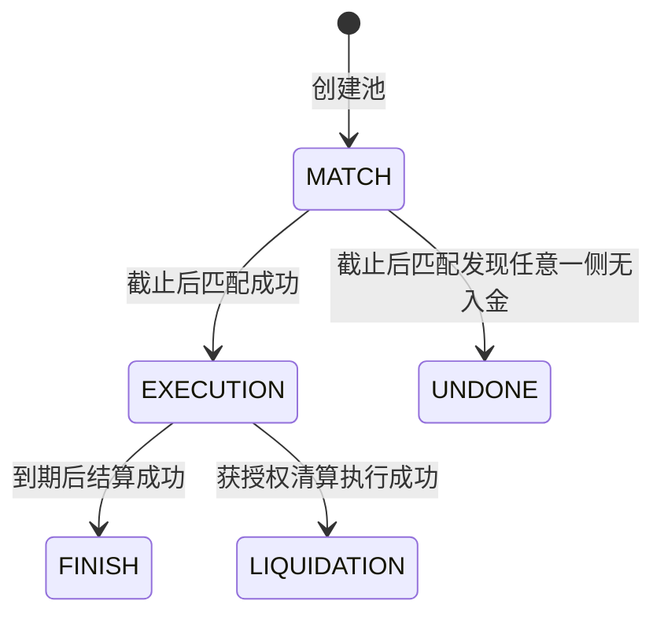
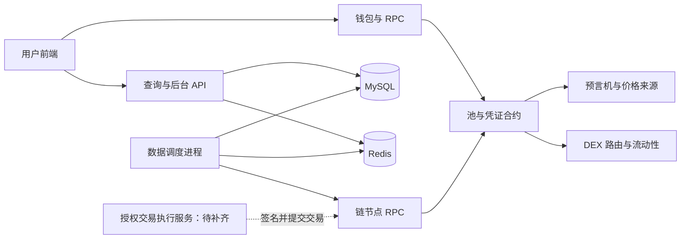

# Pledge 产品需求文档（PRD）

> 版本：v0.3（正文逐节编写）  
> 创建日期：2026-11-02  
> 状态：第一至十三章正文已完成，待评审；第十四章编写中，已保存至 14.2；第十五至十七章为提纲。  
> 研究对象：本地 ProjectBreakdown-Pledge 仓库。本文不代表线上网站的当前产品规格。

## 编写约定

- 本文用于明确产品范围、业务规则、用户交互及验收要求，供产品、开发和测试协作使用。
- 先定义产品行为和验收条件，再映射代码。技术选型与目录结构作为实现参考，不代替产品需求。
- 已支持的行为与计划功能分别说明；未确定的规则列入产品决策清单，不作为已实现能力。
- 以正式 PledgePool 合约为实现核对依据；Mock 合约和已有测试仅作为辅助材料。
- 产品统一使用 ETH 作为抵押资产。示例价格、利率、期限不代表真实市场参数；计算注明单位、精度和忽略项。ETH 与 WETH 的技术处理在后续章节定义。
- 每章完成后补充来源、结论及待解决问题；有关资金的章节补充公式、边界场景和验收条件。
- 正文按最小小节逐次编写，每完成一个小节立即保存并检查，再继续下一节。

## 章节进度

| 章节 | 主题 | 状态 |
|---|---|---|
| 1 | 业务名词解释 | 正文已完成，待评审 |
| 2 | 产品定位与业务边界 | 正文已完成，待评审 |
| 3 | 用户角色与使用场景 | 正文已完成，待评审 |
| 4 | 资产权益模型 | 正文已完成，待评审 |
| 5 | 产品全流程与状态机 | 正文已完成，待评审 |
| 6 | 借贷池创建与参数管理 | 正文已完成，待评审 |
| 7 | 募集、资金匹配与退款 | 正文已完成，待评审 |
| 8 | 借款、凭证领取与权益转移 | 正文已完成，待评审 |
| 9 | 到期结算、计息与费用 | 正文已完成，待评审 |
| 10 | 风险监控、提前清算与异常退出 | 正文已完成，待评审 |
| 11 | 用户端页面与交互需求 | 正文已完成，待评审 |
| 12 | 管理后台与运营流程 | 正文已完成，待评审 |
| 13 | 链上链下职责、数据与接口 | 正文已完成，待评审 |
| 14 | DEX 与流动性功能 | 编写中：14.2 已保存 |
| 15 | 非功能需求与运行保障 | 待编写 |
| 16 | 验收场景与交付里程碑 | 待编写 |
| 17 | 文档实现差异与产品决策清单 | 待编写 |

## 1. 业务名词解释

本章统一产品中的业务名词。示例假设 1 ETH 价值 2,000 单位稳定币，仅说明数量关系，不代表实时价格。借款稳定币及部署网络另行确定。

### 1.1 参与角色与资产

| 名词 | 含义 | 例子与易混淆点 |
|---|---|---|
| Lend / 出借 | 把资金借给借款方 | Alice 存入 1,000 单位稳定币，准备赚取利息 |
| Lender / 出借人 | 提供借款资金的一方 | 领取 SP，结算后按份额赎回稳定币 |
| Borrow / 借入 | 用抵押资产取得借款资金 | Bob 抵押 ETH，匹配后领取稳定币 |
| Borrower / 借款人 | 提供抵押物、取得借款的一方 | depositBorrow 是存抵押物，claimBorrow 才是领取借款 |
| 凭证持有人 | 当前持有 SP 或 JP 的账户 | 可以是最初参与者，也可以是收到转账的受让人 |
| 管理者 / 执行者 | 按权限配置或推进业务的一方 | 后台登录权限与合约执行权限分别校验 |
| ETH | 本产品的抵押资产，也是以太坊原生资产 | ETH 数量与稳定币计价价值分别展示 |
| WETH | 以 ERC20 形式表示的包装 ETH | 通常按 1:1 数量包装与解包；与原生 ETH 的地址、接口和入金方式不同 |
| 稳定币 | 以跟踪法定货币等资产价格为目标的代币类别 | 锚定目标不是始终等值的保证；本产品以池内指定稳定币计价和偿付 |
| 借款资产 / lendToken | 出借方存入、借款方领取的资产 | 本产品为稳定币；lendToken 从出借方视角命名 |
| 抵押物 / borrowToken | 为借款提供偿付保障的资产 | 本产品为 ETH；字段名含 Borrow 不代表它是借到的币 |
| 借贷池 / Pool | 使用同一组资产、利率、期限和抵押要求组织的交易集合 | 同池分别按双方入金比例分配，不逐一配对借贷双方 |
| Pool ID / 池编号 | 区分池子的标识 | 与网络、合约地址一起识别业务对象；展示编号和合约索引可能不同 |

### 1.2 金额、比例与利率

| 名词 | 含义 | 例子与易混淆点 |
|---|---|---|
| 本金 | 实际参与借贷的稳定币金额 | 提交 1,500、成交 1,000，则计息本金为 1,000 |
| 抵押物价值 | 抵押物数量乘其相对借款资产的价格 | 1 ETH × 2,000 = 2,000 单位稳定币，不是 2,000 ETH |
| 抵押率 | 抵押物价值除以借款价值 | 200% 表示每借 1 单位稳定币，需要匹配价值 2 单位的 ETH |
| 池设定抵押率 | 匹配时限制借款额度的参数 | 1 ETH 值 2,000，要求 200%，最多支持借款 1,000 |
| 当前抵押率 | 以当前价格衡量的抵押覆盖比例 | 本金 1,000，抵押物价值跌到 1,500，按本金计算为 150%；若含利息则比例更低 |
| LTV | 债务价值除以抵押物价值 | 相同债务口径下，抵押率 200% 对应 LTV 50%；不可直接混用含息与不含息指标 |
| 固定年利率 / Fixed Rate | 池预先约定的年化计息参数 | 年利率 10% 不表示借 90 天也收本金的 10% |
| 利息 / Interest | 根据本金、利率和期限计算的应付金额 | 本金 1,000、年利率 10%、90 天，按 365 天简单计息约 24.66 |
| 本息 | 本金与利息之和 | 上例为约 1,024.66，未含费用 |
| Fee / 费用 | 产品按约定另外收取的金额 | 必须明确收取资产、费率、计算基数和时间 |
| Share / 份额 | 某项权益占对应总权益的比例 | 25% 的 JP 权益对应剩余 ETH 的 25%，不是原始抵押物的 25% |

可借金额 = 抵押物价值 ÷ 抵押率。因此除以 200% 等于除以 2，也就是乘以 50%。

APR 通常表示年化利率，APY 通常包含复利效果。本产品按期限简单计息，不应将年利率直接表述为复利收益率。上述算例忽略费用和整数舍入。

### 1.3 业务阶段与操作

| 名词 | 含义 | 例子与易混淆点 |
|---|---|---|
| 募集 / MATCH | 收集双方资产、等待确定最终成交规模的阶段 | 入金不表示已借到钱，也不保证全部成交 |
| Deposit / 入金 | 把资产转入合约并记录参与金额 | 出借人存稳定币，借款人存 ETH |
| 匹配 / settle | 根据资金、价格、抵押要求确定实际成交结果 | 成交借款取出借总额与抵押能力中的较小值；不进行利率竞价 |
| 实际参与额 | 最终进入借贷关系的资金或抵押物数量 | 出借只有 600，抵押率 200%、ETH 价格 2,000，则匹配 0.6 ETH |
| Refund / 退款 | 退回未参与匹配的原始资产 | 存入 1 ETH，成交抵押 0.6 ETH，其余 0.4 ETH 可退款 |
| Claim / 领取 | 匹配后领取借款或凭证 | 借款人与 JP 同笔交付；出借人此时领取 SP，不是收回本金 |
| EXECUTION / 执行期 | 匹配成功、尚未完成到期结算或清算的阶段 | ETH 继续锁定，借款可被用户领走 |
| 到期结算 / finish | 到期兑换部分 ETH，确定双方最终可领取资产 | 结算不自动向所有用户转账 |
| Liquidation / 清算 | 为处理风险处置抵押物并结束执行期 | 阈值、权限、实际交易分别确认；不等于清算一定成功 |
| Withdraw / 赎回 | 销毁凭证、按份额领取最终资产 | SP 领取稳定币，JP 领取剩余 ETH |
| UNDONE / 募集失败 | 任一侧无入金而无法形成借贷的终态 | 已参与用户走失败退出流程领取原始资产 |
| FINISH / LIQUIDATION | 分别表示到期结算和清算完成的状态 | 池级处理完成不表示所有凭证都已赎回 |

代码中的 settle 有时被称为“结算”，本文统一称为“匹配”，与 finish 对应的“到期结算”区分。

### 1.4 SP 与 JP

**SP（Senior p_token，优先级凭证）是出借方的稳定币赎回凭证。** 匹配后领取，结算后销毁，按份额领取池内为出借方准备的稳定币。SP 不是已到账的本金，也不承诺固定交易价格。

**JP（Junior p_token，次级凭证）是借款方的剩余 ETH 赎回凭证。** 借款人领取借款时同时领取 JP。部分 ETH 用于偿债后，JP 持有人按份额领取剩余 ETH。

例如池子最终剩余 0.4 ETH，你持有该池 JP 权益的 25%，可领取 0.1 ETH。JP 数量不等于 ETH 数量，也不代表固定稳定币金额。转出 JP，也就转出了相应的剩余 ETH 赎回权。

Senior 与 Junior 表示偿付顺序：先准备出借方应付资产，再确定借款方剩余抵押物。抵押物价值下降会先压缩 JP 的剩余权益，SP 的优先地位不构成保本保证。命名依据：[Pledge 官方资料](https://medium.com/pledge-finance/pledge-finance-community-trivia-quiz-7-9c03042a3049)。

赎回分母使用池子确定的权益总基数，不能因为其他人先销毁凭证，就放大后来赎回者的比例。实际数量、精度和迟领处理见资产权益及领取章节。

### 1.5 时间与风险指标

| 名词 | 含义 | 例子与易混淆点 |
|---|---|---|
| settleTime / 匹配时间 | 预设募集截止与计息期限起点 | 当前入金要求早于该时间，匹配要求晚于该时间；等值边界单独验收 |
| endTime / 到期时间 | 预设借贷期限终点 | 时间到达不表示结算交易已经执行 |
| Length / 约定期限 | 到期时间减预设匹配时间 | 当前计息不以用户实际领取借款时刻为起点 |
| 结算延迟 | 实际结算完成晚于到期时间 | 当前期限公式不包含额外等待时间 |
| 清算阈值参数 | 计算抵押价值边界的增量比例 | 参数 20% 时，边界为本金 × 120% |
| Margin Ratio | 页面显示的清算价值边界比例 | 展示的 120% 与增量参数 20% 必须区分 |
| 穿仓 / 资产不足 | 抵押资产不足以覆盖债务及适用成本 | 损失分配和执行失败恢复需要独立规则 |
| Pause / 暂停 | 管理方限制特定业务操作的状态 | 当前暂停限制也覆盖用户领取和退出，不能假设只禁止入金 |

本金 1,000、清算参数 20%、实际抵押 1 ETH 时，检查边界为 1,200 单位稳定币。ETH 价值低于 1,200 时检查成立，恰好等于时不成立。当前清算入口未强制调用该价格检查，具体差异见第十章。

### 1.6 价格、兑换与钱包交易

| 名词 | 含义 | 例子与易混淆点 |
|---|---|---|
| Oracle / 预言机 | 向合约提供价格的数据机制 | 匹配和风险判断使用的价格，不保证等于实际兑换价格 |
| DEX / 去中心化交易所 | 通过链上合约兑换资产的系统 | 到期将 ETH 兑换为借款稳定币 |
| Swap / 兑换 | 用一种资产换取另一种资产 | 必须记录实际卖出 ETH 与实际收到稳定币的数量 |
| Router / 路由器 | 按兑换路径调用交易池的入口合约 | 借贷合约可直接调用，不要求用户操作独立交易页面 |
| Liquidity / 流动性 | 可供借贷或交易的资金和成交能力 | 持有 ETH 不表示借贷池有足够稳定币，也不保证 DEX 足够深 |
| Quote / 报价 | 按给定数量和市场状态预估的结果 | 市场或数量变化后报价可能变化 |
| Price Impact / 价格影响 | 本笔交易对成交价格的影响 | 大额卖出会改变池内储备，不能直接按小额价格线性估算 |
| Slippage / 滑点 | 预期与实际执行价格或数量的偏差 | 与价格影响相关但不同，需要明确可接受范围 |
| Connect Wallet / 连接钱包 | 网站获取钱包授权公开的账户信息 | 不表示已转账或批准代币；显示账户必须与实际授权一致 |
| Approve / 代币授权 | 允许指定合约在额度内转移 ERC20 | 稳定币通常先授权；原生 ETH 入金不用 ERC20 approve |
| Transaction / 交易 | 提交到区块链执行并改变状态的请求 | 点击、签名、提交和确认是不同阶段 |
| Gas | 链上执行消耗的资源及相应费用 | 回滚交易也可能产生 Gas 费用 |
| Revert / 回滚 | 交易失败，撤销该交易中的状态和资产变更 | 借款或 JP 交付失败时，整笔领取不能留下部分成功结果 |
| Confirmation / 确认 | 交易被链上收录并达到要求的确认程度 | 页面和数据服务使用一致的确认规则 |
| Multi-signature / 多签 | 多个授权参与者达到门槛后批准操作 | 仍需定义批准范围、参数绑定和有效性 |
| 链上 / 链下 | 合约内与外部服务中的处理 | 合约保证权益，页面和 Go 服务负责查询、展示、监控和任务发起 |

### 1.7 常见混淆与依据

| 常见误解 | 正确含义 |
|---|---|
| 借到 1,000 稳定币，另外 1,000 用 JP 替代 | JP 表示剩余 ETH 权益，其价值随价格与结算结果变化 |
| Refund 与 JP 赎回相同 | 前者退回未成交资产，后者领取已成交抵押物偿债后的剩余部分 |
| Claim 与 Withdraw 都是取回本金 | Claim 领取借款或凭证；Withdraw 销毁凭证领取最终资产 |
| 固定利率保证实际收益 | 固定的是计息规则，兑付仍受资产及结算结果影响 |
| 抵押 ETH 就是 Staking | 本产品的抵押用于担保借款，不包含验证者质押收益 |
| 自动清算就是合约自己定时运行 | 需要外部发起交易，并通过权限和业务条件检查 |

依据：正式 PledgePool 合约的参数、状态和业务函数，DebtToken 凭证接口，BscPledgeOracle 价格接口，以及前端市场、钱包调用。业务词义以本章统一，操作约束和计算规则在相应需求章节展开。

## 2. 产品定位与业务边界

### 2.1 产品解决的问题

#### 2.1.1 产品定位

Pledge 是一个按借贷池组织交易的固定年利率、固定期限抵押借贷产品。出借人提供稳定币，借款人提供抵押资产；募集结束后统一确定成交规模，未成交部分由用户领取退款。

产品统一使用 ETH 作为抵押资产，借款资产使用池子指定的稳定币。具体稳定币及部署网络在后续参数章节确定。

匹配成功后，借款人领取稳定币借款和 JP，出借人领取 SP。正常到期时，系统通过 DEX 卖出部分抵押资产，准备出借人的本金与利息；借款方凭 JP 领取结算后的剩余抵押资产。正式合约目前没有主动归还借款、取回全部抵押物的用户还款入口。

#### 2.1.2 参与者要解决的问题

| 参与者 | 需求 | 产品提供的能力 | 需要接受的约束 |
|---|---|---|---|
| 出借人 | 在约定期限内按已知利率出借稳定币 | 查看池参数，参与募集，获得结算赎回凭证 | 提交资金不保证全部成交；实际兑付受抵押资产和结算结果影响 |
| 借款人 | 使用 ETH 获得稳定币流动资金 | 提交 ETH，匹配后领取借款，持有剩余抵押物权益凭证 | ETH 受到锁定和处置规则约束，到期或清算时可能被部分卖出 |
| 管理与执行方 | 将双方资金按统一规则组织成借贷交易 | 配置池参数、推进匹配和结算、处理异常 | 状态推进需要交易执行；运营职责及授权范围必须明确 |

项目定位强调融资成本和收益计算的可预期性。

初期聚焦能够理解抵押借贷及钱包交易的用户，先完成单一 ETH 抵押资产的借贷闭环，再扩展资产种类和独立交易功能。

#### 2.1.3 固定利率与固定期限的产品含义

- 固定年利率：池子预先约定年化计息参数；本金与约定计息期限确定后，可计算目标本息。年利率 10% 不等于借款 90 天也收取本金的 10%。
- 固定期限：池子预设匹配时间和到期时间。募集阶段与计息期限分开；现有合约使用预设的到期时间减匹配时间计算期限。
- 成交数量：受出借资金和 ETH 抵押能力共同限制，在匹配执行时确定；募集页面只能提供预估。
- 执行时间：到达时间边界不代表交易自动发生；匹配和结算仍需有人发起交易并成功执行。
- 收益边界：固定利率确定应计金额的规则，不构成保本或无条件足额兑付承诺。

#### 2.1.4 最小示例

假设只有一位出借人和一位借款人：出借人提供 1,000 单位稳定币；借款人提供 1 ETH，匹配时该 ETH 价值 2,000 单位稳定币；抵押率为 200%。

```text
抵押能力 = 2,000 ÷ 200% = 1,000 单位稳定币
实际成交 = min（出借资金 1,000，抵押能力 1,000）= 1,000
```

双方可以全部成交。借款人领取 1,000 单位稳定币和 JP，出借人领取 SP，1 ETH 留在合约内。到期后，卖出部分 ETH 准备应付本息及适用费用，剩余 ETH 由 JP 持有人按份额赎回。

本例仅说明产品关系，忽略费用、兑换成本和整数舍入；JP 的具体数量、清算规则和最终兑付公式分别在后续章节定义。

#### 2.1.5 本节验收与依据

- 产品说明明确区分借款资产与抵押资产，列出双方分别存入、领取的资产。
- 产品说明明确展示到期处置 ETH 的规则，不能描述为到期默认返还全部原始 ETH。
- 产品说明区分年利率、实际期限、预估成交额和实际成交额。
- 抵押资产为 ETH；具体稳定币、网络及资产技术形态仍需后续定义。

依据：仓库 `README.md` 的系统概述；正式 `PledgePool.sol` 中的 `settle()`、`claimLend()`、`claimBorrow()`、`finish()`、`withdrawLend()`、`withdrawBorrow()`。本节描述依据静态代码核对，运行验证结果在验收章节记录。

### 2.2 产品核心机制

#### 2.2.1 交易组织方式

借贷池是交易组织和结算的基本单位。每个池指定一组借款资产、抵押资产、时间、年利率、抵押率和凭证地址。同池用户接受共同参数，双方资金汇总后分别按入金占比分配成交结果，不建立出借人与借款人之间的一对一债权记录。

抵押资产统一为 ETH。不同期限或不同稳定币可以形成不同池子；首期支持范围见 2.3。

#### 2.2.2 生命周期中的资产与权益

| 阶段 | 业务行为 | 用户可见结果 |
|---|---|---|
| 创建 | 管理者配置池参数及依赖 | 用户可查看资产、年利率、期限、抵押要求和费用信息 |
| 募集 | 出借人存稳定币，借款人存 ETH | 显示已提交金额及预计成交情况；此时尚未最终成交 |
| 匹配 | 授权执行者触发匹配，根据价格和资金确定实际成交额 | 展示实际参与额、可退款额；任一侧无入金时按失败退出流程处理 |
| 领取 | 用户分别领取凭证、借款和未匹配退款 | 出借人得到 SP；借款人得到稳定币和 JP；未匹配资产可单独领取 |
| 执行期 | ETH 留在合约内，外部监控时间与风险 | 展示期限、风险指标、当前凭证余额及可执行操作 |
| 到期或清算 | 授权执行者兑换部分 ETH，确定最终分配资产 | 展示实际兑换、费用和双方可赎回金额；失败则展示未完成原因 |
| 赎回 | 用户销毁 SP 或 JP，按份额领取相应资产 | SP 换取稳定币，JP 换取剩余 ETH；更新余额与赎回记录 |

状态推进、领取、退款和赎回由不同交易完成。到达日期、后端显示结果或用户点击按钮，都不能代替成功的链上交易。

#### 2.2.3 凭证与权益转移

SP 代表出借方对该池最终准备的稳定币的按份额赎回权；JP 代表借款方对该池结算后剩余 ETH 的按份额赎回权。两者都不直接等同于某个固定美元价格。

凭证基于 ERC20，支持转让。赎回时依据调用者持有并销毁的凭证数量计算权益，因此受让人也可以获得相应赎回权。产品需要同时展示原始参与记录和当前凭证余额。

第一章独立解释 SP、JP、份额、退款、结算和清算等业务名词，统一使用 ETH 示例。

#### 2.2.4 与相邻产品的边界

| 维度 | 本次研究的 Pledge 机制 | 需求含义 |
|---|---|---|
| 流动性获得 | 募集后统一匹配，匹配成功后自行领取 | 入金不保证立即借到钱，也不保证全部成交 |
| 正常偿付 | 到期兑换部分抵押物准备本息 | 借款人必须事先理解 ETH 会被按规则处置 |
| 期限 | 池子预设匹配和结束时间 | 不提供可随时结束借贷的活期承诺 |
| 资金执行 | 钱包发起交易，合约执行资金规则 | 后端登录不代替钱包授权，多签仍对关键操作有控制权 |
| 收益来源 | 通过抵押物兑换取得偿付资产 | 本业务中的“抵押”不表示将 ETH 用于验证网络赚取 Staking 收益 |

如果未来增加主动还款、补充抵押、展期或提前退出，需要重新定义权益和资金分配规则；这些能力不能从当前借贷入口自动推导为已有功能。

#### 2.2.5 本节验收与依据

- 能从任一阶段说明资产在哪里、谁持有何种权利、下一笔交易由谁发起。
- 不把“匹配成功”“领取成功”“结算成功”“赎回成功”合并为同一个状态。
- 凭证转让后，产品仍能识别当前持有人权益。
- 募集失败与风险清算具有不同原因、状态和退出路径。

依据：正式 `PledgePool.sol` 的状态枚举及用户、匹配、结算、清算函数；`DebtToken.sol` 的 ERC20 继承及铸销接口；`multiSignatureClient.sol` 的调用授权机制。

### 2.3 目标、范围与非目标

#### 2.3.1 产品目标

| 编号 | 目标 | 交付结果 |
|---|---|---|
| OBJ-01 | 明确交易条件 | 用户入金前可查看资产、年利率、时间、抵押率、费用与资产处置规则 |
| OBJ-02 | 完成借贷流程 | 支持募集、比例匹配、领取、退款、到期结算和凭证赎回 |
| OBJ-03 | 明确异常处理 | 募集失败可退出；价格或兑换异常可识别；失败交易不错误改变权益 |
| OBJ-04 | 保持资产与权益一致 | 每笔资金转移和凭证变动可追溯，不能重复领取或挪用其他池的待付资产 |
| OBJ-05 | 明确执行责任 | 匹配、到期结算、清算及任务重试有确定的权限和执行责任 |

#### 2.3.2 首期功能范围

以下为首期范围安排，表示交付要求，不表示仓库中所有功能均已通过验证。涉及资金和权限的未决规则，应在相应章节明确后再进入验收。

| 模块 | 首期范围 | 依赖与边界 |
|---|---|---|
| 资产与网络 | 单一部署网络、ETH 抵押、一种稳定币借款 | 网络和稳定币地址待确定；测试环境使用明确标识的测试资产 |
| 借贷池 | 创建池、查看参数、按期限组织多个池 | 每池分别核算资产和权益，凭证必须能识别所属池 |
| 用户入金 | 存稳定币、存 ETH、累计参与、检查额度与时间 | 不提供募集期间任意撤回的承诺 |
| 匹配与退款 | 按价格和抵押率计算成交规模，按比例分配，退回未匹配资产 | 募集失败使用全额退出流程 |
| 借款与凭证 | 领取借款、SP 和 JP；凭证转让及余额查询 | SP、JP 为权益凭证，不提供官方回购价格承诺 |
| 结算与清算 | 到期结算、风险检查、清算、最终赎回 | 阈值、计息、损失分配及兑换保护规则在第九、十章确定 |
| 用户页面 | 钱包连接、市场列表、池详情、仓位及交易反馈 | 显示真实账户和网络；查询异常不能伪装成正常零余额 |
| 管理功能 | 创建、授权、参数配置、状态推进、暂停恢复及操作记录 | 后台登录与链上执行权限分别校验 |
| 数据服务 | 同步池信息、提供查询、记录更新时间 | 链上状态为资金与权益依据，缓存不决定提款额度 |

#### 2.3.3 DEX 范围

借贷结算依赖 ETH 与借款稳定币之间的可执行兑换。兑换能力属于借贷闭环的必要依赖，需要明确价格、实际卖出数量、费用、成交限制和失败处理。

仓库包含独立 Swap、流动性池发现、添加与移除流动性页面。独立交易页面不作为首期借贷闭环的完成条件，其具体需求及交付优先级在第十四章定义。

产品层面使用 ETH 表述抵押资产；兑换涉及的 WETH 包装与解包属于资产处理细节，必须保证与用户看到的存取资产一致。

#### 2.3.4 本期不包含的能力

- 主动偿还借款后取回全部原始抵押物。
- 执行期追加抵押、追加借款、展期或自动续借。
- 凭证二级交易市场、自动做市和官方流动性支持。
- 治理代币发行、投票、挖矿激励或 ETH 验证者质押收益。
- 法币出入金、信用借款、跨链借贷和中心化托管账户体系。
- 保本、固定实际兑付金额及无条件随时退出承诺。

上述能力不作为现有核心借贷流程的默认组成部分。未来如需纳入，必须明确新增规则、对存量权益的影响及独立验收条件。

#### 2.3.5 范围验收

- 每项交付需求能归属到明确模块、负责角色及后续详细章节。
- 首期无需依赖独立 DEX 页面即可完成借贷和兑换结算。
- ETH 之外的抵押资产不会出现在首期池创建选项或示例流程中。
- 计划功能和已支持能力分别记录，不因文档描述或页面文件存在而判定已完成。

### 2.4 产品效果与完成标准

#### 2.4.1 业务完成标准

| 编号 | 验收要求 | 通过条件 |
|---|---|---|
| AC-01-01 | 交易条件清晰 | 池页面明确标示借款稳定币、ETH 抵押、年利率、匹配时间、到期时间、抵押率与费用；时间统一展示时区 |
| AC-01-02 | 入金与成交分开 | 提交资金后显示待匹配；匹配成功后展示实际成交和未匹配金额，不能将预估显示为已成交 |
| AC-01-03 | 正常借贷可完成 | 多名双方用户可以完成入金、匹配、领取、退款、到期结算和分次赎回，金额可与业务公式核对 |
| AC-01-04 | 匹配失败可退出 | 任一侧无入金时，池进入失败状态，已入金用户可以按规则全额领取原始资产且不能重复领取 |
| AC-01-05 | 凭证权益可转移 | SP、JP 转让后，受让人可按持有量赎回；原持有人不能赎回已转出的权益 |
| AC-01-06 | 资产核算完整 | 未领取借款、未领退款及未赎回资产均有对应余额；同币种多个池不能相互消耗待付资产 |
| AC-01-07 | 失败反馈准确 | 用户拒签、链上回滚、网络不支持、价格不可用或兑换失败时，页面给出原因，不显示为成功 |
| AC-01-08 | 执行进度可追踪 | 已到期未结算、执行中、成功和失败分别可识别；每笔成功操作可关联到交易记录 |

资金公式、价格条件、暂停策略和费用规则的详细验收在对应章节定义。未决规则不以“沿用现状”代替产品决策。

#### 2.4.2 运行指标

以下指标用于观察交付后的运行情况。目标值、确认区块数、观察窗口和告警阈值在第十五章确定，本章不填写未经测试的性能承诺。

| 指标 | 统计口径 | 用途 |
|---|---|---|
| 交易执行成功率 | 已确认成功交易数 / 已确认成功及失败交易总数，按操作类型统计 | 识别入金、匹配、领取、结算和赎回中的异常；拒签及待确认单独记录 |
| 到期结算延迟 | 成功结算区块时间减池到期时间；未结算池另列等待时长 | 监控状态推进和运营响应 |
| 数据同步延迟 | 链上最新区块时间与最近已同步区块时间的差值，并记录区块高度差 | 识别查询数据滞后 |
| 查询可用率 | 观察窗口内成功返回有效结构的查询数 / 总查询数 | 评估市场和仓位查询服务可用性；数据新鲜度另行判断 |
| 待处理异常数 | 尚未恢复的匹配、结算、清算和同步异常，按原因及持续时间统计 | 支持告警、重试与人工处理 |

#### 2.4.3 对外说明要求

- 页面使用“固定年利率”和“预计本息”，明确年化参数与实际期限的关系。
- 显著说明到期或清算将兑换部分 ETH，最终返还的是剩余抵押物。
- 明确借款领取、未匹配退款和最终赎回需要分别操作。
- 显示价格来源、更新时间及预估标识；预估兑换结果不能作为实际成交承诺。
- 页面显示的钱包地址必须来自实际连接账户，演示数据和测试环境必须有明确标识。
- 固定利率不表述为保本、无风险或任何市场条件下必定足额兑付。

#### 2.4.4 待确定事项

| 编号 | 事项 | 影响 | 详细定义位置 |
|---|---|---|---|
| DEC-01 | 部署网络、借款稳定币、ETH 与 WETH 处理方式 | 地址配置、精度、授权与兑换路径 | 第四、六、十三章 |
| DEC-02 | 清算入口是否强制校验阈值、价格有效性 | 借款方资产处置边界 | 第十章 |
| DEC-03 | 提前清算计息及资产不足的损失分配 | 双方最终权益 | 第九、十章 |
| DEC-04 | 费用是否允许影响已募集或执行中的池 | 用户入金前后条件一致性 | 第六、九章 |
| DEC-05 | 暂停期间可执行操作与恢复责任 | 用户退出能力及故障恢复 | 第十、十二章 |
| DEC-06 | 兑换保护、迟领资产预留与舍入残余 | 结算可执行性及资产核算 | 第八、九、十五章 |
| DEC-07 | 自动执行责任、确认规则与运行指标目标 | 调度、同步及告警验收 | 第十二、十三、十五章 |

#### 2.4.5 本章资料依据

| 来源 | 本章使用范围 |
|---|---|
| `README.md`、`Pledge/README.md` | 固定利率、固定期限的定位及角色描述 |
| `Pledge/pledge智能合约部分/1.pledge智能合约需求清单.md` | 池管理、入金、领取、退款和退出需求 |
| `pledgev2/contracts/pledge/PledgePool.sol` | 状态、匹配、本息、兑换、费用和赎回行为 |
| `pledgev2/contracts/pledge/DebtToken.sol` | SP、JP 凭证能力 |
| `pledgev2/contracts/multiSignature/multiSignatureClient.sol` | 状态推进和管理操作的授权依赖 |
| `pledge-fe/src/pages/Dapp/` | 借贷市场、仓位和 DEX 页面范围 |
| `pledge-backend/api/`、`pledge-backend/schedule/` | 查询、管理和同步任务职责 |

上述路径相对项目仓库根目录。ETH 抵押范围由本产品约定；其余未决事项按决策清单继续完善。第二章完成表示定位、边界和验收框架已写明，不代表实现已经通过测试。

## 3. 用户角色与使用场景

### 3.1 出借人（Lender）

#### 3.1.1 角色目标与参与条件

出借人持有池子支持的稳定币，希望按事先可知的年利率和期限出借资金。参与前需连接正确网络的钱包，持有足够稳定币和 Gas，并完成必要的代币授权。

产品不要求用户用后台账号代替钱包参与。连接钱包仅公开授权账户，不代表资金已入池；授权代币也不代表入金成功。

#### 3.1.2 主要场景

| 场景编号 | 用户目标 | 操作与结果 | 验收条件 |
|---|---|---|---|
| L-01 | 选择借贷池 | 比较稳定币、年利率、期限、抵押要求、费用和募集进度 | 入金前可查看完整交易条件，预计收益注明成交假设 |
| L-02 | 提交出借资金 | 输入金额，授权并发送入金交易 | 余额、额度、最低金额、时间和状态校验通过后记录入金；失败不增加参与金额 |
| L-03 | 查询实际成交 | 匹配后查看实际出借金额与未匹配金额 | 原始入金、实际成交和可退款分别展示 |
| L-04 | 领取 SP 和退款 | 分别领取凭证、未匹配稳定币 | 领取状态独立记录，不允许重复领取；无退款时明确提示 |
| L-05 | 查看执行中权益 | 查看原始参与记录、SP 余额、到期时间和风险状态 | 转入或转出 SP 后，当前权益随余额更新 |
| L-06 | 领取最终资产 | 到期结算或清算成功后销毁全部或部分 SP | 按固定权益基数计算对应稳定币，交易成功后更新余额和赎回记录 |
| L-07 | 募集失败退出 | 池进入 UNDONE 后领取原始稳定币 | 依权限及暂停规则允许时，可全额退出，不能重复领取 |

#### 3.1.3 算例与产品边界

Alice 提交 1,500 单位稳定币，池内 ETH 只支持成交 1,000，则其实际出借本金为 1,000，未匹配退款为 500。她通过 claim 领取 SP，通过 refund 领取 500；两个操作不合并解释为收回全部本金。

假设她持有该池全部 SP，结算后池为出借方准备了 1,024.66 单位稳定币，她销毁全部 SP 可领取该金额。该数值只是结算示例，不表示所有情况下都能足额实现约定收益。

募集期间没有任意撤回已入金稳定币的现有入口；执行期没有随时销毁 SP 提前领取本金的现有入口。凭证可以转让，但产品不承诺有人接盘、存在交易市场或按面值回购。

暂停可能限制领取和退出；到期时间已到但尚未结算时，不能显示为已可赎回。

依据：PledgePool 的 depositLend、refundLend、claimLend、withdrawLend、emergencyLendWithdrawal，以及状态和暂停限制。


### 3.2 借款人（Borrower）

#### 3.2.1 角色目标与参与条件

借款人持有 ETH，希望以 ETH 取得稳定币流动资金，并接受约定期限内锁定及处置抵押物的规则。参与前需了解实际借款受池内稳定币供给与匹配时价格限制，提交 ETH 不保证立即或足额获得借款。

首期以 ETH 抵押，不提供通过主动归还借款取回全部原始 ETH 的流程。入金确认页必须解释到期兑换部分 ETH、通过 JP 领取剩余部分的机制。

#### 3.2.2 主要场景

| 场景编号 | 用户目标 | 操作与结果 | 验收条件 |
|---|---|---|---|
| B-01 | 评估融资条件 | 查看抵押率、年利率、期限、费用、清算要求及预计可借额度 | 明确预估价格和更新时间，预估不能显示为已承诺的借款金额 |
| B-02 | 提交 ETH | 输入 ETH 数量，确认抵押及处置规则后发送交易 | 账户、网络、余额、Gas、时间及状态校验通过后记录参与额 |
| B-03 | 查询成交 | 匹配后查看实际抵押、可借金额和未匹配 ETH | 三项金额分别展示，能说明实际采用的成交结果 |
| B-04 | 领取借款与 JP | 一笔交易交付稳定币和对应 JP | 全部成功或全部回滚，不得出现已领标记与资产不一致 |
| B-05 | 领取未匹配 ETH | 独立领取未参与借贷的 ETH | 与借款领取顺序无关，不可重复领取 |
| B-06 | 监控剩余权益 | 查看 JP 余额、当前抵押覆盖、期限及清算状态 | 风险指标注明口径；暂不可获取价格时显示异常而非零风险 |
| B-07 | 赎回剩余 ETH | 结算或清算成功后销毁 JP | 以实际剩余 ETH 和凭证份额计算，不使用原始抵押额作为固定承诺 |
| B-08 | 募集失败退出 | UNDONE 时领取原始 ETH | 按权限及暂停规则处理，不收取不存在借贷关系的利息 |

#### 3.2.3 算例与风险认知

Bob 存入 1 ETH，匹配时价格为 2,000 单位稳定币，池要求抵押率 200%。抵押能力为 1,000，但池只提供 600，则实际借款为 600、实际参与抵押为 0.6 ETH、未匹配退款为 0.4 ETH。

Bob 可分别领取 600 稳定币及 JP、0.4 ETH 退款。参与抵押的 0.6 ETH 继续留在合约内。假设最终卖出 0.31 ETH 用于偿付及费用，且无其他扣减，剩余 0.29 ETH 由对应 JP 持有人领取。实际兑换数量以结算结果为准。

借款人需要确认：价格下跌会减少剩余 ETH，可能触发清算；出售 JP 会转出相应剩余权益；完整约定期限计息与提前清算计息的规则在第九、十章明示。产品不能使用“借款后始终保有全部 ETH”作为宣传文案。

暂停可能限制退出；兑换失败或无人执行时，终态和赎回可能延迟，需要显示实际状态及处理进度。

依据：PledgePool 的 depositBorrow、refundBorrow、claimBorrow、withdrawBorrow、emergencyBorrowWithdrawal、finish、liquidate。


### 3.3 SP / JP 受让人

#### 3.3.1 权益归属

受让人通过转账取得该池 SP 或 JP，可以没有该池原始入金记录。受让的是凭证对应的赎回权益，不包括转出人的未匹配退款、尚未领取的借款或其他池权益。

凭证领取仍依据原始参与记录；最终赎回依据当前持有凭证。原参与人转出凭证后，其历史参与额不能继续作为可赎回额度。

#### 3.3.2 场景与验收

| 场景编号 | 场景 | 验收条件 |
|---|---|---|
| T-01 | 接收 SP | 未参与募集的账户可发现持有仓位，识别网络、池、凭证合约、终态和可赎回稳定币 |
| T-02 | 接收 JP | 页面说明接收的是剩余 ETH 份额，不显示为固定数量 ETH 或固定美元债权 |
| T-03 | 部分转出后赎回 | 转出方只能按剩余余额赎回，受让方按收到的余额赎回，两者总额受池权益约束 |
| T-04 | 分次销毁凭证 | 每次按确定的总权益基数计算，其他人先赎回不会放大本人的份额 |
| T-05 | 终态前接收凭证 | 显示持仓及不可赎回原因，不能因持币而绕过池状态限制 |

例如该池 JP 总权益基数为 2,000，Bob 转出 500 JP 给 Dana，Dana 对应 25% 的剩余 ETH 权益。若最终剩余 0.4 ETH，Dana 可赎回 0.1 ETH。Bob 的原始退款记录不会随这次转账转移。

转账能力不等于产品已提供买卖市场，受让价格由交易双方自行约定，平台不保证流动性或回购。

依据：DebtToken 的 ERC20 转账机制，PledgePool 的凭证销毁、赎回份额和按原参与地址记录的领取、退款信息。


### 3.4 管理者、多签审批者与任务执行者

#### 3.4.1 角色分工

| 角色 | 职责 | 权限边界 |
|---|---|---|
| 产品运营者 | 准备池参数，检查资产、期限、价格源和兑换路径，跟进异常 | 后台可见或可编辑不代表可直接执行链上操作 |
| 多签审批者 | 按门槛审批或撤销调用授权 | 不直接取得用户 SP、JP 或提款权；实际授权粒度见第十二章 |
| 链上执行者 | 在授权范围内创建池、修改配置、匹配、结算和清算 | 必须受合约权限与业务条件约束，不能以运营需要绕过用户权益规则 |
| 自动任务服务 | 同步数据、检查时间和风险、按配置提交与跟踪交易 | 查询与发交易权限分离；发送能力不表示业务条件已经满足 |
| 异常处理人员 | 分析失败、处理告警、按授权恢复流程 | 记录原因、操作、交易及结果，不能通过改数据库伪造成功 |

上述为职责划分，不表示现有系统已经实现独立的后台角色权限模型，也不强制由不同人员担任。自动执行匹配、结算和清算是待明确的服务能力；当前调度入口主要包含数据与价格同步，不能直接视为完整自动执行系统。

#### 3.4.2 管理场景与验收

| 场景编号 | 场景 | 验收条件 |
|---|---|---|
| M-01 | 发布池 | 校验参数与外部依赖，记录审批及创建交易，确认后才展示为已发布 |
| M-02 | 募集结束后匹配 | 区分待执行、执行中、失败、成功，按交易结果更新池状态 |
| M-03 | 到期结算 | 跟踪待结算池与执行延迟，失败时保留原因和处理责任 |
| M-04 | 风险清算 | 明确价格口径、阈值、授权及执行检查，禁止把查询返回值当成已完成清算 |
| M-05 | 调整费用或依赖 | 展示影响范围、审批及变更记录；存量池影响按明确规则处理 |
| M-06 | 暂停与恢复 | 明示受影响操作、原因、执行人及交易；恢复前检查依赖和资产状态 |
| M-07 | 处理失败任务 | 查询交易实际结果后再重试，避免重复发送造成错误记账 |

#### 3.4.3 执行依赖与待确定事项

匹配、到期结算和清算需要交易推进，必须指定负责人或任务服务。若执行者离线、权限失效或兑换失败，页面应显示等待或失败，不能仅按日期显示业务完成。

现有清算入口未强制检查价格阈值，多签授权摘要也不等同于逐笔参数绑定审批。这些权限边界在第十、十二及十七章记录和决策，不在本章假设其已满足交付要求。

依据：multiSignature、multiSignatureClient、AddressPrivileges；PledgePool 的 validCall 管理入口；后台路由及 schedule/tasks/task.go。


### 3.5 用户故事与场景优先级

#### 3.5.1 优先级定义

P0 为首期交付的必要能力，包括资金安全、用户权益、借贷闭环和异常反馈；P1 为提升查询和运营效率的能力；P2 为可独立排期的扩展功能。优先级表示交付次序，不表示已有代码通过验收。

| 故事编号 | 用户故事 | 关联场景 | 优先级 | 完成标准 |
|---|---|---|---|---|
| US-01 | 作为参与者，我希望入金前理解条件和资产处置规则 | L-01、B-01 | P0 | 年利率、期限、匹配、费用、ETH 处置及退出限制清晰可见 |
| US-02 | 作为出借人，我希望按实际成交出借并取回未成交资金 | L-02 至 L-04 | P0 | 入金、匹配、SP 和退款金额可核对，不能重复领取 |
| US-03 | 作为借款人，我希望知道实际借到多少并领取未匹配 ETH | B-02 至 B-05 | P0 | 借款与 JP 同笔交付，退款独立，失败不留下部分状态 |
| US-04 | 作为参与者，我希望募集失败后按规则退出 | L-07、B-08 | P0 | 失败状态、退出条件和原始应退资产可核对 |
| US-05 | 作为持有人，我希望权益随凭证转移并能分次赎回 | L-06、B-07、T-01 至 T-05 | P0 | 受让人可赎回，总额不因转账和先后顺序而增加 |
| US-06 | 作为参与者，我希望账户和网络变化后显示正确权益 | L-05、B-06、T-01 | P0 | 不复用旧账户余额，不把数据错误显示为无仓位 |
| US-07 | 作为运营者，我希望及时推进匹配、结算并处理风险 | M-01 至 M-07 | P0 | 每步有责任、权限、实际交易及失败处理记录 |
| US-08 | 作为参与者，我希望价格、兑换或任务异常时看到真实状态 | B-06、M-03、M-04、M-07 | P0 | 不虚报成功，记录异常来源及可用操作 |
| US-09 | 作为运营者，我希望通过筛选和统计定位待处理池 | M-02、M-03、M-07 | P1 | 可按状态、时间、失败原因和持续时长查询 |
| US-10 | 作为参与者，我希望收到募集结果和到期提醒 | L-03、B-03、L-06、B-07 | P1 | 提醒与实际状态一致，通知故障不改变链上权益 |
| US-11 | 作为用户，我希望在独立页面兑换和管理流动性 | 第十四章功能 | P2 | 单独定义依赖和验收，不阻塞借贷闭环 |

#### 3.5.2 共同行为要求

- 一个钱包可以同时是不同池的出借人和借款人，也可以同时持有同池 SP、JP；页面不得使用单一账户角色限制其全部操作。
- 我的仓位同时覆盖原始参与记录和当前凭证持仓。无入金记录但有凭证的账户不能被过滤掉。
- 用户拒签、授权成功、入金成功、等待匹配、匹配成功及可赎回是不同状态，分别显示。
- 未领取退款、未领取借款和未赎回凭证分别计算，不混合为一个含糊的余额。
- 钱包连接、后台登录、代币授权和多签审批各自独立，任何一个都不自动取得其他权限。

#### 3.5.3 本章验收与衔接

测试应覆盖出借人、借款人、仅接收凭证的账户，以及分别承担审批、执行、查询职责的账户。多角色账户、账户切换、凭证部分转让、分次赎回和管理调用失败均需单独验证。

角色和场景编号作为后续需求与验收追踪依据。下一章定义资产、参与记录、凭证份额及待领取金额之间的关系，确保上述用户权利能够被准确记录和计算。


## 4. 资产权益模型

### 4.1 资产与数据对象

#### 4.1.1 资产与标识

每个池使用一种稳定币作为借款资产，使用 ETH 作为抵押资产。资产由网络和地址共同识别，名称与符号仅用于展示。原生 ETH 使用明确的资产类型，不能当作 ERC20 调用；兑换涉及的 WETH 必须与原生 ETH 数量及存取记录衔接。

池的完整标识由网络、池合约地址、池索引组成。用户以钱包地址识别，凭证以网络及凭证合约地址识别。接口和页面不得仅按名称合并不同池、不同网络的记录。

首期稳定币地址和精度待定。文中 USDT 数量仅用于业务算例，不代表已确定具体部署资产。

#### 4.1.2 数据对象

| 对象 | 关键内容 | 业务用途 |
|---|---|---|
| 池参数 | 资产、最大出借额、匹配时间、到期时间、年利率、抵押率、清算参数、SP/JP 地址 | 描述参与条件和权益边界 |
| 池募集记录 | 累计稳定币入金、累计 ETH 入金 | 计算双方占比；不是当前合约实时余额 |
| 出借参与记录 | 用户累计入金、SP 是否领取、退款是否领取及已退金额 | 支持原参与人的领取与退款 |
| 借款参与记录 | 用户累计 ETH 入金、借款与 JP 是否领取、退款是否领取及已退金额 | 支持借款交付和抵押退款 |
| 匹配结果 | 实际成交本金、实际匹配 ETH、双方可退款总额 | 固定本次借贷规模与凭证权益基数 |
| 凭证持仓 | SP/JP 当前余额、转账与销毁记录 | 确定当前持有人的最终赎回权 |
| 最终分配结果 | 为 SP 准备的稳定币、为 JP 准备的剩余 ETH、费用及兑换结果 | 确定终态资产分配总额 |
| 已履行与待履行权益 | 已退、已交付借款、已赎回资产及对应待付金额 | 对账、保留待领资产、避免重复支付 |

当前合约使用 PoolBaseInfo、PoolDataInfo、userLendInfo 和 userBorrowInfo 记录主要数据；部分退款和待付金额需要结合结果、标记及交易记录计算，不是每项都已有独立存储字段。

#### 4.1.3 金额分层

原始入金、实际参与金额、待领金额和最终赎回金额分别保存或可验证推导，不覆盖彼此。

```text
出借方：累计入金 = 实际成交本金份额 + 未匹配退款权益
借款方：累计 ETH 入金 = 实际匹配 ETH 份额 + 未匹配 ETH 退款权益
```

假设用户投入 1,000 USDT，匹配比例为 60%，则实际出借为 600、退款为 400。退款领取后，原始入金仍为 1,000，已领退款为 400，待领退款为零。不能把原始入金改成 600 而丢失历史。

终态下的 ETH 剩余金额是实际匹配 ETH 减实际用于结算的 ETH 及相应费用。未匹配退款不属于可被结算消耗的抵押物。

#### 4.1.4 生命周期中的权益确认

| 时点 | 已确定的内容 | 尚未完成的内容 |
|---|---|---|
| 创建池 | 最大出借额、参数、SP/JP 合约地址 | 实际成交、用户份额和代币发行均未确定 |
| 募集入金 | 各用户累计参与金额 | 不发 SP/JP，不承诺最终成交数量 |
| 募集截止 | 不再接受新入金 | 需执行匹配交易，不自动形成成交结果 |
| 匹配成功 | 实际成交、退款权益及凭证总权益基数 | 借款、退款和凭证仍需用户领取 |
| 用户领取 | 对应资产交付或凭证铸造 | 其他未领权益继续保留 |
| 结算或清算成功 | 双方最终可分配资产总额 | 用户仍需销毁凭证赎回 |

最大出借额是上限，当前没有必须足额募集才成交的条件。双方有资金且可形成有效成交额时可部分成交；任意一侧无入金则按募集失败处理。极小金额被整数舍入为零的情况需在匹配验收中单独处理，不能仅以双方余额非零判断有效成交。

依据：PledgePool 的 PoolBaseInfo、PoolDataInfo、用户参与映射，以及 createPoolInfo、depositLend、depositBorrow、settle 和领取、退款接口。


### 4.2 SP / JP 权益定义

#### 4.2.1 池级凭证边界

每个池的 SP 与 JP 必须分别使用独立的凭证合约，不能与其他池共用。跨池凭证不能互相赎回；名称相同或底层资产相同不能作为兼容依据。创建时应拒绝复用其他池的凭证地址及同池 SP/JP 使用同一地址。

上述为交付约束。当前 createPoolInfo 接收 SP、JP 地址并校验非零，但没有校验地址复用或两者相同，需在差异清单记录。

#### 4.2.2 总权益、发行量与余额

必须分别识别三个数量：

| 数量 | 含义 | 变化时点 |
|---|---|---|
| 总权益基数 | 本池所有参与人合计可领取、用于赎回比例计算的凭证基数 | 匹配成功后确定，不随领取、转账或销毁改变 |
| 已发行未销毁量 / totalSupply | 凭证合约当前仍存在的代币总量 | 领取铸造时增加，赎回销毁时减少 |
| 用户余额 / balanceOf | 当前账户持有的凭证数量 | 铸造、转账、销毁时变化 |

建池不发放凭证，入金不发放凭证，匹配只确认权益，claim 才铸造凭证。

例如 SP 总权益基数为 10,000，只有 A 领取了 3,000 SP，则 totalSupply 为 3,000，但 A 的份额仍为 30%，不能按当前发行量解释为拥有全池权益。

#### 4.2.3 数量与比例公式

以下为忽略整数舍入的业务公式。L 为累计出借稳定币，C 为累计 ETH，M 为实际成交本金，R 为抵押率的倍数值；200% 使用 R=2。金额均先明确展示单位与资产精度。

```text
SP 总权益基数 = M
JP 总权益基数 = M × R

出借人 i 的比例 = 其累计稳定币入金 / L
出借人 i 可领取 SP = M × 该比例

借款人 j 的比例 = 其累计 ETH 入金 / C
借款人 j 可领取借款 = M × 该比例
借款人 j 可领取 JP = M × R × 该比例
```

当前代码的 SP 数量直接采用稳定币最小单位数量，JP 数量采用该数量乘费率基数换算后的抵押率。DebtToken 默认 18 位精度，因此不能直接把任意精度稳定币与凭证的展示数量视为一比一。首期须确定稳定币精度以及凭证精度换算；以下算例假设稳定币、SP、JP 均为 18 位，不能未经换算用于 6 位精度资产。

#### 4.2.4 多人权益算例

A、B、C 分别投入 3,000、5,000、2,000 USDT；D 存入 10 ETH。匹配价格为 2,000 USDT/ETH，抵押率 200%，双方全部成交。

| 用户 | 领取资产或凭证 | 对应权益 |
|---|---|---|
| A | 3,000 SP | SP 总权益的 30% |
| B | 5,000 SP | SP 总权益的 50% |
| C | 2,000 SP | SP 总权益的 20% |
| D | 10,000 USDT 与 20,000 JP | JP 总权益的 100% |

假设期限 365 天、年利率 20%，结算价格仍为 2,000，忽略费用和兑换成本。目标本息 12,000 USDT，需要卖出 6 ETH，剩余 4 ETH。结算成功后 A、B、C 分别可赎回 3,600、6,000、2,400 USDT；D 持有全部 JP，可赎回 4 ETH。

如果 D 转出 5,000 JP，受让人取得总权益的 25%，可赎回 1 ETH，D 剩余可赎回 3 ETH。D 尚未领取的原始借款或退款权不会随凭证转让。

#### 4.2.5 最终赎回公式

```text
SP 赎回稳定币 = 已确定的 SP 可分配资产总额 × 本次销毁 SP / SP 总权益基数
JP 赎回 ETH = 已确定的 JP 可分配 ETH 总额 × 本次销毁 JP / JP 总权益基数
```

这里的可分配资产总额是终态确定的分配基数，不是随其他人提款而递减的当前钱包余额。不能同时缩小分母或改用剩余余额，导致后续用户少领或多领。

未领取的凭证可在当前允许的终态领取，已赎回数量不允许再次使用。领取和分次赎回中的舍入残余单独核算；不把残余自动转给最后一个用户。

依据：claimLend、claimBorrow、withdrawLend、withdrawBorrow，以及 DebtToken 的 mint、burn 和 ERC20 精度。领取阶段允许的状态见第五、八章。

### 4.3 资金归属与约束

#### 4.3.1 待履行权益

资金存在合约中不代表可以自由用于新交易。必须按池和资产识别尚未履行的义务。

| 阶段 | 稳定币义务 | ETH 义务 |
|---|---|---|
| 募集期 | 保留出借入金，等待匹配或失败退出 | 保留抵押入金，等待匹配或失败退出 |
| 匹配后 | 未领取借款、未领取出借退款 | 未领取抵押退款，以及继续参与借贷的抵押物 |
| 最终结算后 | 未领取借款、未领取出借退款、尚未兑付的 SP 权益 | 未领取抵押退款、尚未兑付的 JP 权益 |
| 募集失败 | 尚未领取的原始稳定币 | 尚未领取的原始 ETH |

当前 claimBorrow 在 FINISH、LIQUIDATION 状态仍可调用，因此结算后仍可能存在未领取借款；不能以池已结算为由把这些稳定币分给 SP 持有人或转为平台收入。SP/JP 的终态分配资产需要与原始未交付借款、退款分别核算。

#### 4.3.2 池间隔离与对账

多个池可能共用同一个池合约及同一种稳定币。实际钱包余额是合计余额，不代表每个池均有足够资产。

交付要求：

- 每次转账只能消耗该池对应资产的可用余额，不能使用其他池待付资金补足兑换或兑付。
- 结算卖出的 ETH 不超过该池实际匹配且尚未处置的 ETH；未匹配退款不得参与卖出。
- 账目按资产分别核对，不能把稳定币数量与 ETH 数量相加作为资产守恒关系。
- 同一资产的合约余额应覆盖所有池的待付及保留余额；未归属的直接转入、舍入残余和已确认费用单独记录。
- 已支付费用与平台可取收入不能包含未领取借款、退款、SP/JP 赎回准备金。

现有合约按池记录金额，但资产实际存放在共同地址；卖出和支付是否满足完整池间隔离，需通过多池场景验证，不能仅凭结构体带池索引就判定满足。

#### 4.3.3 领取、转让和赎回约束

| 规则编号 | 规则 | 验收条件 |
|---|---|---|
| EQ-01 | 入金不铸造凭证 | 创建和入金交易不增加 SP/JP 发行量 |
| EQ-02 | 领取不可重复 | 同一参与记录成功领取后，再次领取失败且不增加资金或凭证 |
| EQ-03 | 退款与领取独立 | 先退款后领取与先领取后退款结果一致；两次退款不可重复成功 |
| EQ-04 | 转让仅转移凭证权益 | 接收凭证不能调用转出人的借款或退款领取记录 |
| EQ-05 | 跨池凭证不混用 | 创建拒绝复用凭证，持有 A 池凭证不能作为 B 池赎回依据 |
| EQ-06 | 赎回比例不随发行和销毁变化 | 部分用户迟领、他人先赎回，不放大剩余用户权益 |
| EQ-07 | 部分赎回不超领 | 多次销毁的合计数量不超过持有量及有效总权益，支付受资产预算约束 |
| EQ-08 | 失败不留下部分状态 | 转账、铸造或销毁失败时整笔交易回滚，页面不显示领取完成 |
| EQ-09 | 多池资金不可互补 | 人为制造一个池资产不足时，其操作失败，不消耗另一个池准备金 |
| EQ-10 | 展示精度与链上数量一致 | 覆盖不同稳定币精度和 18 位凭证换算，入金、份额、退款、赎回均可核对 |
| EQ-11 | 无效成交不可分配 | 实际成交为零、分母为零或价格无效时不生成可领取份额；处理路径在匹配章节确定 |

EQ-05、EQ-09、EQ-10、EQ-11 等为产品交付要求，现有实现不据此视为已经满足。具体差异和处置方案列入第十七章。

#### 4.3.4 金额精度与残余

页面按资产精度显示，交易使用最小单位整数。利率和比例参数使用各自明确的基数，不把 200%、2 和 200000000 混作同一个输入值。

现有份额计算先按 1e18 计算比例，再乘总额，存在向下取整。业务公式中的等式为忽略舍入的关系；实际对账需显式记录不可分配残余。可展示金额不得向上舍入后直接用于提交，否则可能超过真实可领金额。

残余的归属、是否允许小额领取以及最终处理条件待数值规则章节确定。用户不会因为别人先领取而自动取得更多份额；不能将无法解释的差额笼统归为手续费。

#### 4.3.5 来源及待确定事项

本章依据 PledgePool 的池和用户数据结构、入金、匹配、领取、退款、最终分配和赎回逻辑，以及 DebtToken 和 SafeTransfer 接口。全部规则仍需通过正式合约测试和资产对账验证。

后续需确定：稳定币精度及凭证换算方式、ETH/WETH 的入账衔接、凭证地址唯一性校验、多池余额预算、迟领资产预留与舍入残余处理。相关事项在第六至十章、第十三及十五至十七章展开。

## 5. 产品全流程与状态机

### 5.1 正常业务流程

#### 5.1.1 流程与责任

| 步骤 | 发起方 | 前置条件 | 处理结果 |
|---|---|---|---|
| 1. 创建借贷池 | 获授权的执行账户 | 参数及依赖准备完成，具备链上调用授权 | 池以 MATCH 状态建立，记录 ETH、稳定币、期限、利率及凭证地址 |
| 2. 募集资金 | 出借人、借款人 | MATCH、早于匹配时间、未暂停；余额和额度满足 | 出借方存稳定币，借款方存 ETH；累计参与金额，不铸造凭证 |
| 3. 执行匹配 | 获授权的执行账户 | MATCH、晚于匹配时间 | 计算实际成交及退款权益；成功进入 EXECUTION；任一侧无入金则进入 UNDONE |
| 4. 领取借款和凭证 | 原始参与账户 | 匹配成功，满足领取状态、时间及暂停限制 | 出借人领取 SP；借款人同笔领取稳定币及 JP |
| 5. 领取未匹配资产 | 原始参与账户 | 存在退款权益且未领取 | 出借方领稳定币退款，借款方领 ETH 退款 |
| 6. 执行期监控 | 用户、运营者和监控服务 | EXECUTION | 查询当前风险和期限，持续识别待执行事项；查询本身不改变状态 |
| 7. 到期结算 | 获授权的执行账户 | EXECUTION、晚于到期时间，兑换可完成 | 卖出部分 ETH，记录本息偿付及剩余 ETH，进入 FINISH |
| 8. 最终赎回 | 当前 SP/JP 持有人 | 合法终态，具备可销毁凭证，未暂停 | 销毁凭证，按份额领取对应资产；池终态不因单次赎回改变 |

领取凭证和退款是相互独立的交易，不要求所有用户先完成领取才进入结算。匹配成功后即可进入 EXECUTION，即使仍有人未领取借款、凭证或退款。

#### 5.1.2 时间推进与交易推进

募集截止时间由池参数确定。截止前接受入金，截止后必须由获授权执行者发送匹配交易；借款人不能仅因身份为借款人就提前匹配。现有 Go 调度未包含完整的 settle 自动调用流程，自动调度作为执行能力在第十二、十三章明确。

页面分别展示业务时间和链上状态。例如 MATCH 池已经过了截止时间，应展示“募集结束，待匹配”，禁止新入金；不能仅按时间推算为 EXECUTION。

到期同理：EXECUTION 且时间超过 endTime 时显示“已到期，待结算”。只有 finish 成功才显示到期结算完成，并根据实际结果开放赎回。

#### 5.1.3 正常场景验收

- 计划募集 10,000 USDT，实际只募集 5,000 且有足够 ETH 抵押时，截止后允许部分成交，不要求满额。
- 创建、入金、匹配均不直接增加 SP/JP 的代币发行量；用户领取成功时才铸造。
- 用户可先领取借款与 JP 再退 ETH，也可先退 ETH 再领取；两条路径结果一致。
- 到期未执行结算时，不开放正常到期赎回；结算后允许合法持有人分次赎回。
- 历史参与人及凭证受让人的入口分别根据参与记录和当前持仓判断，不混用权益依据。

依据：createPoolInfo、双方入金与领取接口、settle、finish、withdrawLend、withdrawBorrow 及现有调度入口。


### 5.2 异常与清算流程

#### 5.2.1 募集失败

匹配执行时，若稳定币累计入金或 ETH 累计入金任意一侧为零，池进入 UNDONE。原始参与人通过对应失败退出接口领取原始入金，不发放 SP/JP，不计算已成立借贷的利息。

UNDONE 为池终态，不表示自动退款完成。页面继续显示尚未领取的稳定币或 ETH 以及退出按钮。暂停限制仍适用，不得将失败退出标注为无条件可操作。

若双方非零但经价格和舍入计算后成交为零，现有逻辑可能仍进入 EXECUTION，产生后续零基数问题。交付要求是不得建立无效成交权益；具体应拒绝匹配还是转入失败退出，列为第七、十七章决策项。

#### 5.2.2 风险清算

风险监控读取实际匹配 ETH 的当前价值，与本金及清算阈值比较。达到风险条件后，由获授权执行者发起 liquidate；成功后记录兑换、费用和双方分配金额，进入 LIQUIDATION。用户随后以 SP、JP 分别赎回。

当前 liquidate 检查 EXECUTION、晚于 settleTime 和 validCall 授权，但没有强制检查价格阈值，也未要求早于 endTime。因此现有实现中，它既可能提前执行，也可能在到期后尚未结算时执行。产品不能将它描述为仅允许“提前且跌破阈值”执行。

当前清算按完整约定期限计息，不是借款人按实际天数主动还款。入口阈值校验、到期后路径选择及计息政策在第九、十章确定；现有行为不替代待定的交付约束。

#### 5.2.3 交易及外部依赖异常

| 异常 | 状态与资产要求 | 页面和运营处理 |
|---|---|---|
| 用户拒签或尚未提交 | 不改变链上状态 | 显示取消或未提交，不生成成功资产记录 |
| 交易已提交未确认 | 不提前认定完成 | 显示交易哈希及等待状态；重试前检查原交易结果 |
| 入金、领取或赎回回滚 | 本次交易资产和业务状态全部回滚 | 保留失败原因，刷新余额后允许满足条件的重试 |
| 价格不可用或异常 | 不以无效价格计算匹配或清算权益 | 显示价格异常，告警并阻止错误报价；有效性规则见第十章 |
| DEX 流动性不足或兑换失败 | 不因交易失败进入 FINISH 或 LIQUIDATION | 保持原链上状态，记录原因，按授权处理兑换依赖后重试 |
| 执行账户无授权或 Gas 不足 | 不推进池状态 | 显示待处理责任与失败原因，不暗示用户可立即赎回 |
| 数据同步失败或链上重组 | 页面不以旧索引确认新状态 | 标记更新时间和待核对状态，根据确认规则重新同步 |

价格有效性和池级资产预算是交付要求，不能据现有调用接口推定所有校验已存在。不能通过改数据库把失败状态改成成功，或用其他池资产弥补本池结算不足。

#### 5.2.4 暂停与恢复

全局暂停是独立开关，不是新增池状态。暂停后，池仍保持 MATCH、EXECUTION 或终态，受限制的用户入口暂时不可执行。

当前入金、领取、退款、失败退出及赎回都受 notPause 限制；settle、finish、liquidate 以及管理设置不受该修饰符限制。暂停不会停止时间流逝，也不能理解为冻结所有业务交易。

恢复操作只能解除相应限制，不自动执行遗漏匹配、退款或赎回。恢复前需要检查时间、池状态、外部依赖和资产账目。应急退出政策及暂停期间管理调用范围，在第十、十二章细化。

依据：settle 的失败分支、liquidate、setPause、各用户入口修饰符及兑换调用。


### 5.3 池状态与转换条件

#### 5.3.1 池状态定义

| 状态值 | 状态 | 含义 | 不代表的事情 |
|---|---|---|---|
| 0 | MATCH | 池已创建，尚未执行最终匹配 | 不保证当前仍在募集，可能已过截止时间 |
| 1 | EXECUTION | 已匹配成功，等待终态处理 | 不保证所有用户已领取借款和凭证，也不保证尚未到期 |
| 2 | FINISH | 正常到期结算成功 | 不保证全部 SP/JP 或退款已领取、赎回 |
| 3 | LIQUIDATION | 清算交易成功 | 不表示所有持有人已提现，也不构成足额兑付保证 |
| 4 | UNDONE | 募集失败 | 不表示用户资产已自动退回 |



状态图描述现有合法状态转换，不等于清算入口已完整校验风险条件。终态不再转回 MATCH 或 EXECUTION；领取、退款、转账和赎回通常不改变池级状态。

#### 5.3.2 转换条件

| 编号 | 转换 | 现有必要检查 | 成功结果 |
|---|---|---|---|
| ST-01 | 新建 → MATCH | 有效授权；endTime > settleTime；凭证非零等创建检查 | 初始化参数、零入金和零结算记录 |
| ST-02 | MATCH → EXECUTION | 有效授权；当前时间 > settleTime；双方入金均非零；计算可成功 | 写入匹配金额，确定权益基数 |
| ST-03 | MATCH → UNDONE | 有效授权；当前时间 > settleTime；至少一侧入金为零 | 记录失败结果，开放符合条件的失败退出 |
| ST-04 | EXECUTION → FINISH | 有效授权；当前时间 > endTime；兑换及后续计算成功；所得覆盖要求成立 | 写入正常结算分配金额 |
| ST-05 | EXECUTION → LIQUIDATION | 有效授权；当前时间 > settleTime；兑换及后续计算成功 | 写入清算分配金额；价格阈值未在入口强制校验 |

以上为现有检查概述，不表示参数检查已充分。有效成交、价格、凭证唯一性、池级资产预算及授权粒度的补充约束在对应章节定义。

#### 5.3.3 时间边界

| 当前时间 t | 入金 | 匹配 | 到期结算 |
|---|---|---|---|
| t < settleTime | 满足其他条件时允许 | 不允许 | 不允许 |
| t = settleTime | 不允许 | 不允许 | 不允许 |
| settleTime < t < endTime | 不允许 | MATCH 时允许 | 不允许 |
| t = endTime | 不允许 | MATCH 时仍可执行 | 不允许 |
| t > endTime | 不允许 | MATCH 时仍可执行 | EXECUTION 时允许 |

当前 settle 没有 endTime 上界，导致到期后仍可能首次匹配；现有计息仍采用预设完整期限。是否禁止迟到匹配、改为失败退出或重新确认条件，属于必须明确的产品决策，不在页面自动修正。

#### 5.3.4 页面派生状态

前端可组合链上状态、链上时间、暂停开关和交易进度生成展示文案，但不得把文案写回为未经交易确认的链上状态。

| 条件 | 页面建议状态 |
|---|---|
| MATCH 且早于截止 | 募集中 |
| MATCH 且达到或超过截止 | 募集结束，待匹配；严格等值时提示等待可执行时间 |
| EXECUTION 且未超过到期 | 借贷执行中，分别展示领取与退款状态 |
| EXECUTION 且超过到期 | 已到期，待结算 |
| 合法终态且存在可领权益 | 已结算或已失败，待领取 |
| 任一池状态且全局暂停 | 保留池状态，叠加暂停及受影响操作说明 |

用户拒签、交易待确认、交易回滚属于操作状态，不作为新的池枚举。两笔终态交易竞争时，以链上执行结果为准：首笔成功改变状态后，后续不满足原状态条件的交易应失败。

### 5.4 角色与操作权限矩阵

#### 5.4.1 池状态与操作

表中“允许”表示通过状态检查，仍须满足时间、权限、余额、领取标记和外部执行条件，不代表交易必定成功。

| 操作 | MATCH | EXECUTION | FINISH | LIQUIDATION | UNDONE |
|---|---|---|---|---|---|
| 出借入金、ETH 入金 | 截止前允许 | 不允许 | 不允许 | 不允许 | 不允许 |
| 执行匹配 | 截止后允许 | 不允许 | 不允许 | 不允许 | 不允许 |
| 出借人领取 SP | 不允许 | 允许 | 允许 | 允许 | 不允许 |
| 借款人领取借款与 JP | 不允许 | 允许 | 允许 | 允许 | 不允许 |
| 领取未匹配退款 | 不允许 | 允许 | 允许 | 允许 | 不允许，使用失败退出 |
| 正常到期结算 | 不允许 | 到期后允许 | 不允许 | 不允许 | 不允许 |
| 清算 | 不允许 | 当前入口允许 | 不允许 | 不允许 | 不允许 |
| SP/JP 赎回 | 不允许 | 不允许 | 允许 | 允许 | 不允许 |
| 募集失败退出 | 不允许 | 不允许 | 不允许 | 不允许 | 允许 |
| SP/JP 转让 | 按 ERC20 余额和规则 | 按 ERC20 余额和规则 | 按 ERC20 余额和规则 | 按 ERC20 余额和规则 | 按 ERC20 余额和规则 |

池状态不直接限制凭证 ERC20 转账；MATCH、UNDONE 正常情况下不应形成可领取凭证，表中不表示应在这些状态人为发行凭证。铸销权限需另行控制。

#### 5.4.2 调用身份与暂停影响

| 操作 | 身份依据 | 受当前全局暂停限制 |
|---|---|---|
| 出借入金、抵押入金 | 发送交易的钱包，持有所需资产及授权 | 是 |
| 领取 SP、借款和 JP | 当前池有原始入金记录且尚未领取的账户 | 是 |
| 领取未匹配退款 | 当前池原参与账户，存在未领取退款 | 是 |
| 最终赎回 | 当前持有并销毁本池 SP/JP 的账户 | 是 |
| 募集失败退出 | UNDONE 池原参与账户，尚未退出 | 是 |
| 创建、匹配、结算、清算及相关配置 | 通过 validCall 验证的执行账户 | 当前入口不受 notPause 限制 |
| 查询池与用户信息 | 可访问公开链上数据的调用方 | 不因暂停而禁止 |
| 凭证转账 | 凭证持有人或其授权操作者 | 不受池合约暂停开关直接限制 |

借款人身份不授予匹配权限，SP/JP 持有不授予管理权限。后台 JWT 登录不等于合约授权，单个多签审批者也不因持有审批身份就自动获得全部执行权限。

#### 5.4.3 多签批准与执行

当前部署脚本配置三个签名地址，批准门槛为二。它们是管理员签名账户，代码未规定分别代表平台、出借方或借款方；具体组织归属不作为已知事实写入产品角色。

现有申请由调用账户针对目标合约发起，达到批准门槛后，调用账户执行目标操作。批准摘要绑定调用账户和目标合约，未绑定函数、池索引和参数，授权检查也未逐次消耗批准。因此它更接近对调用账户访问目标合约的授权，不能描述为每笔匹配均经过一次独立的 2/3 审批。

后台应分别记录申请账户、目标合约、审批进度与实际执行交易。对具体参数绑定、授权期限和防复用的交付要求在第十二、十七章确定，不从“多签”名称推定其已存在。

#### 5.4.4 验收场景

| 编号 | 场景 | 预期结果 |
|---|---|---|
| SM-01 | 募集截止前尝试匹配 | 回滚，保持 MATCH |
| SM-02 | 恰好到达 settleTime | 新入金和匹配均不通过当前严格时间检查 |
| SM-03 | 截止后无人执行匹配 | 保持 MATCH，页面显示待匹配，不自动铸造凭证 |
| SM-04 | 未满额但有效资金齐备 | 按实际可成交量进入 EXECUTION，记录退款，不强求满额 |
| SM-05 | 任意一侧无入金 | 匹配后进入 UNDONE，双方不领取 SP/JP |
| SM-06 | 入金账户未取得管理授权 | settle、finish、liquidate 调用因授权失败，不能以用户角色绕过 |
| SM-07 | 恰好到达 endTime | finish 不通过严格时间检查；超过后满足其余条件才可执行 |
| SM-08 | 执行终态交易失败 | 保持 EXECUTION，资产与结果不出现部分成功 |
| SM-09 | 池终态仍有未领取借款或凭证 | 保留合法领取能力和对应资产，不能认为终态等于已清空 |
| SM-10 | 开启暂停 | 用户资金入口按现有规则拒绝；管理员及凭证转账影响按矩阵单独验证 |
| SM-11 | finish 与 liquidate 先后竞争 | 只有满足当时状态的交易成功，后续不能重复终态结算 |
| SM-12 | 到期后首次执行匹配 | 明确现有允许行为及后续决策，不按正常按时匹配静默处理 |
| SM-13 | 清算未达到价格阈值 | 记录当前入口缺失校验的事实；补充交付约束后须有拒绝测试 |

本章依据正式 PledgePool 的 PoolState、所有业务入口及修饰符，multiSignature、multiSignatureClient 和部署脚本。测试中使用的 Mock 状态设置函数不作为产品支持任意修改池状态的依据。

下一章定义创建池的字段、校验条件和参数变更范围。迟到匹配、零额成交、清算入口条件、暂停退出及多签粒度继续进入决策清单，在决定前不视为已满足交付要求。

## 6. 借贷池创建与参数管理

### 6.1 创建流程与前置条件

#### 6.1.1 创建主体

借贷池由通过链上授权的执行账户调用 createPoolInfo 创建。借款人可以提出融资需求，但当前没有借款申请审批和自动建池的完整流程，也不能直接凭借款人身份建池。后台草稿和审核记录属于管理流程，不等于已创建的链上池。

创建池定义可供多名借款人参与的共同条件，不会自动锁定为某个融资申请人的专属池。若计划由 D 单独借款，现有公开抵押入口仍不能保证其他账户无法参加；专属借款人限制不在首期默认能力中。

#### 6.1.2 前置准备

| 检查项 | 要求 | 不满足时 |
|---|---|---|
| 网络与资产 | 确认链 ID、池合约、ETH 处理方式、稳定币地址与精度 | 阻止发布，显示冲突配置 |
| 价格源 | ETH 与稳定币价格可读取，计价与精度明确 | 阻止发布，记录价格源或精度错误 |
| 兑换依赖 | 确认 ETH/WETH 与稳定币的路由、可调用性及报价 | 不能只依据存在地址就认定可结算 |
| 凭证 | 每池独立 SP、JP，地址不同且均有正确合约接口 | 阻止复用或错误地址发布 |
| 铸销权限 | 池合约拥有对应 SP、JP 的合法 mint/burn 权限 | 阻止开放入金，避免资金进入后无法领取或赎回 |
| 调用授权 | 执行账户获得目标合约调用授权 | 不能提交为成功；缺少授权时明确显示 |
| 时间和参数 | 参数经过校验并展示单位，匹配时间在未来 | 阻止不合法参数发布 |
| 执行责任 | 明确匹配、到期和风险处理的执行责任 | 不把无人执行的池宣传为自动运行 |

以上为发布要求。当前 createPoolInfo 仅有部分链上检查，没有自动验证全部依赖，缺失项必须明确记录，不能仅靠前端提示保证资金规则。

#### 6.1.3 创建步骤

1. 管理者填写参数，生成草稿和参数预览。
2. 检查价格、兑换、凭证和权限依赖，记录结果。
3. 按授权流程确认执行账户和目标合约；当前授权不等同于逐参数审批。
4. 执行账户提交创建交易，保存交易哈希，等待确认。
5. 从链上读取新池索引及参数，与提交值逐项核对，再同步到市场列表。

草稿、审批和发布检查是管理端交付需求，不表示现有后台已完整实现。当前合约创建后立即为 MATCH，没有单独的链上草稿或待发布状态。仅隐藏页面不能阻止用户直接向已创建池入金，因此关键前置条件应在创建前完成或由合约强制校验。

依据：PledgePool 构造函数及 createPoolInfo；DebtToken、AddressPrivileges 的铸销授权接口；池及代币部署脚本。


### 6.2 参数字典

#### 6.2.1 池参数

| 参数 | 业务含义 | 输入与存储口径 | 发布校验 |
|---|---|---|---|
| settleTime | 预设募集截止与匹配时间 | Unix 秒时间戳，页面显示时区 | 应晚于当前链上时间，留足募集与部署确认时间 |
| endTime | 预设借贷到期时间 | Unix 秒时间戳 | 必须晚于 settleTime |
| interestRate | 固定年利率 | 1e8 为 100%，20% 为 20000000 | 正数；是否支持零息、利率上限和期限范围另行配置并确认 |
| maxSupply | 最大累计出借金额 | 稳定币最小单位整数 | 大于零，与最低入金额度形成可参与区间 |
| martgageRate | 匹配抵押率 | 1e8 为 100%，200% 为 200000000 | ETH 超额抵押产品应大于 100%；阈值间关系通过风险规则校验 |
| lendToken | 借款稳定币地址 | 当前网络的 ERC20 地址 | 来自支持清单，确认代码、接口和精度；首期不接受任意代币 |
| borrowToken | 抵押资产标识 | 本产品为原生 ETH；当前合约使用零地址表示原生资产 | 创建端固定为 ETH，不能允许误填稳定币或其他资产 |
| spToken | 本池 SP 合约地址 | 当前网络的代币地址 | 非零、有代码、接口与精度正确、未被其他池使用、有池铸销授权 |
| jpToken | 本池 JP 合约地址 | 当前网络的代币地址 | 同上，且不得与 spToken 相同 |
| autoLiquidateThreshold | 清算边界增量参数 | 1e8 为 100%，20% 为 20000000 | 显示时同时给出本金的 120% 边界，不与 200% 抵押率混淆 |

此表中的发布校验是交付要求。现有创建函数只强制 endTime > settleTime、凭证地址非零和调用授权，没有强制未来募集时间、正本金上限、抵押率下限、支持资产清单、凭证唯一性及全部接口校验。

#### 6.2.2 派生字段

| 字段 | 计算方式或来源 | 展示要求 |
|---|---|---|
| 约定期限 | endTime − settleTime | 同时展示日期和天数；天数截断不得改变链上秒数 |
| 抵押物借款能力 | ETH 价值 / 抵押率 | 明确价格时间和预估标识 |
| 清算价值边界 | 成交本金 ×（1 + autoLiquidateThreshold） | 区分增量参数与最终覆盖比例 |
| 最大预计利息 | maxSupply × 年利率 × 约定期限 / 365 天 | 仅为满额假设；不是实际成交利息或兑付保证 |
| 初始状态 | 创建后 MATCH | 不直接显示为已成交，不显示已发行凭证 |

没有最低成功募集金额参数；maxSupply 只限制上限，不提供“筹满才成交”的能力。没有借款人专属地址参数，也没有提前还款、续借或最低参与人数参数。

#### 6.2.3 参数示例

例如：计划最高出借 10,000 USDT，募集结束后约定期限 365 天，年利率 20%，抵押率 200%，清算增量 20%。页面展示如下：

```text
最高出借额度：10,000 USDT
固定年利率：20%
约定期限：365 天
抵押资产：ETH
抵押率：200%（同口径下对应 LTV 50%）
清算价值边界：本金的 120%（增量参数 20%）
```

若稳定币为 6 位精度，maxSupply 对应 10000 × 10^6；若为 18 位则为 10000 × 10^18。不可将 1e18 固定应用于全部稳定币；凭证数量换算同时遵守第四章精度要求。

匹配时若 1 ETH 价值 2,000 USDT，则 10 ETH 可支持 10,000 USDT。创建池本身不要求借款方已经存入这 10 ETH；资金不足时按后续实际匹配结果处理。

依据：createPoolInfo 参数、PoolBaseInfo、baseDecimal、calDecimal、baseYear，以及原生资产转入转出处理。

### 6.3 全局配置与池配置

#### 6.3.1 配置层级

| 配置 | 当前作用域与变更方式 | 影响 |
|---|---|---|
| 池资产、时间、利率、额度、抵押率、凭证及清算参数 | 创建时写入每个池，当前无对应编辑入口 | 不能通过后台改库假装更改链上条件；填写错误不能直接编辑为新参数 |
| lendFee、borrowFee | 池合约全局，setFee 修改 | 后续结算读取当时全局值，可能影响已募集或执行中的池 |
| minAmount | 池合约全局，setMinAmount 修改 | 后续出借入金使用新门槛，可能影响募集中的池 |
| swapRouter | 池合约全局，setSwapRouterAddress 修改 | 后续兑换使用新路由，影响所有尚未结算池 |
| feeAddress | 池合约全局，setFeeAddress 修改 | 后续费用转给新接收地址 |
| globalPaused | 全局布尔值，setPause 切换 | 限制用户入口，但不统一阻止管理操作或凭证转账 |
| oracle | 构造时指定的价格合约地址 | 当前池合约无替换 oracle 地址入口；价格合约内部配置可由其授权接口修改 |
| multiSignature | 池构造时指定的授权合约地址 | 当前池合约无公开替换入口；签名人可按多签机制管理 |

所有变更必须显示作用域、受影响池、当前值、拟变更值和链上交易结果。不能把全局配置编辑包装成只修改当前选中池的操作。

#### 6.3.2 费用口径

当前 lendFee、borrowFee 默认均为零，使用 1e8 为比例基数；它们不是池子固定年利率。

- lendFee：结算时先按应付本息乘以（1 + lendFee）形成兑换目标。兑换所得超过应付本息的部分作为对应费用转出；不能把该费率简单解释为从出借本金直接扣减。
- borrowFee：从偿债兑换后剩余的 ETH 中按比例扣除，剩余部分作为 JP 可赎回资产。
- 具体成交、舍入及费用计算以第九章公式为准。页面需分别显示借款利息、平台费用、兑换成本与 Gas，不重复计入。

当前费用没有在池创建或首次入金时锁定，因此用户看到的费用与未来执行时可能不同。费用采用全局实时值、创建快照或首次入金快照，属于待确定政策。决定前不得向用户承诺“全部费用已锁定”。收费上限和变更生效时间也需明确。

#### 6.3.3 最低入金与额度

minAmount 默认原始值为 100 × 10^18，出借入口要求实际入金严格大于该值，而非大于等于。它是全局整数，不会自动适配不同稳定币精度；借款方 ETH 入金只检查实际金额大于零，没有相同最低门槛。

创建检查应确保 maxSupply 大于有效最低入金门槛，否则可能出现可展示却无法有效参与的池。最低门槛按单次交易还是累计入金执行必须明示；当前出借检查针对每次调用的实际入金。

原生 ETH 入金还需保证请求数量、实际 msg.value 及预算校验一致；不能因数值输入和实际付款不一致绕过资产规则。此项在后续入金与验收中处理。

#### 6.3.4 变更和恢复要求

- 关键参数提交前复核网络、目标合约、单位和资产精度；链上确认后再显示生效。
- 路由或价格配置变更前检查对尚未结算池的影响，变更后验证报价和账户权限。
- setPause 当前采用开关翻转，重复发送可能把暂停重新打开或关闭。管理端应读取当前状态并显示拟达到的状态，处理待确认交易后再允许重复操作。
- 参数错误但池尚未募集时，当前没有通用撤销池入口；作废、资金退回和停止募集不能仅通过隐藏页面实现。创建前复核与作废政策需分别定义。
- 后台保留变更前后值、操作者、审批依据、时间及交易，事件不足以提供完整前后值时补充交易前读取记录。

依据：setFee、setMinAmount、setSwapRouterAddress、setFeeAddress、setPause、构造参数、入金检查和 finish/liquidate 的实时费用读取。

### 6.4 发布与验收

#### 6.4.1 发布记录

每次创建或配置变更都保存操作记录，至少包含：网络、目标合约、参数及单位、执行账户、审批关联、交易哈希、确认区块、结果、池索引及链上回读值。

创建结果不能只根据交易“已发送”判断。确认成功后，读取 poolLength、新池参数及状态，核对对应交易实际创建的池。多账户并行创建时，不得仅用提交前预测的“下一个索引”绑定业务记录。

当前 createPoolInfo 没有专门的创建事件；可以结合确认区块、交易调用和池数据核对，但新增创建事件及索引方案属于接口与可观测性需求，不能假设已有。交易重复提交可能创建多个参数相同的池，管理端必须识别原交易结果后再重试。

#### 6.4.2 验收清单

| 编号 | 场景 | 验收条件 |
|---|---|---|
| CP-01 | 合法建池 | 确认后出现唯一可识别池，参数一致、状态 MATCH，入金与结算数据为零，不发行 SP/JP |
| CP-02 | 非法时间 | endTime 不大于 settleTime 时拒绝；匹配时间不在未来的发布要求需明确验证实现 |
| CP-03 | 零凭证地址 | 创建拒绝；不能误把零地址原生 ETH 约定用于 SP/JP |
| CP-04 | 凭证地址复用或相同 | 发布拒绝；直接调用也必须满足最终确定的链上唯一性约束，记录当前缺口 |
| CP-05 | 凭证无铸销权限 | 不开放资金参与；依赖检查失败可定位到具体凭证和权限 |
| CP-06 | 网络或资产不匹配 | 拒绝错误地址、错误资产类型或不支持精度，不能只检查名称 |
| CP-07 | 出借额度不可参与 | 零额度或额度不超过最低有效门槛时拒绝发布 |
| CP-08 | 比例输入混淆 | 20% 年利率与 200% 抵押率分别转成正确 1e8 基数，LTV 50% 不直接写成抵押率 50% |
| CP-09 | 价格或兑换不可用 | 显示依赖错误，禁止以未验证地址完成发布；价格有效性规则与第十章一致 |
| CP-10 | 调用账户未获授权 | 管理操作失败且无链上参数变化；后台登录不能绕过 |
| CP-11 | 费用变更 | 显示所有受影响池及已确认新值，不能误称只影响未来新池；锁定策略待决策 |
| CP-12 | 最小入金边界 | 等于 minAmount 时当前拒绝，大于时再按余额、额度和状态校验；不同精度资产单独验证 |
| CP-13 | 发布或变更交易失败 | 不生成已发布或已生效结果，不修改历史条件；保留失败记录 |
| CP-14 | 重试与并行创建 | 查询已有交易，避免重复创建；正确绑定实际链上索引 |
| CP-15 | 暂停开关重复操作 | 识别当前与待确认状态，不因盲目重试造成意外恢复或再次暂停 |
| CP-16 | 页面与链上回读不一致 | 显示待核对或失败，不能开放误导性的入金入口 |

以上验收包含现有行为和应补齐的发布约束，完成情况分别记录。合约缺少的检查不能仅以后台测试通过代替；能影响资金安全的参数约束需要链上保证。

#### 6.4.3 待确定政策

| 事项 | 需要确定的内容 | 影响章节 |
|---|---|---|
| 网络与稳定币 | 链 ID、资产地址、精度及允许列表 | 第四、七、十三章 |
| 风险参数范围 | 年利率及期限上限、抵押率和清算边界关系、是否允许零息 | 第七、九、十章 |
| 费用有效期 | 全局实时值或池级快照、生效时间、上限及存量影响 | 第九、十二章 |
| 作废与取消 | 错误池的停止募集、资金退出与管理权限 | 第五、十、十二章 |
| 凭证约束 | 唯一性、接口验证和最小铸销权限 | 第四、八、十二章 |
| 参数校验落实 | 哪些约束由合约保证，如何与发布检查一致 | 第十三、十五至十七章 |

第七章接续定义入金、匹配公式、满额与未满额处理、双方退款及募集失败退出。

## 7. 募集、资金匹配与退款

### 7.1 出借入金与抵押入金

#### 7.1.1 参与条件

入金交易必须在池为 MATCH、当前链上时间严格早于 settleTime、全局未暂停时执行。提交时满足条件但上链时已截止的交易应失败，前端倒计时不代替链上判断。

| 条件 | 出借稳定币 | 抵押 ETH |
|---|---|---|
| 账户准备 | 持有稳定币、Gas，并向池合约提供足够 ERC20 授权 | 持有 ETH，保留支付 Gas 所需余额 |
| 单次金额 | 当前代码要求实际金额严格大于 minAmount | 当前要求实际 msg.value 大于零 |
| 总额上限 | 不超过 maxSupply 减累计稳定币入金 | 当前没有对应 ETH 总抵押上限 |
| 累计参与 | 同一账户可多次入金，累计记录 | 同一账户可多次入金，累计记录 |
| 身份范围 | 公开参与，不需要成为管理员 | 公开参与，不自动限定为融资申请人 |
| 即时交付 | 记录入金，不发 SP 或利息 | 记录抵押，不即时发借款或 JP |

最低出借门槛针对单次入金，不是把多次小额累加后判断。ETH 入金金额以实际付款为准；产品要求输入、确认页、请求参数及 msg.value 一致，偏差不能静默忽略。

#### 7.1.2 用户操作与结果

1. 选择池及出借或借款角色，查看当前网络、资产、募集截止和参数。
2. 输入数量，显示预计参与结果及不保证足额成交的说明。
3. 出借人按需完成授权，再提交入金；借款人直接提交携带 ETH 的入金交易。
4. 交易确认后更新累计参与额、池总入金和交易记录，显示“已入金，待匹配”。

稳定币入金不应附带无关原生 ETH；当前 ERC20 路径未显式拒绝多余 msg.value，因此客户端应避免发送，链上拒绝要求作为差异项记录。非标准收费转账、重基准代币不纳入首期默认支持，避免声明入金与合约实收不一致。

#### 7.1.3 额度与并发

剩余可出借额度取链上累计入金，而非缓存的预估值。两个用户同时提交导致额度不足时，以执行顺序为准，后执行且超额的交易回滚，不自动截断或将多余金额改为退款。

达到 maxSupply 只意味着不能继续出借，不提前结束募集、不立即匹配，也不自动禁止借款方继续抵押。截止前没有普通撤回入口；平台不承诺用户可随时取消入金。

交易拒签、余额不足、授权不足、超额、金额等于最低门槛或超时分别反馈。授权成功不代表入金成功，失败交易不增加参与记录。

依据：depositLend、depositBorrow、SafeTransfer.getPayableAmount 及状态、时间、暂停修饰符。


### 7.2 匹配规则与公式

#### 7.2.1 执行时点与权限

匹配由获多签授权的执行账户调用 settle。必须处于 MATCH 且当前时间严格晚于 settleTime；不允许普通借款人提前触发。到达截止时间、募集满额或页面刷新都不会自动完成匹配。

系统可通过任务服务代发交易，但需要独立的执行授权、Gas、交易跟踪及重试能力；现有调度不能视为已经提供此能力。匹配一旦成功不再次执行，不因有人迟领而重新计算份额。

#### 7.2.2 输入及计价

| 符号 | 含义 | 业务单位 |
|---|---|---|
| L | 稳定币累计入金 | 稳定币数量 |
| C | ETH 累计入金 | ETH 数量 |
| P | 执行匹配时每 ETH 相对借款稳定币的价格 | 稳定币 / ETH |
| R | 抵押率倍数 | 200% 使用 2 |
| M | 实际成交本金 | 稳定币数量 |
| E | 实际匹配抵押物 | ETH 数量 |

P 按预言机中 ETH 和借款稳定币的价格比得出，不能一律假设稳定币恒等于一美元。匹配采用交易执行时读取的价格，不保证等于用户入金时或截止瞬间的价格；页面预估应注明来源与时点。

#### 7.2.3 池级公式

在 L、C、P、R 均有效、非零且已统一精度时：

```text
抵押物借款能力 = C × P / R
M = min（L，C × P / R）
E = M × R / P
出借方可退款总额 = L − M
借款方可退 ETH 总额 = C − E
```

以上为忽略整数舍入的业务公式。当前代码在 L 大于抵押能力时直接把全部 C 记为实际匹配抵押物；否则再根据本金反算 ETH。因此整数分支结果应按原始单位核对，不强行套用浮点等式覆盖链上结果。

maxSupply 仅限制募集上限，不进入最低成功量判断。没有足额成交条件：计划 10,000，实际 5,000 且抵押支持时，可以成交 5,000。单边为零则执行失败募集分支；双边非零但算出零成交不得当作有效借贷，处理策略待确定。

#### 7.2.4 用户级分配

对出借人 i，原始入金为 Li；对借款人 j，原始抵押为 Cj：

```text
出借人比例 ai = Li / L
实际出借本金 = M × ai
可退稳定币 =（L − M）× ai

借款人比例 bj = Cj / C
实际借款 = M × bj
实际匹配 ETH 份额 = E × bj
可退 ETH =（C − E）× bj
```

同侧按比例分配，不采用先到先得成交，也不把某个出借人固定对应某个借款人。所有参与者接受池子已设年利率，匹配过程不重新竞价或计算不同用户利率。

#### 7.2.5 结果与失败边界

成功匹配固定 M、E 及双方比例计算基数，进入 EXECUTION；不直接转借款、不自动退款、不铸造 SP/JP。累计原始入金保持不变，后续退款不能改变分配比例。

价格为零、精度错误、参数导致除零或计算溢出时不得产生有效成交结果。当前调用能否发现过期或异常价格需另行验证；不能把只要返回数字就视为价格有效。

当前代码未限制必须在 endTime 前匹配。迟到匹配政策见第五、十七章，在政策确定前必须在执行端显示异常并人工核对，不能按正常时效宣传。

依据：settle、getUnderlyingPriceView、PoolBaseInfo、PoolDataInfo 及价格接口。

### 7.3 未匹配资金退款

#### 7.3.1 领取条件

退款由原始参与账户分别调用 refundLend 或 refundBorrow，条件为：池已成功匹配，处于 EXECUTION、FINISH 或 LIQUIDATION；时间晚于 settleTime；全局未暂停；账户原始入金非零、该侧存在未匹配总额且本账户尚未领取退款。

退款退回原资产：出借方领稳定币，借款方领 ETH。退款权不随 SP/JP 转让，不用销毁凭证，也不要求账户先领取凭证或借款。

#### 7.3.2 金额与标记

金额按 7.2 中的比例计算。当前合约先把用户比例按 1e18 向下取整，再乘退款总额并取整；产品与接口必须使用同一原始单位规则，不能以页面四舍五入数值提交。

当前入口校验该侧存在总退款，但未单独要求用户算出的退款金额大于零。极小份额可能算出零金额，交易成功后仍写已退款标记。该边界需记录并决定是拒绝零额领取还是接受其为舍入结果，不在页面把零额领取误报为收到正数资产。

成功后记录已退金额、退款标记和交易；失败则资产与标记均不改变。领取只能成功一次，不提供当前一次退款金额内的分次领取。

#### 7.3.3 领取顺序与资金保留

先退后领与先领后退应得到相同结果。到期或清算不取消未领退款，终态继续保留权益和资产。参与抵押和未匹配 ETH 的资金预算分开；未退 ETH 不得用于结算兑换。

```text
原始应退金额 = 已领取退款 + 待领取退款
```

原始入金和池累计募集金额不因退款减少，以免改变其他用户比例。页面分别显示应退、已退和待退，不把尚未领取的退款描述为已到账。

依据：refundLend、refundBorrow、用户退款标记及金额记录。


### 7.4 募集失败

#### 7.4.1 失败确认

截止后执行 settle 时，L 或 C 任意一个为零，池进入 UNDONE；两边都为零也按此分支处理。没有人执行匹配时，即使明显缺少一侧资金，仍是 MATCH，不自动开放失败退出。

失败分支把双方原始总量写入结算数据字段，这是当前实现的记录方式，不应据字段名误认为已经形成借贷成交。接口必须先判断池状态；UNDONE 不生成本金计息和凭证权益。

#### 7.4.2 全额退出

| 参与情况 | 退出入口 | 领取内容 |
|---|---|---|
| 仅出借侧有入金 | emergencyLendWithdrawal | 当前账户累计稳定币原始入金 |
| 仅借款侧有入金 | emergencyBorrowWithdrawal | 当前账户累计 ETH 原始入金 |
| 两侧均无入金 | 无用户资金可退出 | 页面显示募集失败、无待领金额 |

调用条件包括 UNDONE、账户入金非零、未领取退出及未暂停。失败退出不收取不存在借贷关系的利息，不铸造凭证，不经过普通未匹配退款流程；Gas 成本仍由交易发起者承担。

当前失败退出主要写入 hasNoRefund 标记并发送退出事件，不一定把金额累加到普通 refundAmount 字段。查询服务应结合失败状态、退出标记、事件和实际转账推导已退出金额，不能只读 refundAmount 而显示仍未领取。

#### 7.4.3 异常分支

执行账户长期未操作、授权缺失、全局暂停等情况可能阻塞退出。产品需展示具体阻塞原因及处理责任，不把“募集失败后可退”描述为无需执行、无需权限即可自动到账。

双边非零但无有效成交的退出政策，与“达到最低募集金额才成功”等新规则，尚无完整当前实现。新增条件若影响失败判定，必须同时明确原始资产返还、状态转换和重复退出约束。

依据：settle 的 UNDONE 分支、emergencyLendWithdrawal、emergencyBorrowWithdrawal 及退款标记。


### 7.5 算例及验收

#### 7.5.1 池级匹配算例

统一假设 ETH 价格为 2,000 USDT、抵押率 200%、最高出借额为 10,000 USDT。忽略费用与整数舍入，USDT 为示例稳定币。

| 场景 | 稳定币入金 L | ETH 入金 C | 成交 M | 匹配 ETH E | 退稳定币 | 退 ETH |
|---|---:|---:|---:|---:|---:|---:|
| 双方恰好匹配 | 10,000 | 10 | 10,000 | 10 | 0 | 0 |
| 未满额但全部成交 | 5,000 | 5 | 5,000 | 5 | 0 | 0 |
| 抵押物过剩 | 5,000 | 10 | 5,000 | 5 | 0 | 5 |
| 出借资金过剩 | 10,000 | 5 | 5,000 | 5 | 5,000 | 0 |
| 无抵押物 | 5,000 | 0 | 不成立，UNDONE | 不适用 | 失败退出 5,000 | 0 |
| 无出借资金 | 0 | 5 | 不成立，UNDONE | 不适用 | 0 | 失败退出 5 |

最后两行是原始资产全额失败退出，不是成功匹配后的普通退款。

#### 7.5.2 多用户分配算例

A、B、C 分别存入 3,000、5,000、2,000 USDT；D 抵押 3 ETH，E 抵押 2 ETH。抵押物支持借出 5,000，因此只成交出借资金的一半，所有 ETH 均参与匹配。

| 用户 | 同侧占比 | 实际出借或借到 | 未匹配退款 |
|---|---:|---:|---:|
| A | 出借方 30% | 出借 1,500 USDT | 1,500 USDT |
| B | 出借方 50% | 出借 2,500 USDT | 2,500 USDT |
| C | 出借方 20% | 出借 1,000 USDT | 1,000 USDT |
| D | 借款方 60% | 借到 3,000 USDT，匹配抵押 3 ETH | 0 |
| E | 借款方 40% | 借到 2,000 USDT，匹配抵押 2 ETH | 0 |

匹配成功只记录结果，上表的借款、退款及凭证均需对应用户实际领取。凭证数量及发行流程遵守第四、八章。

#### 7.5.3 验收清单

| 编号 | 场景 | 预期结果 |
|---|---|---|
| MT-01 | 满额、未满额、双方比例不同 | 与池级公式和整数分支结果一致，未满额不自动失败 |
| MT-02 | 同侧多人、同人多次入金 | 按累计占比分配，不能按人数均分或先到先得 |
| MT-03 | 达上限前后并发出借 | 后执行的超额交易回滚，不自动拆分或超募 |
| MT-04 | 满额但未截止 | 不允许提前匹配，不自动铸造凭证 |
| MT-05 | 入金与匹配时间等值 | 两者均按当前严格时间检查拒绝 |
| MT-06 | 截止后无人或未授权账户匹配 | 保持 MATCH，不能由普通借款人绕过授权 |
| MT-07 | 价格无效、比例为零、舍入零成交 | 不形成有效权益，按确定的异常政策处理并记录当前缺口 |
| MT-08 | 匹配后价格变化 | 不重新修改已确定的本金、比例和退款基数 |
| MT-09 | 普通退款顺序变化 | 先退款后领取与相反顺序金额一致，不影响其他用户比例 |
| MT-10 | 转让 SP/JP 后尝试领原参与人退款 | 受让人无权领取转出人的退款，原参与人仍按记录领取 |
| MT-11 | 重复退款或失败退出 | 第二次不能成功，不重复支付 |
| MT-12 | 用户退款被舍入为零 | 明确真实计算结果与标记，不显示虚构正数到账 |
| MT-13 | 单边无资金或两边均无资金 | settle 后进入 UNDONE，不生成成交凭证，合法原参与人可按规则退出 |
| MT-14 | 终态仍未领取退款 | 保留资产和领取能力，结算不消耗退款预算 |
| MT-15 | ETH 实际付款与参数不一致 | 使用实际资产并落实一致性约束，接口与账目不虚增 |
| MT-16 | 稳定币路径误带 ETH 或非标准转账 | 不产生无归属资金或虚假入金，按明确支持范围拒绝或处理 |
| MT-17 | 失败退出记录与普通退款字段不同 | 正确展示应退、已退和待退，不仅依赖 refundAmount |
| MT-18 | 多次舍入及不同资产精度 | 总分配不超过可分配额，残余可解释、可追踪，不混作手续费 |

本章公式和算例为业务验收依据；MT-07、MT-15、MT-16 等涉及当前实现缺口，验证结果与所需补齐项分别记录。稳定币、凭证精度、原生 ETH 支付方式与第四、六章保持一致。


## 8. 借款、凭证领取与权益转移

### 8.1 出借人领取 SP

#### 8.1.1 领取条件

原始出借账户调用 claimLend。池必须处于 EXECUTION、FINISH 或 LIQUIDATION，当前时间晚于 settleTime，全局未暂停，账户累计稳定币入金大于零且尚未领取 SP。

已部署 SP 合约不表示代币已发行；池创建时登记凭证地址，用户入金时登记参与金额，匹配成功后确定权益基数，领取成功时才铸造代币。

#### 8.1.2 数量与交付

```text
用户入金比例 = 用户累计稳定币入金 / 池累计稳定币入金
用户应领 SP = 实际成交本金 × 用户入金比例
```

实际计算需遵守第四章的最小单位、份额截断及稳定币与凭证精度换算。仅按当前 totalSupply 计算比例会使先领取者超领，不允许使用。

成功领取向调用账户铸造全部应领 SP，并写入已领取标记；当前不支持部分领取，也不支持在该接口指定其他接收地址。领取不会退回本金或支付利息，不会减少未匹配退款权益。

合约中的 hasNoClaim 实际用于记录“是否已领取”，成功后为 true；接口与页面应使用明确字段，不能照变量字面理解为“没有领取”。

#### 8.1.3 失败与特殊金额

SP 合约必须授予池合约铸造权限，接口可调用且数量可计算。铸造失败则整笔交易回滚，不更新成功记录。当前代码没有针对用户最终算出的零 SP 设置独立拒绝条件，极小份额领取零额的策略需确定并验收。

确认前显示待领取或领取中，确认后同时刷新领取标记和凭证余额。用户领取后立即转走 SP，余额可以为零，但已领取状态仍为真，不能再次领取。

依据：claimLend、DebtToken.mint、AddressPrivileges.onlyMinter 及用户参与记录。


### 8.2 借款人领取借款和 JP

#### 8.2.1 条件与金额

原始抵押账户调用 claimBorrow，要求匹配成功、池处于 EXECUTION 或允许领取的终态、时间晚于 settleTime、全局未暂停、账户累计抵押非零且尚未领取借款与 JP。

```text
用户抵押比例 = 用户累计 ETH 入金 / 池累计 ETH 入金
用户应领借款 = 实际成交本金 × 用户抵押比例
用户应领 JP = JP 总权益基数 × 用户抵押比例
```

JP 总权益基数按照实际成交本金与抵押率确定，精度转换见第四章。借款额度采用匹配时已确定的结果，领取时不按最新 ETH 价格重算。

#### 8.2.2 同笔交付

一笔成功交易完成：向调用账户铸造 JP、向同一账户转入稳定币借款、标记借款与 JP 已领取。两项资产不可通过当前接口拆开领取，也不能只领借款后再次领 JP。

如果 JP 铸造失败、稳定币余额或转账条件不足，整笔交易回滚，包括已执行的铸造，不产生“只拿到凭证却未收到借款”的成功结果。Gas 消耗与业务回滚分别显示。

该接口不卖出用户 ETH，也不是退还抵押物。领取未匹配 ETH 仍通过 refundBorrow 单独完成，两项操作前后顺序不影响应得金额。

#### 8.2.3 查询与事件

领取页面显示：已匹配借款、应领 JP、是否已领取、当前 JP 余额、未匹配 ETH 退款和池状态。当前余额不等于历史领取量，领取资格必须读取原始参与记录。

ClaimBorrow 事件中的 token 字段使用抵押资产地址，amount 对应 JP 数量，并非实际收到的稳定币金额；ClaimLend 事件也不能仅按 token 字段直接解释为铸造代币地址。索引服务应结合池参数、ERC20 铸造与转账、用户记录核对实际结果，事件语义不足列入接口完善项。

依据：claimBorrow、ClaimBorrow、ClaimLend、DebtToken.mint 和 SafeTransfer._redeem。

### 8.3 转让、部分赎回与持有人识别

#### 8.3.1 转让的权利边界

SP、JP 支持标准 ERC20 转让及授权转账。转出方减少对应权益，受让方增加权益；不需要受让方原先参加募集。转账不修改原出借或抵押记录、领取标记，也不转移原参与人的未领借款和退款权。

不同池必须使用独立凭证地址。系统根据网络及合约地址识别资产，不按代币简称合并。当前创建入口缺少凭证唯一性检查，交付约束见第四、六章。

#### 8.3.2 赎回条件与数量

| 凭证 | 接口 | 支付资产 | 时间及状态 |
|---|---|---|---|
| SP | withdrawLend | 池内借款稳定币 | FINISH 且晚于 endTime，或 LIQUIDATION 且晚于 settleTime |
| JP | withdrawBorrow | 该池结算后剩余 ETH | 同上 |

赎回需全局未暂停、本次销毁数量大于零、账户持有足够本池凭证、池拥有销毁权限且有足够对应资产。支持销毁全部或部分余额，不要求调用者存在原始入金记录。

当前池直接通过 onlyMinter 的 burn 销毁调用者持币，不使用 ERC20 transferFrom，因此不要求用户额外 approve 池来赎回。这也要求严格管理凭证的 minter 权限：该权限能从指定地址销毁代币，不能随意授予第三方。

```text
本次 SP 应得 = 终态确定的稳定币分配总额 × 本次销毁 SP / SP 总权益基数
本次 JP 应得 = 终态确定的剩余 ETH 总额 × 本次销毁 JP / JP 总权益基数
```

代码先按 1e18 计算份额再计算资产，需保留相同取整路径。totalSupply、当前池资产余额都不作为随用户赎回变化的计算分母。

#### 8.3.3 部分赎回与资金失败

例如 SP 总权益 10,000、最终稳定币分配额 12,000。用户持有 3,000 SP，先销毁 1,000 可领 1,200，再销毁 2,000 可领 2,400；其他人先赎回不改变此比例。非整除时分次截断可能使累计领取小于一次领取，残余按第十五章规则处理，不自动补给最后一人。

销毁后若稳定币或 ETH 支付失败，整笔交易回滚，凭证恢复。ETH 接收方可能是不能接收当前转账方式的合约钱包；当前 _redeem 使用 transfer，存在接收端执行限制。应单独验证账户兼容性，不以持有凭证就保证任何钱包都能成功收款。

当前只检查销毁凭证大于零，不保证计算后支付资产大于零。极小额或最终剩余资产为零时，可能销毁凭证却收到零额；前端必须显示真实预估，是否允许零额赎回列为待决策项。

#### 8.3.4 持仓展示

仓位页面同时保留原始参与视图和当前持仓视图。无入金但持有凭证的账户应出现可识别仓位；原参与人转出全部凭证后不能仍按原入金显示可赎回金额。

支持展示所属池、网络、完整凭证地址、当前余额、总权益基数、赎回比例、终态分配额及本次预计到账。EXECUTION 仅可显示权益或估值，不显示已经确定的最终可提金额。

依据：DebtToken 的 ERC20 与 mint/burn，withdrawLend、withdrawBorrow、SafeTransfer._redeem。

### 8.4 延迟领取

#### 8.4.1 终态后的领取能力

当前 claimLend、claimBorrow 允许 FINISH 和 LIQUIDATION，因此池结算后，原参与人仍可领取尚未领取的 SP，或同笔领取借款和 JP，再按终态结果赎回。终态未自动使这些权益失效，也没有现有超期没收入口。

用户迟领不增加计息期限、不重新匹配、不按领取时价格改变权益。借款人在终态才领取借款，也仍承受该池已完成的抵押物处置结果，不能把它理解为从领取时开始新的借款周期。

例如用户在匹配时确定可借 1,000 稳定币，到期前一直未领取，系统仍按约定本金与期限进行结算。结算后必须保留这 1,000 借款、其 JP 对应剩余 ETH，以及尚未领取的未匹配退款；用户领取不改变 SP 的最终分配基数。

#### 8.4.2 资产和查询要求

- 未领借款、未匹配退款和终态凭证赎回准备金分别核算，不能把同一笔余额重复计作多种可支配资产。
- 已领取并转走凭证的用户不得因余额为零再次领取；未领取用户不得因池终态被隐藏。
- 部分用户先领取并赎回后，其他用户再领取，仍采用相同权益基数与分配总额。
- 后台不因长时间未操作将权益标记为已完成，也不把未领资金转作平台收入。
- 暂停、铸销权限被撤销、付款失败可能阻塞迟领，页面需给出实际原因和处理记录。

#### 8.4.3 期限与权利变更

当前允许的迟领行为作为本期流程基础。若增加领取截止、逾期清退、资产迁移或代领，必须先定义通知、授权、接收账户、资产预留及存量权益，不得仅在前端隐藏入口实现。

迟领资产的完整预算仍需多池、多人和先后顺序场景验证。存在接口不等于合约在所有兑换场景下都已保证足够余额。

依据：stateNotMatchUndone、claimLend、claimBorrow、退款接口和第四章待履行权益定义。


### 8.5 算例及验收

#### 8.5.1 先领与迟领算例

假设全部成交 10,000 USDT，抵押 10 ETH，匹配价格 2,000 USDT/ETH，抵押率 200%。A、B、C 出借分别为 3,000、5,000、2,000，D 是唯一借款人。算例中稳定币和凭证均为 18 位，忽略费用及舍入。

1. 匹配后 SP 总权益基数为 10,000、JP 为 20,000，尚无用户领取时两种代币实际发行量均为零。
2. A 先领 3,000 SP，此时实际 SP 发行量为 3,000，但 A 仍仅有 30% 权益。
3. D 领取 10,000 USDT 与 20,000 JP，再转出 5,000 JP 给 F；F 得到剩余 ETH 权益的 25%，不是 D 的借款领取权。
4. 假设最终稳定币分配额为 12,000、剩余 ETH 为 4。A 销毁 3,000 SP 领取 3,600，SP 发行量此时可归零。
5. B、C 之后才领取 SP，分别销毁后领取 6,000 和 2,400，总偿付仍为 12,000，不受 A 先赎回影响。
6. D、F 分别凭 15,000、5,000 JP 领取 3 ETH、1 ETH，总计 4 ETH。

这个流程中，代币发行量经历增加、减少、再次增加，均不改变既定池权益基数。索引服务不能根据 totalSupply 曾归零就判断整个池资金已清退。

#### 8.5.2 验收清单

| 编号 | 场景 | 预期结果 |
|---|---|---|
| CL-01 | 创建、入金和匹配 | 不立即铸造 SP/JP，发行量与权益基数分开记录 |
| CL-02 | 合法领取 SP | 原参与人获得全部应领 SP，不退本金，不影响退款 |
| CL-03 | 合法领取借款和 JP | 同一账户同笔收到两项资产，标记已领取 |
| CL-04 | 铸造权限缺失或资金转移失败 | 整笔领取回滚，无部分交付或错误成功标记 |
| CL-05 | 重复领取或转走全部后再领 | 拒绝，不能依余额为零重新铸造 |
| CL-06 | 受让人没有入金记录 | 可识别凭证持仓，合法终态可赎回，但不能领转出人的借款或退款 |
| CL-07 | 跨池地址或仅符号相同 | 不混合持仓，不以其他池凭证支付权益 |
| CL-08 | 部分转让、分次赎回 | 双方份额及支付总额正确，取整残余可追踪 |
| CL-09 | 先领者先赎回、其他人迟领 | 固定权益基数不变，总额不超分配预算 |
| CL-10 | EXECUTION 或错误时间赎回 | 拒绝；时间到达不代替终态交易 |
| CL-11 | 暂停期间领取和赎回 | 按当前入口拒绝；恢复后按实际状态操作 |
| CL-12 | 原生 ETH 接收失败 | 赎回回滚，凭证不永久销毁，失败原因可追踪 |
| CL-13 | 极小额领取、零额赎回 | 明确真实到账与标记，按确定策略处理，不虚构资产 |
| CL-14 | 终态迟领借款、退款与凭证 | 资产预留完整，不消耗其他池准备金或重复付款 |
| CL-15 | 事件字段与业务资产不一致 | 结合参数和实际转账正确识别，不能只依事件 token 字段归类 |
| CL-16 | 钱包账户变化及索引延迟 | 刷新领取资格和余额，未确认前不错误显示已领取 |
| CL-17 | 多次销毁后 totalSupply 归零 | 不清除未领凭证和借款权益，不用发行量替代总权益基数 |
| CL-18 | 凭证 minter 权限变更 | 可追踪影响；越权铸销不得成为合法新增权益，最小授权要求单独验证 |

零额领取、零额赎回、凭证额外铸销权限、合约钱包收款兼容性及迟领资金预算，列入第十五至十七章。现有测试使用 Mock 的部分结果不能直接替代正式合约验收。

下一章定义到期结算实际兑换、完整期限计息、平台费用和最终分配金额。


## 9. 到期结算、计息与费用

### 9.1 到期结算条件与执行角色

#### 9.1.1 触发与权限

到期结算由通过 validCall 授权的执行账户调用 finish。必要条件是池处于 EXECUTION、当前链上时间严格晚于 endTime。借款人不因其身份自动拥有此权限，出借人也不能通过赎回入口代为触发结算。

checkoutFinish 仅检查时间并返回布尔值，不检查完整状态、权限或兑换可行性，也不发送交易。自动执行服务应独立检查实际链上状态、授权、Gas 和交易结果，不能把查询返回 true 视为结算已完成。

现有 finish 不受全局 notPause 限制，暂停期间仍可能由授权账户执行。用户赎回受暂停限制，两者需在管理界面分别说明。

#### 9.1.2 执行前后

| 时点 | 要求 |
|---|---|
| 执行前 | 核对成交本金、约定期限、当时费用、路由报价、池级可用 ETH 和待领资产预算 |
| 交易提交 | 记录执行账户和交易哈希，显示结算中，不提前开放 FINISH 赎回 |
| 链上执行 | 计算目标本息，兑换 ETH，支付适用费用，记录双方分配总额并进入 FINISH |
| 交易确认 | 回读状态、金额、兑换与费用记录，更新查询和持仓 |
| 执行失败 | 保持原状态与资产，记录原因，核对原交易后再重试 |

当前不要求所有借款、凭证或退款已经领取才能 finish。因此结算前后都必须保留迟领资产，不得将实际合约余额全部视为可结算抵押物。

FINISH 后不能再次 finish，也不能再 liquidate。池已进入 LIQUIDATION 时不再正常结算；两个入口竞争以实际交易执行顺序为准。

依据：checkoutFinish、finish、validCall、StateChange 和第五章状态转换规则。

### 9.2 本息计算

#### 9.2.1 业务公式

M 为实际成交本金，r 为年利率，T 为 endTime − settleTime 的秒数，Y 为 365 天的秒数：

```text
目标利息 I = M × r × T / Y
目标本息 B = M + I
```

采用简单计息，不按每块复利。最高募集额不直接作为本金，未匹配退款不产生借贷利息。

当前按预设时间计算完整期限，不以匹配交易实际完成时刻或用户领取借款时刻作为起点，也不因为结算交易延迟而增加利息。延期、罚息和实际占用时间计息均不是默认能力。

#### 9.2.2 整数执行口径

当前代码的利率基数为 1e8，计算顺序如下，除法均向下取整：

```text
期限比例 timeRatio = floor（T × 10^8 / Y）
利息最小单位 I = floor（timeRatio × interestRate × M / 10^16）
本息最小单位 B = M + I
```

分步取整可能使结果与将业务公式最后一次取整不同。接口、预估和验收使用同一顺序及稳定币精度；页面保留足够精度，不把四舍五入展示值作为合约实付数量。

#### 9.2.3 目标与实际兑付

目标本息是利率规则确定的应准备金额；实际兑换结果、费用和最终分配金额分别记录。正常 finish 要求本次兑换所得至少覆盖 B，否则回滚，不在该入口直接形成短付终态。

例如实际成交 5,000 USDT，年利率 20%、365 天，目标利息为 1,000，目标本息为 6,000；即使计划最高出借 10,000，也不按 10,000 计算。出借人的兑付比例按其凭证权益，不能再按原始入金重复计算一套利息。

提前清算当前也使用完整约定期限，具体规则在第十章说明；不能把本章公式解释为支持用户主动提前还款。

依据：finish 中 timeRatio、interest 和 lendAmount 的计算，以及 baseYear、baseDecimal。

### 9.3 抵押物兑换与费用分配

#### 9.3.1 兑换数量与资产单位

到期结算通过出售已匹配 ETH 准备出借人的稳定币本息，不要求借款人另行转入稳定币。目标本息 B 采用 9.2 的计算结果，已匹配抵押物总量记为 E。

| 符号 | 含义 | 资产单位 |
|---|---|---|
| Q | 按 lendFee 加成后的目标兑换产出 | 稳定币 |
| S | 路由根据 Q 报价得出的 ETH 输入量，也是本次提交兑换的输入量 | ETH |
| O | 本次兑换实际获得的产出 | 稳定币 |
| W | 出售 ETH 后、扣除抵押端费用前的剩余抵押物 | ETH |
| U | 扣费后分配给 JP 持有人的抵押物总额 | ETH |

当前计算顺序如下。金额按各自资产的最小单位表示，费率原始值以 10^8 为基数：

```text
Q = floor（B ×（10^8 + lendFee）/ 10^8）
S = 路由为产出 Q 所报出的 ETH 输入量
O = 以 S 为固定输入兑换后，路由实际返回的稳定币数量
要求 O ≥ B
稳定币费用 = O − B
出借侧分配总额 finishAmountLend = B
W = E − S
ETH 费用 = floor（W × borrowFee / 10^8）
抵押侧分配总额 finishAmountBorrow = U = W − ETH 费用
```

代码中的 sellAmount 是稳定币目标产出 Q，amountSell 是 ETH 输入量 S，amountIn 是实际稳定币产出 O。页面与接口按业务含义命名并注明币种，避免把三个数量当作同一资产。

#### 9.3.2 费用归属与计算基数

稳定币费用和 ETH 费用在结算交易中支付给 feeAddress。lendFee 用于提高目标兑换产出，实际稳定币费用取 O 超过 B 的全部差额；borrowFee 以出售后的剩余 ETH 为基数，不以原始抵押量、借款本金或利息为基数。

因此，稳定币费用不一定等于 B × lendFee。若 O 高于 Q，超过目标的部分也计入稳定币费用；若 B ≤ O < Q，结算仍可成功，实际费用低于目标；即使 lendFee 为零，只要 O > B，超出部分仍支付给费用地址。JP 持有人领取的是扣费后的剩余 ETH，不分享这部分稳定币差额。

费用配置在执行时读取，当前没有为每个池冻结费用快照。管理端调整费用前，应展示受影响的存续池；结算记录保存实际使用的费率、费用地址和两种资产的实付费用，不能只展示建池时的预估。

#### 9.3.3 报价、执行与失败处理

预言机价格用于抵押估值，不直接决定本次卖出多少 ETH。S 来自 DEX 路由报价，实际结果还受交易路径、流动性、交易费用和执行条件影响。页面应分别展示估值、报价和已确认成交结果。

当前兑换先按目标产出查询输入量，再执行固定输入兑换，并非精确输出兑换。兑换入口的最小产出参数为零，finish 随后仅检查 O ≥ B，没有要求覆盖含费用的 Q。交付时需明确执行允许的最大 ETH 支出、最小稳定币产出与报价有效条件，不能将现有接口名称当作兑换保证。

若 O < B、ETH 支出超过该池可用抵押物、费用转账失败，或路由执行失败，整笔结算回滚。池保持 EXECUTION，不产生部分已结算状态；失败交易仍可能消耗 Gas。执行服务保留失败原因，重新检查报价与资产预算后重试，不能直接将失败交易标为 FINISH。

池级预算必须排除其他池资产、未匹配退款和尚未领取的借款。当前实现将 E − S 的检查放在兑换之后，交付时还应在兑换前限制该池可支出的抵押量，避免仅凭合约总余额判断可执行。

依据：finish、redeemFees、_getAmountIn、_sellExactAmount、_swap 和第六章全局配置规则。

### 9.4 最终赎回

#### 9.4.1 领取条件与支付对象

finish 成功后，双方分配总额固定记录在池中，资产仍需凭证持有人主动领取。结算交易不会遍历原始参与人自动打款，也不代表所有资金已经离开合约。

| 项目 | SP 赎回 | JP 赎回 |
|---|---|---|
| 支付资产 | 该池借款稳定币 | 该池剩余 ETH |
| 到期分配总额 | finishAmountLend | finishAmountBorrow |
| 分配比例的固定分母 | 成交本金 M 对应的 SP 记账量 | floor（M × martgageRate / 10^8）对应的 JP 记账量 |
| 支付对象 | 调用时持有并销毁 SP 的账户 | 调用时持有并销毁 JP 的账户 |
| 赎回凭证数量 | 大于零，且不超过账户可销毁余额 | 大于零，且不超过账户可销毁余额 |

到期赎回要求 FINISH、链上时间严格晚于 endTime，且平台未暂停用户操作。LIQUIDATION 使用另一组分配金额，详见第十章。池仍处于 EXECUTION 时，不能以到期或页面预计收益为依据提前赎回。

凭证可全部或部分赎回，成功后销毁本次使用的数量。凭证转让后由当前持有人行使赎回权；原参与人不能凭历史存款记录重复领取。当前由池合约以 minter 权限销毁调用者凭证，不另行要求用户给池合约 ERC20 allowance。

#### 9.4.2 分配公式与舍入

s 为本次销毁的 SP 记账量，j 为本次销毁的 JP 记账量，J 为该池固定 JP 分配分母。以下数量沿用第四、八章的凭证记账口径，不将 ERC20 界面显示数量直接代入：

```text
SP 比例 = floor（s × 10^18 / M）
本次支付稳定币 = floor（finishAmountLend × SP 比例 / 10^18）
J = floor（M × martgageRate / 10^8）
JP 比例 = floor（j × 10^18 / J）
本次支付 ETH = floor（finishAmountBorrow × JP 比例 / 10^18）
```

分母不会随领取、凭证转让或销毁改变，不能使用当前 totalSupply 替代。迟领凭证同样对应既定权益，不改变先领取者的单位分配比例。

分批赎回有多次向下取整，可能比一次性赎回少获得若干最小单位。页面提交前显示本次实际可收金额；当前代码允许销毁正数凭证却支付零资产，界面应提示并阻止误操作，不能把零兑付显示为正常收益领取。舍入余量单独核算，不默认归最后一名领取人或费用地址。

#### 9.4.3 待领取资产与对账

结算后需要分别保留以下负债，不以 FINISH 作为清空池预算的条件：

- 已确定但尚未通过凭证赎回的稳定币和 ETH。
- 原始参与人尚未领取的未匹配退款。
- 借款人尚未领取的成交借款，以及参与人尚未领取的凭证权益。

未领取的凭证权益与已铸造凭证属于同一份分配额度，不能重复计为两笔待兑付。未领借款与未匹配退款则为独立支付义务，不包含在 finishAmountLend 或 finishAmountBorrow 中。

每笔赎回记录池编号、凭证地址、持有人、销毁量、支付资产、实付数量和交易哈希。对账应以确认后的交易、销毁和资产转移结果更新累计兑付；分配总额减去累计实付得到剩余分配预算，其中可能包含舍入余量，不能直接视为可提走收入。

交易失败时，凭证销毁与支付整体回滚；前端核对交易结果与最新余额后允许重试。成功交易不得因查询延迟重复记账，凭证余额与可赎回额须重新读取。

依据：withdrawLend、withdrawBorrow、stateFinishLiquidation、notPause，以及第七、八章的退款和迟领规则。

### 9.5 算例及验收

#### 9.5.1 统一算例

假设池已完成匹配，成交本金 10,000 USDT，匹配抵押物 10 ETH，匹配时 ETH 估值为 2,000 USDT，抵押率为 200%，约定年利率 20%、期限 365 天。A、B、C 的成交出借额分别为 3,000、5,000、2,000 USDT，分别持有该池 SP 权益的 30%、50%、20%；D 持有该池全部 JP 权益。不存在未匹配退款或未领借款。

到期目标利息为 2,000 USDT，目标本息 B 为 12,000 USDT。下列算例假设可按给定价格完成兑换，忽略 DEX 费用、价格冲击和最小单位舍入，Gas 另计；实际验收使用路由报价和链上整数结果。

**费用为零。** 若到期执行价格仍为 2,000 USDT/ETH，卖出 6 ETH 获得 12,000 USDT。SP 分配总额为 12,000 USDT，JP 分配总额为 4 ETH。A、B、C 分别销毁其全部 SP，可领取 3,600、6,000、2,400 USDT；D 销毁全部 JP，可领取 4 ETH。D 此前领取的 10,000 USDT 借款不再重复发放。

**lendFee 为 1%、borrowFee 为 2%。** 价格仍为 2,000 USDT/ETH，结果如下：

| 项目 | 计算 | 结果 |
|---|---|---|
| 目标兑换产出 | 12,000 × 1.01 | 12,120 USDT |
| 卖出抵押物 | 12,120 ÷ 2,000 | 6.06 ETH |
| 稳定币费用 | 12,120 − 12,000 | 120 USDT |
| 扣费前剩余抵押物 | 10 − 6.06 | 3.94 ETH |
| ETH 费用 | 3.94 × 2% | 0.0788 ETH |
| JP 分配总额 | 3.94 − 0.0788 | 3.8612 ETH |
| SP 分配总额 | 12,120 − 120 | 12,000 USDT |

A、B、C 的稳定币领取额仍为 3,600、6,000、2,400 USDT。费用地址收到 120 USDT 和 0.0788 ETH，D 领取 3.8612 ETH；不能把两种费用直接相加成一个无币种金额。

#### 9.5.2 价格与执行结果变化

沿用上述非零费用条件，仅改变到期可执行价格，且假设此前未进入清算：

| ETH 可执行价格 | 卖出 ETH | 扣费前剩余 ETH | ETH 费用 | JP 可领 ETH |
|---|---|---|---|---|
| 3,000 USDT | 4.04 | 5.96 | 0.1192 | 5.8408 |
| 2,000 USDT | 6.06 | 3.94 | 0.0788 | 3.8612 |
| 1,500 USDT | 8.08 | 1.92 | 0.0384 | 1.8816 |

在这些均能覆盖目标本息的条件下，SP 分配总额不随 ETH 涨跌改变；JP 承担剩余抵押权益的变化。该表只描述到期结算，不承诺价格下跌途中不会触发第十章的清算流程。

若目标产出为 12,120 USDT，而实际兑换结果 O 不同，当前 finish 的行为如下。每种情况仍须通过池级抵押物和费用支付检查：

| O | 出借侧分配 | 稳定币费用 | 结果 |
|---|---|---|---|
| 12,200 USDT | 12,000 USDT | 200 USDT | 可完成结算 |
| 12,050 USDT | 12,000 USDT | 50 USDT | 可完成结算，费用低于目标 |
| 12,000 USDT | 12,000 USDT | 0 | 可完成结算 |
| 11,999 USDT | 不记录最终分配 | 不支付 | 整笔回滚，仍为 EXECUTION |

这些分支用于核验实际路由返回值的处理，不表示在相同交易条件下路由必然出现上述偏差。若准备目标产出需要出售超过该池可用的 ETH，也不能通过使用其他池余额完成结算，应按资产不足处理。

#### 9.5.3 抵押物不足与结算退出缺口

初始超额抵押不能保证到期本息足额兑付。ETH 下跌、DEX 流动性不足、兑换成本或清算执行延迟，都可能使该池抵押物的实际可变现金额低于目标本息。SP 的优先分配权益不构成本金或利息保证，JP 的剩余权益也可能归零。

沿用成交本金 10,000 USDT、目标利息 2,000 USDT、抵押物 10 ETH 的算例，假设费用为零，暂不计兑换成本：

| ETH 可执行价格 | 全部抵押物可变现金额 | 相对目标本息的缺口 | 风险结果 |
|---|---|---|---|
| 1,200 USDT | 12,000 USDT | 0 | 理论上恰好覆盖本息，无剩余 ETH；实际兑换成本可能使其不足 |
| 1,100 USDT | 11,000 USDT | 1,000 USDT | 可覆盖本金，但无法支付全部约定利息 |
| 800 USDT | 8,000 USDT | 4,000 USDT | 无法覆盖本金，本金缺口为 2,000 USDT |

上述金额仅用于说明偿付能力，不代表当前合约已经完成了对应兑付。以 ETH 为 800 USDT 为例，finish 为准备 12,000 USDT 会向路由查询所需输入，按简化价格需要 15 ETH，但该池只有 10 ETH。当前实现没有将卖出数量限制为该池可用的全部抵押物后再进行亏损分配；兑换可能因余额不足失败，即便合约总余额足够，后续 E − S 也会因超出该池匹配抵押量而回滚。finish 还要求实际稳定币产出至少覆盖本息，不能直接以不足额产出完成正常结算。

liquidate 允许将低于目标本息的实际兑换所得记为出借侧分配额，但同样先按完整期限本息及费用目标查询所需 ETH，再扣减该池抵押量。因此它也可能在抵押物不足时回滚，不能视为已经具备“出售全部抵押物、按实际回收额分配损失”的完整退出能力。

上述交易失败后，池仍可能停留在 EXECUTION。现有 SP、JP 赎回入口要求 FINISH 或 LIQUIDATION，持有人不能仅凭已到期或发生亏损直接退出。当前也没有成交后追加抵押物的专用入口；募集期 depositBorrow 受募集截止时间和 MATCH 状态限制，向合约直接转入 ETH 不会自动更新该池抵押记账与权益。

提前清算只能降低风险，不能消除抵押不足。checkoutLiquidate 仅查询价格条件，不自动提交交易，liquidate 也没有调用该查询强制验证风险阈值。以本金 10,000 USDT、阈值参数 20% 为例，查询条件为抵押估值严格低于 12,000 USDT；本例完整期限本息已达 12,000 USDT，该设置没有额外覆盖兑换成本、费用和执行延迟的缓冲。

交付前须明确并落实不足额结算规则：可出售抵押物的池级上限、实际回收资产的费用及权益分配顺序、SP 损失分摊口径、JP 无剩余资产时的处理、进入可领取终态的条件，以及迟领借款和退款的独立预算。是否提供补仓、外部补偿或其他资金来源须单独决策；在规则及资金来源确定前，不将其描述为现有偿付保障。

例如若后续确定采用“无额外补偿、忽略费用、回收额全部按 SP 比例分配”的规则，卖出全部 ETH 回收 8,000 USDT 后，A、B、C 将分别分配 2,400、4,000、1,600 USDT，JP 无剩余 ETH。此处仅说明待决策规则下的损失分摊结果，不作为当前合约已支持的领取结果。

依据：finish、liquidate、checkoutLiquidate、depositBorrow、withdrawLend 和 withdrawBorrow。

#### 9.5.4 验收条件

| 编号 | 场景 | 预期结果 |
|---|---|---|
| FN-01 | 当前时间等于 endTime | finish 拒绝；严格晚于后才满足时间条件 |
| FN-02 | 未授权账户或非 EXECUTION 池调用 | 拒绝执行，不改变状态与资产 |
| FN-03 | 募集上限高于实际成交额 | 仅按成交本金计息 |
| FN-04 | 期限不足一年或利率、金额含小数 | 按 9.2 分步整数公式计算，展示值不参与实付计算 |
| FN-05 | 匹配晚于预定时间、借款迟领或结算延迟 | 当前仍按 endTime − settleTime 计息，不自动减息、加息 |
| FN-06 | 费用为零与两端费用非零 | 分别符合 9.5.1，费用资产及计算基数正确 |
| FN-07 | 实际产出在 B 与 Q 之间，或超过 Q | 以 O − B 支付稳定币费用，SP 分配总额为 B |
| FN-08 | 实际产出不足 B | 所有兑换、费用支付和状态写入一起回滚 |
| FN-09 | 池级 ETH 不足、路由无流动性或资产转账失败 | 不形成 FINISH，不占用其他池或迟领资产预算 |
| FN-10 | 结算成功后重复 finish | 拒绝重复执行，不再次出售抵押物或支付费用 |
| FN-11 | 用户全部赎回、部分赎回或转让后赎回 | 以固定分母计算，向当前销毁凭证账户支付，不重复兑付 |
| FN-12 | 结算前尚有借款、凭证或退款未领 | 结算后原权益仍可按对应入口领取，预算不重复计入 |
| FN-13 | 极小凭证赎回、拆分赎回 | 结果符合分步取整，零兑付提示明确，余量独立核算 |
| FN-14 | 赎回转账失败后重试 | 失败不消耗凭证，成功记录只入账一次 |
| FN-15 | 全局暂停期间执行结算与用户赎回 | 授权 finish 当前仍可执行；用户赎回拒绝，界面分别展示 |
| FN-16 | 全部已领资产与待领预算对账 | 兑换产出、费用、双方兑付及余量可按资产分别勾稽 |
| FN-17 | 抵押物可变现金额介于本金与目标本息之间 | 明确显示利息缺口，不显示足额兑付；区分预计回收额与已确认分配额 |
| FN-18 | 抵押物可变现金额低于本金 | 同时显示本金缺口和本息总缺口，不承诺 SP 保本或 JP 存在剩余资产 |
| FN-19 | finish 或 liquidate 报价所需 ETH 超过该池抵押量 | 核验当前失败回滚及 EXECUTION 状态保留，不将失败解释为已完成损失分配；交付版本另验池级支出上限 |
| FN-20 | 不足额结算与退出流程交付 | 依据已确认的回收额、费用及损失分配规则进入可领取终态；SP、JP、迟领借款和退款预算均可对账，规则未确认或未实现时不得判定通过 |
| FN-21 | 成交后尝试补充抵押物 | 当前 depositBorrow 拒绝，不将直接转入 ETH 记作该池有效补仓；如后续新增补仓，另验池级记账、风险指标及权益归属 |

本章验收同时覆盖现有行为与交付要求。不足额结算与退出、费用冻结、兑换保护、池级预算限制和舍入余量处置若尚未落实，应在评审和交付记录中列为待决策或待实现项，不以页面说明替代链上约束。

## 10. 风险监控、提前清算与异常退出

### 10.1 风险指标与价格条件

#### 10.1.1 监控对象与估值口径

风险监控以 EXECUTION 池为处置对象，使用已匹配本金和抵押物，不将原始募集总量、未匹配退款或其他池余额计为该池偿付资产。未领取借款、未铸造凭证不改变已经确定的匹配权益。

M 为成交本金，E 为已匹配 ETH，P 为每 ETH 折算的借款稳定币价格，B 为第九章计算的完整期限目标本息：

```text
抵押估值 V = E × P
当前抵押率 = V / M
本息覆盖率 = V / B
清算估值边界 H = M ×（1 + θ）
```

θ 为 autoLiquidateThreshold 表示的比例。例如 θ 为 20%，表示抵押估值边界为本金的 120%，不是抵押价值只剩本金的 20%，也不是允许 ETH 价格下跌 20%。募集时的 martgageRate 与存续期间的清算阈值分别展示。

金额统一到借款稳定币口径后比较，原始整数计算须考虑 ETH、稳定币和报价各自精度。稳定币相对法币的价格可能变化，P 应由两种资产的相对价格确定，不将稳定币固定为一美元后混用不同口径。

#### 10.1.2 当前阈值与边界

checkoutLiquidate 当前判断抵押估值是否严格小于清算估值边界；相等时返回 false。以合约整数运算结果为准：

```text
相对价格 = floor（ETH 报价 × 10^18 / 借款资产报价）
Vraw = floor（settleAmountBorrow × 相对价格 / 10^18）
Hraw = floor（settleAmountLend ×（10^8 + autoLiquidateThreshold）/ 10^8）
风险条件成立：Vraw < Hraw
```

该查询不完整校验池状态、执行权限或兑换可行性。非 EXECUTION 池即使查询返回 true，也不能据此列为可以立即清算的池。

阈值按本金计算，不随本息增加而自动提高。以 M = 10,000 USDT、E = 10 ETH、θ = 20% 为例，H 为 12,000 USDT：ETH 价格为 1,200 USDT 时等值，查询不满足；价格为 1,190 USDT 时估值为 11,900 USDT，查询满足。若约定一年利率 20%，完整期限本息已经达到 12,000 USDT，后一个价格下连本息都无法覆盖，更未计兑换成本。

因此阈值需结合完整期限本息、费用、市场流动性及执行延迟评审，不能仅凭初始抵押率为 200% 判定风险可控。调整池的风险政策应有明确生效规则；现有池没有修改该阈值的入口。

#### 10.1.3 预警、价格有效性与执行报价

产品应分别展示抵押估值、完整期限本息覆盖率、清算条件和 DEX 可执行回收额。预警线与监控频率作为运行配置另行确定，不将页面预警等同于链上状态变更。价格失效、查询失败或监控停止时显示风险数据不可用，不沿用上次正常值继续显示安全。

预言机价格用于判断风险，路由报价用于核对实际可卖数量和预计回收额。报价前记录网络、资产、价格来源、更新时间、区块及数量；执行前重新读取并校验。交付需规定价格有效期、异常偏差处置和报价有效条件，明确校验发生在链下还是链上；现有查询本身没有提供完整的价格时效保障。

当预言机价格仍高于边界，而 DEX 流动性不足、回收额已低于本息时，同样列入异常处置。不能等待一个布尔风险条件取代偿付能力检查，也不能以预言机估值承诺最终兑付。

依据：checkoutLiquidate、getUnderlyingPriceView、PoolBaseInfo 和第九章本息及兑换规则。

### 10.2 清算流程与授权

#### 10.2.1 触发资格与现有约束

清算由通过 validCall 授权的账户调用 liquidate。普通借款人、出借人及 SP、JP 持有人不因参与池而获得执行权限。授权管理沿用第六章规则，不能将当前按调用者与目标合约授权的机制描述成每次清算均审核池编号、报价和交易参数。

现有入口仅要求池处于 EXECUTION，链上时间严格晚于 settleTime；未限制必须早于 endTime，也未调用 checkoutLiquidate 强制检查风险阈值。因此授权账户即使在价格条件未触发时也可能成功执行，且池到期后仍可能从 liquidate 进入 LIQUIDATION。

交付规则要求清算决策记录触发原因、价格证据与执行依据，明确是否只允许阈值触发以及异常人工处置条件。如要求价格条件在链上强制成立，必须补齐对应约束，不能依靠隐藏前端按钮实现。未经风险规则允许的提前终止不能作为常规运营操作。

#### 10.2.2 从监测到确认

| 环节 | 处理要求 | 用户可见结果 |
|---|---|---|
| 发现风险 | 读取池状态、估值、阈值、本息和数据有效性 | 显示风险原因与更新时间 |
| 决定处置 | 留存触发证据，核对执行账户授权及适用规则 | 显示待处置，不提前变更池状态 |
| 执行前检查 | 重新核对池状态、价格、路由、池级抵押预算、费用与迟领资产 | 展示预估回收额及可能损失 |
| 提交交易 | 记录交易哈希、账户、网络和池编号，防止并发重复提交 | 显示清算处理中 |
| 链上执行 | 兑换 ETH、支付适用费用、写入双方清算分配总额 | 等待交易确认 |
| 确认成功 | 回读 LIQUIDATION、兑换结果、费用及分配数据 | 开放对应凭证赎回 |
| 执行失败 | 记录回滚原因，重新检查原交易和最新条件 | 维持实际状态并显示待处理原因 |

同一池的 finish 与 liquidate 必须协调调度。任一成功进入终态后，另一入口不再执行；不得因多个任务各自读取到旧的 EXECUTION 而重复扣账。待确认、失败及链重组需依据交易回执和最新链状态处理，缓存不作为最终依据。

现有后端 schedule/tasks/task.go 配置了池信息、价格和余额等定时任务，未见清算交易调度；合约绑定包含 Liquidate 方法也不代表已部署自动执行服务。自动清算需落实执行账户、监控、交易提交、确认及失败告警的完整流程后再对外声明可用。

#### 10.2.3 交易原子性与重试

现有清算在一笔交易中完成兑换、费用转账、分配写入和状态转换。任一步骤回滚时，不保留部分兑换或已完成清算记录；失败交易消耗的 Gas 单独处理。

重试前核对是否存在待确认交易、是否已由另一笔交易完成处置、报价是否有效及池级预算是否足够。持续资产不足、无可用交易路径或价格不可验证，应升级为异常处置，不通过反复提交相同交易代替处理。

清算执行记录至少包括触发时和执行前的风险快照、当时配置、交易及确认状态、实际 ETH 支出、稳定币回收、两种费用、双方分配总额和失败原因。Gas 支出不自动从用户权益扣减；如需补偿执行成本，必须有独立确认的规则与实现。

依据：liquidate、validCall、StateChange，pledge-backend/schedule/tasks/task.go，以及第六、九章授权与结算规则。

### 10.3 提前清算的本息与损失分配

#### 10.3.1 提前终止的计息口径

当前 liquidate 沿用 endTime − settleTime 计算完整期限利息，公式及分步舍入与 9.2 一致。清算发生在期限中途，也不会自动改为实际经过时间计息，不存在按剩余天数减免利息的默认规则。

例如本金 10,000 USDT、约定年利率 20%、期限 365 天，即使匹配后第 30 天清算，当前目标利息仍为 2,000 USDT，目标本息仍为 12,000 USDT。提前出售抵押物承担完整期限本息，可能明显减少 JP 剩余资产，参与页面应在募集前说明这一规则。

若评审决定采用实际经过时间计息，需同时确定起算时刻、停止时刻、时间上限、整数算法及对已创建池的适用范围，并同步修改合约、查询和验收。该选项为待决策政策，不与当前完整期限算法混用。

#### 10.3.2 清算分配与凭证赎回

沿用第九章符号：B 为完整期限本息，Q 为含 lendFee 的目标稳定币产出，S 为实际投入的 ETH，O 为实际稳定币产出，E 为该池匹配抵押量。成功执行时：

```text
目标产出 Q = floor（B ×（10^8 + lendFee）/ 10^8）
稳定币费用 = max（O − B，0）
清算出借侧分配 liquidationAmounLend = min（O，B）
扣费前剩余 ETH W = E − S
ETH 费用 = floor（W × borrowFee / 10^8）
清算抵押侧分配 liquidationAmounBorrow = W − ETH 费用
```

两侧费用仍按执行时配置支付。与 finish 不同，liquidate 没有 O ≥ B 的检查，因此在其余条件均通过时可记录不足额分配；这仅说明该分支允许短付，不代表抵押物不足时一定能兑换成功。

LIQUIDATION 确认后，SP 持有人按固定 SP 分母领取 liquidationAmounLend，JP 持有人按固定 JP 分母领取 liquidationAmounBorrow。使用第八、九章的分步比例与舍入规则；销毁凭证后向当前持有人支付，不向原始参与人重复支付。清算赎回要求时间晚于 settleTime，无须等到 endTime，但仍受全局暂停限制。

若剩余 ETH 为零，JP 不再对应可领取资产；当前代码仍可能允许销毁 JP 并支付零 ETH。界面须明确区分“权益无剩余资产”与“存在可领取资产”，不引导用户将零兑付交易视为正常领取收益。

#### 10.3.3 算例与偿付缺口

假设本金 10,000 USDT、10 ETH 抵押、全年目标本息 12,000 USDT，两端费用为零。若经适用的处置规则批准，在第 30 天以 1,500 USDT/ETH 的价格完成清算，忽略兑换成本：

```text
卖出 ETH = 12,000 ÷ 1,500 = 8 ETH
SP 分配总额 = 12,000 USDT
JP 分配总额 = 10 − 8 = 2 ETH
```

即使只经过 30 天，当前仍按全年目标本息出售 8 ETH。该示例用于说明计息与分配，不表示价格 1,500 USDT 已触发 10.1 中本金 120% 的风险条件。

若 ETH 跌至 800 USDT，按目标产出报价需要约 15 ETH，超过该池 10 ETH。liquidate 仍可能因兑换余额不足或 E − S 下溢而回滚，池无法凭该入口保证进入 LIQUIDATION。此时 JP 的经济剩余价值可能为零，SP 也可能损失本金，但不能把估算亏损写成已完成分配。

不足额处置须落实 9.5.3 列出的池级出售上限、费用顺序、回收额分配、终态与领取规则。不得挪用未匹配退款、未领借款或其他池资产填补缺口；不得在没有约定及资金来源时显示平台、借款人或第三方将补足差额。

#### 10.3.4 产品决策与交付边界

| 事项 | 当前情况 | 交付前须明确 |
|---|---|---|
| 提前清算利息 | 完整约定期限计息 | 是否保留、如何向双方披露及对存续池的适用规则 |
| 风险阈值约束 | 查询与执行入口分离 | 链上强制条件、例外处置权限及操作记录 |
| 抵押物不足 | 目标兑换可能超出池预算并回滚 | 有限抵押物的处置、损失分配和退出流程 |
| 成交后补仓 | 无专用入口 | 是否支持、资金归属、风险与 JP 权益如何更新 |
| 外部补偿 | 当前流程未定义补偿资金来源 | 是否设置及其资金、触发、额度与支付规则 |
| 无剩余资产的凭证 | 可能销毁后零支付 | 余额及损失展示、是否提供单独的凭证处置方式 |

以上未决事项应同步纳入第十七章决策清单。完成风险页面或报警服务不等于已完成不足额资产处置；相关链上约束与终态退出必须分别验收。

依据：liquidate、redeemFees、withdrawLend、withdrawBorrow，以及第九章不足额结算说明。

### 10.4 暂停、恢复与应急退出

#### 10.4.1 暂停范围

setPause 由 validCall 授权账户调用，将 globalPaused 在 true 与 false 之间切换，作用于整个 PledgePool 合约实例中的池。它不是某一个池的暂停，也不自动切换任何池的 MATCH、EXECUTION 或终态。

| 操作 | 全局暂停时的现有行为 |
|---|---|
| 出借、抵押入金 | notPause 拒绝 |
| 未匹配退款 | notPause 拒绝 |
| 领取 SP、领取借款及 JP | notPause 拒绝 |
| FINISH、LIQUIDATION 凭证赎回 | notPause 拒绝 |
| UNDONE 紧急退出 | notPause 拒绝 |
| 授权匹配 settle | 未使用 notPause，仍可能执行 |
| 授权到期结算 finish、清算 liquidate | 未使用 notPause，仍可能执行 |
| 授权全局配置操作 | 不因 globalPaused 自动禁止，按各自权限执行 |
| SP、JP 的 ERC20 转让 | 不受池合约的 notPause 控制 |

暂停不会停止链上时间，也不会自动延长募集截止或到期时间。恢复时如已错过募集截止，不能继续入金；不得承诺用户在暂停后获得同等长的补充参与时间。暂停也不冻结前述完整期限利息计算。

管理端显示当前暂停状态及预期操作。由于 setPause 为反转开关，提交前重新读取状态，确认交易后再次回读；待确认交易不得通过重复点击同一开关重试，避免连续两笔成功后恢复原状态。多名管理员的并发操作须协调。

#### 10.4.2 恢复条件与处置记录

发生价格异常、兑换失败、资产对账差异或权限异常时，应分别判断受影响范围和仍可执行的管理入口。当前全局暂停不能单独阻止授权清算或配置变更，运行流程须同时控制执行服务和授权账户，不能把暂停当作全部风险操作均已停止。

恢复前核对异常原因、池状态、价格有效性、路由及授权配置、迟领负债与资产预算，并确认失败或待确认交易的最终结果。恢复交易仅解除用户操作限制，不自动修复此前的资产缺口或失败结算。

处置记录保存原因、影响网络及合约、受影响池、操作账户、暂停与恢复交易、关键配置变化、复核结论和时间。用户页面展示当前限制及可核实的处理进展，不预报未经确认的恢复时间或兑付金额。

#### 10.4.3 UNDONE 募集失败退出

募集截止后，授权 settle 在出借或抵押任一侧为零时将池置为 UNDONE。用户不能仅因募集不足上限要求进入 UNDONE；两侧均有资金时的部分匹配沿用第七章规则。

| 退出方 | 入口 | 支付资产与数量 |
|---|---|---|
| 原始出借人 | emergencyLendWithdrawal | 退回该账户在该池累计投入的借款稳定币 |
| 原始抵押人 | emergencyBorrowWithdrawal | 退回该账户在该池累计投入的 ETH |

调用要求池已为 UNDONE、该侧有募集资产、调用者存款大于零且尚未退款，同时平台未暂停。每个参与人分别主动领取，不遍历自动退款；成功后标记 hasNoRefund，禁止重复领取。不存在成交借款与利息，不铸造或销毁 SP、JP 来换取这笔退款。

当前紧急退出会标记已退款并发出事件，但不相应累计常规 refundAmount 字段。查询及对账需结合 UNDONE 状态、退出事件、领取标记和实际资产转移，不能因 refundAmount 未变而显示仍可退款。

#### 10.4.4 不适用的退出场景

UNDONE 紧急退出不是 EXECUTION 池的通用逃生入口。抵押物跌价、本息不足、路由不可用、全局暂停或管理员失联，都不会自动允许用户退回原始本金或原始 ETH；FINISH 与 LIQUIDATION 也只能按各自已确认权益领取。

当前没有由用户超时触发的替代结算、成交后补仓或主动还款入口。若授权账户长期不可用，正常匹配与结算可能停滞；应明确执行账户的可用性保障及故障处置，不能向用户承诺现有合约支持无需授权方参与的退出。

任何新增异常退出能力都需定义可用状态、触发条件、权限、资产分配、凭证处置和防重复领取规则，并与迟领资产预算一致。不得通过直接转账、后台改状态或数据库记账替代链上权益处理。

依据：setPause、notPause、settle、emergencyLendWithdrawal、emergencyBorrowWithdrawal 和各用户入口修饰器。

### 10.5 验收

#### 10.5.1 风险与清算验收条件

| 编号 | 场景 | 预期结果 |
|---|---|---|
| RK-01 | 抵押估值高于、等于或低于本金阈值 | 按合约整数结果比较，仅严格低于时 checkoutLiquidate 为 true |
| RK-02 | 阈值参数为 20%、募集抵押率为 200% | 分别显示本金 120% 的清算边界与募集抵押率，不混用含义 |
| RK-03 | 稳定币精度、ETH 精度或价格精度不同 | 统一资产单位后核对估值，复现相对价格及两步取整结果 |
| RK-04 | 价格无效、过期、来源异常或查询失败 | 显示数据不可用并进入异常流程，不继续将池显示为安全；交付校验位置与策略可验证 |
| RK-05 | 预言机估值可覆盖本息，但 DEX 回收额不足 | 同时记录偿付风险与流动性问题，不以估值替代可执行报价 |
| RK-06 | 非 EXECUTION 池查询得到风险条件 true | 不显示可直接执行清算，入口仍按实际池状态判断 |
| RK-07 | 未授权账户调用 liquidate | 拒绝执行，不改变资产、分配总额及状态 |
| RK-08 | 时间等于 settleTime 或已超过 endTime | 等于时拒绝；超过 endTime 时当前仍可能清算，须满足状态和权限 |
| RK-09 | 授权账户在阈值未触发时调用 | 明确记录当前入口未强制风险阈值；若交付要求阈值约束，须另验链上拒绝及例外规则 |
| RK-10 | 第 30 天清算一年期、年利率 20% 的 10,000 USDT 借款 | 当前目标利息仍为 2,000 USDT，不按 30 天计息 |
| RK-11 | 清算 O 高于、等于或低于目标本息 B | 其余条件通过时 SP 分配为 min（O，B），稳定币费用为 max（O − B，0） |
| RK-12 | 抵押物足够且成功清算 | 写入双方清算分配总额，进入 LIQUIDATION，已确认后可按固定分母赎回 |
| RK-13 | 目标兑换所需 ETH 超过该池抵押量 | 当前可能整体回滚；交付的不足额退出另按 9.5.3 验证，不占用其他池或迟领资产 |
| RK-14 | 兑换、费用转账或赎回转账失败 | 对应交易整体回滚，余额、凭证和状态无部分完成记录，重试前重新核对 |
| RK-15 | finish 与 liquidate 并发、重复清算或交易重组 | 依据链上最终状态去重，终态不再次出售资产，分配记录不重复入账 |
| RK-16 | 尚有借款、凭证或退款未领时清算 | 既定权益与独立预算保留，清算所得及待领义务不重复计算 |
| RK-17 | JP 分配为零或极小凭证兑付向下取零 | 明确显示无剩余资产或零兑付，避免误导领取，记录凭证处理结果 |

#### 10.5.2 暂停、退出与运行验收条件

| 编号 | 场景 | 预期结果 |
|---|---|---|
| RK-18 | 全局暂停 | 入金、退款、权益领取、凭证赎回和 UNDONE 紧急退出均拒绝；池状态与时间不被重置 |
| RK-19 | 暂停期间授权匹配、结算、清算及凭证转让 | 按 10.4.1 的实际范围处理，不显示全部操作冻结 |
| RK-20 | 多管理员切换暂停、交易待确认或重复点击 | 核对开关当前值与待确认交易，操作去重，最终回读状态正确 |
| RK-21 | 暂停期间募集截止、恢复后再次入金 | 不延长截止时间，恢复后按当前链上时间拒绝过期入金 |
| RK-22 | 募集任一侧为零并经 settle 进入 UNDONE | 有存款参与人可以按对应入口退回全部原始投入，无利息和凭证兑付 |
| RK-23 | UNDONE 重复退款或仅依据 refundAmount 判断 | 重复调用拒绝，查询结合退款标记与事件，不误报可领金额 |
| RK-24 | 在 EXECUTION 或亏损时调用 UNDONE 退出 | 拒绝，不将紧急退出显示为通用本金赎回 |
| RK-25 | 清算服务停止、价格更新中断或授权账户不可用 | 监测并告警，显示实际处置进度，不因存在定时任务或方法绑定而声明自动清算正常 |
| RK-26 | 出现持续穿仓或无法成交 | 升级异常处置，不无限重复同一失败交易；不足额退出未落实时不得判定交付完成 |

本章所列监控、报价保护、链上风险约束、不足额退出及执行服务中的未实现要求，必须分别在交付记录中注明。验收现有代码的限制不等于接受其作为最终产品规则；未决政策按 10.3.4 纳入后续评审。

## 11. 用户端页面与交互需求

### 11.1 钱包与网络

#### 11.1.1 连接与身份确认

未连接钱包时，用户可浏览市场、池参数与公开风险数据；查询个人仓位及提交交易前须连接钱包。连接仅取得钱包账户访问能力，不代表用户已授权稳定币支出、已提交入金或已完成任何领取。

连接成功后，全局显示当前账户缩写与网络，支持查看和复制完整地址。交易确认页显示完整发送账户及目标池，钱包最终签名账户须与页面当前账户一致。只读浏览其他地址时，应明确标注查看对象，不能将其显示为已连接账户或据此允许交易。

页面不得使用固定账户、演示账户或缓存中的上一个账户替代钱包真实账户。用户拒绝连接时保留公开浏览，不显示虚构余额、零仓位结论或已连接状态；无可用钱包时提供安装或打开支持钱包的入口。

#### 11.1.2 网络匹配与地址配置

支持网络由交付配置明确，页面同时区分正式环境和测试环境。本产品的抵押资产为指定网络的原生 ETH，稳定币、池合约及 SP、JP 均按网络校验地址，不沿用历史部署网络或资产名称推断可用地址。

| 场景 | 页面行为 |
|---|---|
| 钱包位于支持网络 | 读取该网络数据，并核对池所属网络 |
| 钱包网络与当前池不符 | 显示目标网络及切换入口，禁止提交池交易 |
| 用户拒绝切换 | 保持当前网络，说明尚未切换，不继续弹出交易 |
| 网络未配置或地址不存在 | 显示服务不可用，不回退使用另一网络的合约地址 |
| RPC 或索引服务不可用 | 保留可识别的历史数据及更新时间，暂停依赖新数据的操作 |

切换网络成功后须重新读取账户余额、授权、池状态、价格与个人权益，确认完成前不复用原网络的可操作状态。地址相同也不能据此合并不同网络的资产或仓位。

#### 11.1.3 账户变更与断开

钱包切换账户、账户列表变空或连接失效时，立即取消旧账户的输入确认状态、可领取判断与授权缓存，按新上下文重新加载。旧请求返回结果不得覆盖新账户的数据。

断开连接后清除当前个人信息展示，保留公开市场数据。已经广播的交易不会因断开而取消；交易记录继续关联原网络与发送账户，新账户不能被显示为该笔交易的参与人。恢复连接时按交易回执及最新状态恢复进度，不能仅依赖页面内存判断交易是否完成。

依据：ConnectWallet/WalletHooks.ts、services/web3.ts、services/PoolServer.ts，以及第五、八章账户权益规则。本节为交付要求，现有钱包适配及历史网络回退逻辑需逐项核对。

### 11.2 市场列表

#### 11.2.1 列表信息与筛选

市场按池展示，资产组合相同的不同池仍须分别可识别。每项至少包含池编号、借款稳定币、抵押资产 ETH、约定年利率、募集截止、到期时间、约定期限、募集上限、出借募集进度、抵押募集量及当前业务状态。

列表支持按状态、借款稳定币及募集是否开放筛选，按募集截止、到期时间、约定年利率排序，并提供清晰的当前筛选条件及重置入口。默认优先展示仍可参与的池，同组按募集截止时间由近到远排列，编号作为稳定的次序补充。无结果与加载失败分别提示。

募集进度以累计出借量除以出借上限计算，不能把它解释为已成交比例。抵押量以 ETH 单独显示；折算为稳定币时注明价格与更新时间。募集上限并非最低成交门槛，达到上限也不表示立即匹配或开始计息。

出借人看到约定年利率及期限收益预估，借款人看到约定利率、募集抵押率与费用说明。列表中的利率统一标注为年利率，不能将其显示为整个期限的收益率或保证收益。

#### 11.2.2 状态与时间展示

| 链上状态与时间 | 页面状态 | 主要操作与提示 |
|---|---|---|
| MATCH 且早于募集截止，未暂停 | 募集中 | 可进入详情参与；出借额度用尽时说明原因 |
| MATCH 且已到募集截止 | 募集已截止，待匹配 | 禁止继续入金，等待授权执行；不提前展示为成交 |
| EXECUTION 且未到期 | 借款执行中 | 查看成交权益、领取借款及凭证、领取适用退款 |
| EXECUTION 且已到期 | 已到期，待结算 | 显示实际处理进度，不将预估本息列为可赎回 |
| FINISH | 到期结算完成 | 显示对应凭证可赎回资产与领取入口 |
| LIQUIDATION | 已清算 | 显示实际分配、损失与领取入口，不沿用正常收益承诺 |
| UNDONE | 募集未成交 | 显示原始参与人的退款入口 |

全局暂停、价格失效、清算处理中、交易失败和不足额待处置作为补充标记，不覆盖链上主状态。暂停期间保留用户当前权益信息，并说明哪些操作暂不可用。

页面倒计时以统一时区展示截止与到期时间，提交前以最新链上时间和入口条件核对。募集截止要求严格早于 settleTime；到点后即使仍为 MATCH 也不可入金。执行入口普遍要求严格晚于边界时间，不能用本地倒计时归零直接推断交易必然可执行。

#### 11.2.3 池定位与数据一致性

池的唯一定位使用网络、池合约地址和实际池编号。详情地址应可稳定解析到该池，不仅通过资产简称或列表位置推断；筛选、分页和排序不得改变交易所指向的池。

缓存、API 和链上数据不一致时，明确展示数据更新时间，关键操作回读链上状态后再决定是否开放。读取失败不填入零资产、零利率或已完成状态，不将缺少数据的池静默归类为已结束。

现有 Home 页 Finished 筛选使用 state ≥ 1，将执行中、到期完成、清算和未成交混在一起。交付时按本节状态语义分别展示，不将这一分组直接用作用户是否能取款的依据。

依据：pages/Dapp/Home、pages/Dapp/Market_Pool、PoolState，以及第五、七、九、十章状态和时间规则。

### 11.3 池详情与入金

#### 11.3.1 页面分区与角色切换

详情由池概况、参与表单、匹配预估、风险及费用、当前账户权益和交易记录组成。出借与借款分别标注为“出借稳定币”和“抵押 ETH 借款”，切换角色仅改变表单及相关预估，不改变池编号或已提交交易。

池概况显示第 11.2 节参数，并补充募集抵押率、清算估值边界、完整期限计息规则、当前费用、价格及更新时间、实际 SP 与 JP 地址。凭证地址可查看完整值；稳定币地址与 SP 地址、ETH 标识与 JP 地址分别展示，不能只用 SP、JP 字样指代入金资产。

风险说明在参与前可见，明确募集后匹配、未匹配部分主动退款、成交后无补仓及主动还款入口、提前清算当前仍按完整期限计息，以及抵押不足可能造成损失和结算停滞。当前实现缺口应明确显示，不用“固定利率”暗示固定回收金额或保本。

#### 11.3.2 输入校验与匹配预估

| 项目 | 出借稳定币 | 抵押 ETH 借款 |
|---|---|---|
| 输入资产 | 该池配置的稳定币 | 该池原生 ETH |
| 精度 | 按稳定币 decimals 限制 | 按 ETH 精度限制 |
| 单次金额 | 大于当前 minAmount，且不超过剩余出借额度 | 大于零，按当前代码无同等的募集量上限 |
| 余额检查 | 稳定币足额，另有 ETH 支付 Gas | ETH 覆盖抵押量及预计 Gas |
| 预计结果 | 预计成交本金、未匹配退款、SP 权益与期限收益 | 预计成交借款、匹配 ETH、未匹配 ETH 退款及 JP 权益 |

表单拒绝负数、零、非法字符及超过资产精度的数量，不静默截断用户输入后发送。余额、剩余额度、最小金额任一读取失败时不能继续提交。出借最小值为严格大于关系，界面说明边界而非显示“至少等于”。当前 minAmount 为全局原始整数，需先按该稳定币精度解释，不能为所有稳定币固定套用同一个展示数量。

“最大”按当前余额、额度及 Gas 预估计算。ETH 入金预留 Gas，稳定币入金分别检查稳定币余额与 ETH Gas；手续费估算不足时由最新钱包校验进一步提示，不保证点击最大后必然可执行。

预估采用第七章公式，将当前募集量与本次拟入金合并后估算匹配结果，并注明价格、时间与假设。募集截止前其他人仍可入金，价格也可能变化，预估不能记为确定借款或确定凭证余额。最终以 settle 的已确认匹配结果为准；未匹配资金不计借贷利息。

#### 11.3.3 稳定币授权与 ETH 支付

稳定币入金先读取当前账户对该网络池合约的 allowance。不足时显示“授权稳定币”，确认授权对象与数量后由钱包提交；默认按本次所需金额授权。若资产要求先清零再重新授权，应分步骤展示，逐笔确认后再继续。

授权成功只表示 allowance 更新，用户仍需确认入金交易。重新读取 allowance 与余额后才能进入下一步，不将授权交易成功显示为已参与募集。已有足额授权时直接进入入金确认，不重复要求授权。

原生 ETH 抵押不走 ERC20 授权，使用交易附带的 ETH 入金；界面始终显示实际发送量与 Gas。稳定币入金不得附带额外 ETH 作为本金，ETH 抵押须核对填写数量与交易 value 一致，避免输入值和实付值不同。

#### 11.3.4 确认、成功与后续操作

提交前展示当前网络、完整账户、池编号、入金资产与数量、授权对象或收款合约、预计 Gas、募集截止及匹配后领取方式。用户确认后再次核对账户、网络、池状态、时间、暂停、余额和剩余额度；任一改变时更新确认内容，不沿用旧授权上下文提交。

交易广播后记录哈希并锁定本次提交，允许用户查看区块浏览器。确认成功后回读个人累计入金与池募集量，显示“已存入，等待募集截止后匹配”，不显示为已借款、已获得 SP 或 JP。

若提交时募集额度被其他交易占用、募集已截止或暂停，应解释实际失败原因；重新输入或重试前刷新数据。成功后可以继续参与仍开放的募集，但新一笔入金作为独立交易确认，累计计入该账户的原始参与权益。

在 EXECUTION 状态不展示可用的抵押追加、主动还款或提前赎回表单。募集期间的再次入金应称为“继续参与募集”，不能称为存续借款补仓。详情可引导到对应仓位领取凭证、借款或退款，不合并成含义不清的“领取全部”。

依据：components/Coin_pool、services/PoolServer.ts、depositLend、depositBorrow，以及第六至十章入金、匹配和风险规则。本节授权数量及确认流程为交付要求，需与现有前端逐项核对。

### 11.4 我的仓位

#### 11.4.1 原始参与与当前持有权益

仓位按网络、池和当前账户归集，分别展示原始参与记录与当前 SP、JP 持仓。同一账户可以既出借又抵押，也可以同时持有两种凭证，不能通过单一 Lend 或 Borrow 身份隐藏另一侧权益。

| 信息分组 | 展示内容 | 权益来源 |
|---|---|---|
| 原始出借 | 累计投入、匹配本金、未匹配退款、SP 是否已领取 | 该账户的募集参与记录 |
| 原始抵押 | 累计 ETH 投入、匹配抵押量、未匹配退款、借款及 JP 是否已领取 | 该账户的募集参与记录 |
| 当前 SP 持仓 | 凭证地址、余额、适用状态、对应可兑付稳定币 | 当前 SP 余额与固定分配规则 |
| 当前 JP 持仓 | 凭证地址、余额、适用状态、对应剩余 ETH | 当前 JP 余额与固定分配规则 |
| 操作历史 | 入金、退款、借款与凭证领取、转入转出、赎回 | 已确认交易、事件及资产变化 |

没有原始存款但接收过 SP 或 JP 的账户，也应显示对应持仓和赎回入口。仅按 userLendInfo、userBorrowInfo 的 stakeAmount 是否大于零筛选会遗漏这些账户；交付查询须覆盖凭证持有人。

转出全部凭证后仍保留原始参与和历史交易，但当前凭证可赎回量归零。凭证转让不转移原账户未领借款、未匹配退款或未领取凭证的权利；接收方也不能凭收到的 JP 再次领取原借款。

#### 11.4.2 领取事项与操作条件

下表列出业务条件，各入口还须满足钱包与网络正确、平台未暂停、没有冲突中的待确认操作及链上对应条件。

| 事项与按钮 | 主要可用条件 | 成功后变化 |
|---|---|---|
| 领取 SP | EXECUTION、FINISH 或 LIQUIDATION，已过匹配时间，有原始出借且尚未领取 | 铸造该池 SP，原始领取权标记完成 |
| 领取借款与 JP | 上述状态及时间，有原始抵押且尚未领取 | 同一交易支付借款并铸造 JP，不能拆成两次领取 |
| 领取未匹配稳定币退款 | 存在出借侧超额，当前账户有适用原始投入且未退款 | 支付本次完整退款并标记完成 |
| 领取未匹配 ETH 退款 | 存在抵押侧超额，当前账户有适用原始投入且未退款 | 支付本次完整退款并标记完成 |
| SP 赎回稳定币 | FINISH 或 LIQUIDATION，持有正数 SP，满足终态时间条件 | 销毁本次 SP，支付对应稳定币 |
| JP 赎回 ETH | FINISH 或 LIQUIDATION，持有正数 JP，满足终态时间条件 | 销毁本次 JP，支付对应剩余 ETH |
| 募集未成交退款 | UNDONE，原始投入大于零且尚未退款 | 退回累计原始投入，标记完成 |

未匹配退款按第七章的固定比例和两次取整计算，一次领取全部，不提供任意部分退款输入。退款领取标记与凭证领取标记分开展示，不能因为已领取 SP 或 JP 就隐藏未匹配退款。

池进入终态后仍须保留未领借款、凭证与退款入口。迟领 SP 或 JP 后可再按终态规则赎回，但借款领取和凭证赎回为不同交易；页面显示各步骤及各自 Gas，不承诺一次点击即可完成所有操作。

#### 11.4.3 可赎回量、收益和损失

EXECUTION 期间仅显示预计终态权益，不显示为当前可提现余额。FINISH、LIQUIDATION 按实际分配总额、固定分母与当前凭证余额计算，允许部分或全部赎回；预览结果采用链上相同的取整顺序。

赎回确认页显示池、凭证、销毁数量、预计收到资产、Gas 和当前账户。此流程不要求另做 ERC20 allowance 授权；当前池以 minter 权限销毁调用者凭证。成功后刷新凭证余额与累计实付，失败则凭证销毁和资产转移一同回滚。

损失展示区分目标本息、预估回收额和已确认分配。已清算池不能继续套用正常年化收益计算为确定收益；结算失败的池不能将预估亏损显示为已经支付。JP 无剩余资产和极小份额计算为零时，明确提示当前不能获得资产，不以正常“领取”文案引导零兑付。

只有原始参与且成本已知时，才可据此展示该笔出借的本金与收益拆分。转入或二级获得的 SP、JP 若缺少取得成本，不推断持有人的实际利润，也不将可赎回总额直接称为收益。不同币种的持仓和费用不得无汇率说明直接合计。

#### 11.4.4 查询失败与历史核对

连接账户无仓位、查询中、查询失败和索引延迟分别展示。只有完成当前账户和网络的必要查询后才能显示“暂无仓位”；接口超时或凭证发现不完整不能当作零余额。

操作成功后先按交易回执及链上结果确认，再等待索引更新；期间提示数据同步中，禁止重复计入可领取资产。UNDONE 退款结合退出标记和事件核对，不单看 refundAmount；借款领取结合实际稳定币转移核对，不用 ClaimBorrow 事件中的凭证量替代借款金额。

依据：pages/Dapp/Market_Mode、components/AccessTab、Refund、ClaimTime，以及第七至十章领取、转让、赎回和退出规则。现有原始存款筛选与交付所需的凭证持有人查询应分别验收。

### 11.5 交互状态与文案

#### 11.5.1 交易与数据状态

| 状态 | 页面反馈 | 后续处理 |
|---|---|---|
| 未连接 | 连接钱包后查看个人权益或继续操作 | 保留公开信息，不虚构个人数据 |
| 数据加载中 | 加载余额、授权或池状态，说明正在读取 | 相关按钮暂不可提交 |
| 无记录 | 完成查询后显示当前网络、账户暂无对应记录 | 提供浏览市场入口 |
| 等待钱包确认 | 请在钱包核对并确认本次操作 | 锁定本次提交，允许用户在钱包拒绝 |
| 用户拒绝 | 本次操作未提交 | 保留有效输入，允许重新确认 |
| 广播结果未知 | 暂未取得明确提交结果，请核对钱包记录 | 先查是否已产生交易，不直接重复发送 |
| 已广播、待确认 | 显示交易哈希、网络与浏览器入口 | 不提前增加余额或标记领取完成 |
| 确认成功 | 按具体操作说明实际结果 | 回读链上余额、标记、池状态并同步记录 |
| 确认失败 | 显示可识别原因与交易链接 | 刷新条件后再允许重试 |
| 数据同步中 | 交易已确认，列表数据更新中 | 不显示可重复领取，不覆盖已确认结果 |
| 服务异常 | 数据暂不可用，并显示最近更新时间 | 提供刷新入口，不显示正常空仓或安全状态 |

钱包授权账户访问、稳定币 allowance 授权和资金交易分别命名。连接钱包不要求额外的无关资产授权；交易确认必须能对应具体资产、池和动作。

前端成功标准为按所选网络确认策略核实交易回执成功，并核对相应状态或资产变化。出现交易替换、取消或重组时更新原记录与最终结果，不把哈希已产生当作最终成功，也不因刷新页面而丢失待确认交易。

#### 11.5.2 按钮不可用原因

主按钮附近显示最直接的阻塞原因，并随条件改变刷新；涉及金额或权限时给出具体资产与数量，不仅显示“不可操作”。多个条件同时不满足时先引导解决钱包和网络，再检查数据与业务条件，避免重复弹出无关步骤。

| 原因 | 文案示例 |
|---|---|
| 钱包未连接 | 连接钱包后继续 |
| 网络不符 | 请切换至该池所属网络 |
| 数据未就绪 | 正在读取最新池状态，请稍候 |
| 平台暂停 | 用户操作暂时暂停，已有权益可在此查看 |
| 募集截止或出借额度用尽 | 募集已截止，等待匹配／当前出借额度已用尽 |
| 金额不符合最小值或精度 | 本次出借须大于最小金额／最多输入该资产支持的小数位数 |
| 资产或 Gas 不足 | 稳定币余额不足／ETH 不足以支付抵押金额及预计 Gas |
| 尚未匹配 | 匹配完成后可领取凭证与借款 |
| 借款未到期或尚未结算 | 当前不可赎回；到期后仍需完成结算 |
| 已领取或余额为零 | 已领取／当前没有可赎回凭证 |
| 有交易待确认 | 此项操作已有交易待确认，请查看进度 |
| 本息不足或结算失败 | 存在偿付缺口，当前尚未完成分配，请查看处置进度 |
| JP 无剩余资产或预览为零 | 当前对应可领取资产为零 |

当前没有用户补仓、主动提前还款和 EXECUTION 紧急取回本金的入口，不展示可以提交的同名按钮。平台暂停、清算和不足额属于不同问题，不能共用“稍后即可取款”暗示已知的恢复路径。

#### 11.5.3 金额、时间与术语规范

资产数量始终附币种，年利率、募集抵押率、当前抵押率、清算边界和本息覆盖率分别命名。SP、JP 的解释链接到第一章，并标明所属池；借款稳定币与凭证不共用含糊的资产标签。

小额非零余额超出默认展示精度时，用小于最小显示单位等形式表示，支持查看完整数量，不直接显示为零。输入、计算和发送采用各资产正确精度，展示四舍五入不得改变实际交易数量。预计值、已确认值与实际可领值分别标注。

时间显示包含日期、时间和时区，倒计时作为辅助。年化收益换算为期限收益时展示对应本金、约定期限及计息规则；提前清算完整期限计息的行为须单独说明。

中文界面统一使用“出借”“抵押借款”“未匹配退款”“凭证赎回”“到期结算”“清算”。“收益”不用于概括本金与利息总额，“已结束”不替代尚待结算、清算完成或募集未成交等具体状态。

#### 11.5.4 验收条件

| 编号 | 场景 | 预期结果 |
|---|---|---|
| UI-01 | 未连接钱包浏览市场 | 公开数据可见，个人权益与交易需连接，无虚构账户 |
| UI-02 | 连接、切换账户、账户列表为空或断开 | 地址及个人数据正确更新，旧请求不覆盖新账户，已广播交易保留原账户归属 |
| UI-03 | 错误网络、拒绝切换或网络无合约配置 | 禁止提交，不回退至其他网络地址，错误原因明确 |
| UI-04 | 同资产多池、列表排序筛选及详情深链接 | 始终定位同一网络、合约与池编号，不按列表位置误选池 |
| UI-05 | 五类链上状态及截止、到期时间变化 | 按 11.2.2 显示，不将 EXECUTION 混为已结算，不按本地倒计时自动开放交易 |
| UI-06 | 募集上限、抵押募集量及预计成交量展示 | 募集进度、抵押数量与实际匹配结果分开，无提前成交或必然满额借款承诺 |
| UI-07 | 最小金额等值、余额不足、超精度或剩余额度变化 | 按实际入口条件拒绝，保留可纠正输入，不静默修改实付量 |
| UI-08 | 稳定币授权不足、足够或需要清零重授 | 分步确认正确额度及对象，授权成功不显示入金成功 |
| UI-09 | ETH 抵押与最大金额 | 不要求 ERC20 授权，输入与 value 一致，预留并说明预计 Gas |
| UI-10 | 入金成功但未匹配 | 显示存入募集，未生成可用 SP、JP 或已领借款 |
| UI-11 | 原始参与账户与仅接收凭证账户 | 均显示正确权益，凭证转让不转移未领借款和退款 |
| UI-12 | 领取借款、JP、SP 与未匹配退款 | 正确使用各自标记，借款与 JP 同交易领取，退款不因领取凭证而隐藏 |
| UI-13 | 终态迟领、部分赎回和全额赎回 | 固定分母及取整与合约一致，不使用当前 totalSupply，成功后余额与可领额刷新 |
| UI-14 | 极小兑付、JP 无剩余资产与不足额未结算 | 显示实际限制，不虚构可提现额，不承诺保本，不引导正常零兑付领取 |
| UI-15 | 用户拒绝、广播结果未知、待确认、失败和重试 | 状态区分准确，核对原交易后再提交，失败不记录已入金或已领取 |
| UI-16 | 交易替换、页面刷新、账户或网络变更 | 记录保留正确交易归属，确认结果可恢复，不重复入账 |
| UI-17 | RPC、索引异常或索引滞后 | 区分空仓与失败，展示更新时间，链上已完成领取不再次开放 |
| UI-18 | 全局暂停与募集未成交退款 | 按第十章限制按钮，暂停不显示紧急退款仍可用，不自动延长时间 |
| UI-19 | 转入凭证但取得成本未知 | 展示可赎回资产，不推断个人利润或将全部兑付称为收益 |
| UI-20 | 角色切换、移动端与弹窗确认 | 池及账户上下文保持正确，金额、币种、网络、风险与提交状态可读可操作 |

本章定义用户端交付行为，现有页面和组件仅作为实现核对来源。钱包上下文、完整状态划分、凭证持有人仓位发现和交易恢复等要求须逐项验证，不能以已有页面入口判定相关能力已经完成。

## 12. 管理后台与运营流程

### 12.1 登录与权限

#### 12.1.1 后台身份与链上账户

管理后台用于参数准备、依赖检查、审批协作、交易跟踪、运行监控和异常处置。后台登录身份、钱包账户、链上审批身份与执行授权分别校验：登录成功不授予链上管理权，连接审批者钱包也不自动取得后台数据修改权。

后台全局显示环境、网络、池合约、当前登录身份和当前钱包。涉及写入时显示完整目标地址与影响范围，避免将测试环境参数提交到正式环境，或将某一池的操作误认为全局变更。

当前 API 使用 CheckToken 校验 JWT、默认管理员用户名和 Redis 登录标记，提供登录及退出接口。该机制不等同于完整的多人角色权限系统；本章角色、审核流和操作审计为交付要求，不从现有单管理员登录能力推定已经实现。

#### 12.1.2 管理职责与权限范围

| 角色 | 后台职责 | 链上能力及限制 |
|---|---|---|
| 只读查看者 | 查看池、任务、价格、交易和对账记录 | 无后台写入或默认链上执行权 |
| 运营管理者 | 准备建池草稿、整理依赖、发起变更与异常工单 | 不因后台身份取得 validCall 或 minter 权限 |
| 审核者 | 核对参数、影响范围和执行前置条件，记录审核结论 | 后台审核不替代链上多签批准 |
| 多签审批者 | 以当前链上 owner 身份批准或撤销授权 | 按实际多签合约机制生效，不直接取得用户提款权 |
| 交易执行者 | 提交建池、配置、匹配、结算及清算交易 | 调用账户须具备相应目标合约授权，且满足业务条件 |
| 运行维护者 | 维护任务服务、告警、查询与对账，处理服务故障 | 不默认保管审批者私钥，不通过数据库修改链上权益 |

同一人可以承担多项职责，但每笔记录仍注明其实际角色、登录身份和链上账户。高影响变更的审核与执行责任应可区分，不能仅通过一个通用管理员名称完成归责。

#### 12.1.3 会话、越权与操作记录

后台页面与服务端接口同时校验权限，不能只隐藏按钮。会话过期、退出、角色变更或钱包账户、网络改变后，重新验证相关资格；已广播交易继续保留原执行账户归属，不因退出登录而认定取消。

后台登录不要求用户提交私钥或助记词。人工交易由获授权钱包确认；自动执行账户采用独立运行配置，并明确签名使用范围、可用性与故障责任，不将密钥写入业务表单或操作日志。

操作记录包含登录身份、角色、时间、网络、目标合约、池编号、操作类型、提交前后参数、审核依据、交易及结果。读取配置、修改后台记录、链上授权和实际资产执行分别记录；API 返回成功不能代替链上交易确认。

依据：api/routes/route.go、api/middlewares/checkToken.go、multiSignatureClient.sol，以及第三、六章管理职责和权限规则。

### 12.2 多签管理

#### 12.2.1 配置与授权范围

后台从实际部署合约读取多签地址、signatureOwners 和 threshold，展示网络、目标合约、申请账户及当前批准人数。部署脚本配置为三名 owner、门槛二，但该脚本不能证明某个线上环境仍采用同一配置，也不能据此确定三个地址分别代表哪家机构。

当前授权摘要为 keccak256（申请账户，目标合约）。未绑定函数、池编号、参数、转账数量、有效期或网络域；目标合约校验也未消耗已批准索引。因此某次授权一旦满足门槛，可用于该账户对该目标合约的多次 validCall 操作，不是仅执行一次的交易批准。

例如账户 X 获得对 PledgePool 的有效授权后，当前可能调用建池、费用修改、匹配、到期结算、清算及暂停等入口，仍受各入口自身业务条件约束。后台即使将申请备注写成“为池 3 执行到期结算”，也不会将链上权限限制为该操作。对 Oracle、SP、JP 等其他目标合约的授权须分别核对。

#### 12.2.2 申请、审批与执行记录

| 环节 | 后台要求 | 当前链上对应行为 |
|---|---|---|
| 准备申请 | 展示申请账户、目标合约、计划操作与实际授权范围 | 后台草稿不产生链上批准 |
| 创建申请 | 由计划执行账户发起，记录摘要、索引与交易 | createApplication 为调用账户创建申请，可产生多条记录 |
| 审批 | 当前 owner 核对后提交，读取确认后的批准人数 | signApplication 针对该摘要索引 0 的记录签署 |
| 撤销批准 | 展示撤销后的门槛是否仍满足 | revokeSignApplication 撤销调用 owner 在索引 0 中的签署 |
| 执行业务 | 申请账户提交实际目标交易，展示完整参数 | 目标通过 validCall 校验后执行，审批交易不自动执行目标业务 |
| 核对结果 | 分别记录授权状态和业务交易结果 | 有效授权不代表建池、配置或结算已经成功 |

现有签署与撤销入口固定处理索引 0，虽然可创建多条申请，但不能假定后台选择的任意新索引都能独立进入签署流程。界面应识别实际被批准的记录，不能把新增申请当作替换旧授权或刷新参数的机制。

批准人数达到门槛后显示“调用授权有效”，同时说明适用范围；不显示“该业务操作已执行”。单个审批者撤销自己的签署后，如其余批准仍达到门槛，授权仍可能有效。撤销交易确认后须重新读取有效性，不仅更新后台状态。

#### 12.2.3 owner 变更与授权失效

当前 transferOwner 要求调用者属于 owner，且通过多签合约自身的 validCall 校验，按指定索引替换 owner。更换前核对实际 owner 列表、待审批申请、执行账户与可用门槛；替换交易成功不代表其他目标合约的权限已经迁移。

现有授权有效性按记录中的签署地址数量计算，并未在每次查询时逐一重新验证这些签署地址是否仍是当前 owner。替换 owner 不能直接当作旧批准全部失效，历史有效授权须单独核验。现有接口也没有通用的门槛修改、授权到期或按业务参数撤销入口，运行方案不得依赖尚不存在的管理能力。

后台数据库中的 multi_sign 配置用于保存链 ID、凭证及相关账户信息；调用 setMultiSign API 不会创建链上申请、增加批准、变更链上 owner 或授予 minter 权限。数据库配置与链上实际状态不一致时显示差异并阻止误执行，不以后台配置覆盖链上事实。

#### 12.2.4 交付权限要求

如产品要求逐笔审批，授权需明确绑定网络、目标合约、函数、池及完整参数、申请账户、有效期与防复用标识，执行时校验并消耗批准。参数变化后重新审核，不能沿用旧参数的批准。现有合约没有提供这套约束，须列为待实现项，不通过后台备注或页面限制宣称已完成。

若首期保留当前账户级调用授权，须明确账户可调用的完整入口、授权持续时间实际没有到期限制、撤销手段及异常处置，评审接受后方可使用。对费用、路由、价格和凭证 minter 等高影响权限分别列出影响范围，不能将其笼统描述为无资金风险的后台权限。

审批、撤销、owner 变更与业务执行均保留独立交易和审核记录；记录能够回答谁批准了哪个范围、当时使用何种配置、哪个账户最终执行及结果如何。

依据：multiSignature.sol、multiSignatureClient.sol、scripts/deploy/multiSignature.js、api/models/multiSign.go 及相关控制器。

### 12.3 池及全局参数管理

#### 12.3.1 建池工作台

建池工作台按第六章组织草稿、参数审核、凭证部署、铸销授权、依赖检查、创建交易及结果核对。草稿保存不表示资金池已存在；创建后直接进入 MATCH，不存在独立的链上待发布状态。

每个池独立部署 SP 和 JP，登记实际部署网络、交易、地址、名称、精度与多签依赖，检查地址不相同、不被其他池复用。当前 debtToken.js 每次部署一份 DebtToken，需要分别部署并登记两份凭证；创建池时填入这两份已部署地址，不等待池自动生成凭证。

池合约须在两份凭证中获得 minter 权限，并通过链上读取确认。价格、路由、时间、利率、抵押率、清算阈值、最小入金和执行责任均完成校验后再创建，避免先接收资金后补依赖。相同参数的建池请求提示已有池及重复原因；当前合约未自动验重，创建交易重试前先核对原交易结果。

创建交易确认后，按实际执行结果定位新增池，并逐项回读参数。不能预先假定列表下一个编号必然属于本次创建；现有创建入口没有专用建池事件，需结合交易、执行结果及池数据核验。配置不符时登记异常，不能仅靠修改数据库把已创建池改成另一组条件。

#### 12.3.2 固定参数与全局配置

| 管理对象 | 当前变更能力 | 后台要求与影响 |
|---|---|---|
| 池资产、利率、期限、抵押率、凭证和清算阈值 | 创建后无对应修改入口 | 只读展示，不提供可提交的编辑表单 |
| 池删除、取消或重置 | 无通用管理入口 | 不把隐藏市场记录当作取消链上募集或解除负债 |
| lendFee、borrowFee | setFee 修改实例级配置 | 展示所有受影响存续池、旧新费率及预估差异；执行时生效，不伪装成建池冻结费率 |
| 费用地址 | setFeeAddress 修改实例级配置 | 核对网络、完整地址、收款能力及实际控制责任 |
| 兑换路由 | setSwapRouterAddress 修改实例级配置 | 核对路由、原生 ETH/WETH 处理及每种稳定币的可执行路径 |
| 最小出借金额 | setMinAmount 修改全局原始值 | 展示各稳定币精度下的实际门槛，保留严格大于关系 |
| 全局暂停 | setPause 反转状态 | 显示当前值、目标值与影响操作，按第十章处理并发及恢复 |
| 池引用的预言机、多签地址 | 构造时指定，无公开替换入口 | 不提供虚假的原地址替换操作；另行处置须明确资产及权限连续性 |

提交变更前生成旧值、新值、生效方式、影响池和依赖校验结果，保存审核依据及计划执行账户。费率须在评审确定的有效范围内，地址须为目标网络可用对象；当前 setter 的检查不足以代替交付参数校验。

交易确认后回读实际值，再更新用户展示和执行服务。未确认变更不提前当作现行配置；执行失败保留原配置。不存在通用链上撤销交易能力，恢复旧值需要适用接口、有效授权和另一笔成功交易，不能承诺一键无损回滚。

#### 12.3.3 价格管理

价格管理覆盖 ETH 和借款稳定币的资产映射、报价来源、相关精度、有效性、读取结果及受影响池。更换来源或精度前，核对相对价格、募集匹配和清算边界是否会突变；执行后同时验证单资产查询与池相对估值。

BscPledgeOracle 提供价格与聚合器配置入口，相关权限属于预言机目标合约，不因账户已取得 PledgePool 授权而自动具备。设置手工价格不代表其一定被使用：若资产已配置聚合器，当前读取优先走聚合器分支。后台应显示当前实际生效来源，不能仅将手工录入成功当作最终价格已更新。

当前批量 setPrices 按数组下标写入 priceMap，而非按传入资产键写入，不能直接作为已验证的批量资产改价能力交付。价格正值、有效期、精度换算及异常处理还需按第十、十三章落实。配置和交易成功后必须回读目标资产结果，不能只检查接口是否返回成功。

#### 12.3.4 凭证铸销权限

后台按每份 SP、JP 展示当前 minter 列表，核对对应池合约是否在列，区分管理 minter 列表的调用授权与实际 mint、burn 权限。addMinter、delMinter 成功后通过 isMinter 等查询确认，不将后台地址登记当作授权完成。

DebtToken 的 minter 可以铸造凭证，并销毁指定账户的凭证。因此额外授予个人账户或其他合约可能改变权益与供应量，不能作为普通运营功能随意开放；权限方案应明确允许对象与审核责任。撤销池合约的 minter 会影响后续凭证领取与赎回，不能将其误认为只禁止新增发行。

凭证余额或供应量异常时，先核对领取、转让、铸造、销毁及池固定分母，避免以人工补铸或销毁作为对账差异的默认修复。任何新增资产修复规则均须明确权限、资金和权益依据，不绕过既定分配模型。

依据：createPoolInfo、实例级 setter、BscPledgeOracle、AddressPrivileges、DebtToken 及部署脚本；建池参数与校验沿用第六章。

### 12.4 执行任务与运营异常

#### 12.4.1 任务清单与责任

| 任务 | 发现条件 | 执行责任与完成依据 |
|---|---|---|
| 募集匹配 | MATCH 且链上时间晚于 settleTime | 授权执行者调用 settle，确认 EXECUTION 或 UNDONE 及匹配数据 |
| 到期结算 | EXECUTION 且链上时间晚于 endTime | 授权执行者完成 finish，确认 FINISH 及实际分配 |
| 风险清算 | EXECUTION 出现适用风险或经批准的异常处置条件 | 责任人按第十章核对依据，授权执行者调用 liquidate，确认 LIQUIDATION |
| 状态与交易同步 | 出现新交易、确认、重组或索引滞后 | 查询服务回读链状态，更新展示与记录，不替代链上执行 |
| 价格与偿付监控 | 存续池需要持续估值、报价及预算核对 | 运行维护者监控来源、时效、覆盖率与可执行回收额，异常升级 |
| 池及资产对账 | 资金、凭证或分配记录变化 | 核对每池负债、资产、已领和待领金额，差异登记异常 |

每类任务明确所属环境、账户、主要责任人、备援责任人、检查频率、超时告警和处置时限，具体配置在上线前确认。用户可以查看状态，不因借款人或凭证持有人身份取得代执行权限。

checkoutSettle、checkoutFinish、checkoutLiquidate 均是查询能力，不会自动发送交易，也不能完整证明可执行。现有 Go 定时任务主要更新池、价格、符号、图标和余额等数据，未包含完整的自动匹配、结算和清算交易闭环；新增执行能力须单独实现并验收。

#### 12.4.2 任务状态与交易协调

任务状态采用“待检查、前置条件不满足、待授权、待执行、已广播、待确认、执行成功、执行失败、需人工处理”。这些是后台工作状态，不增加或替代池的五类链上业务状态。

任务定位至少包含网络、目标合约、池编号与动作，同一任务保留每次尝试和交易记录。任务被领取或人工接管后，其他工作者不得并发发送相同动作；同池 finish 与 liquidate 还须相互协调。链上状态发生变化时重新判断任务是否仍需执行，不能只依赖任务锁或上一次查询。

已广播但回执未知时继续查询原交易、账户 nonce 及可能的替换交易，不直接重新发送一笔独立操作。超时不等于回滚，网络短暂不可用也不等于交易失败。确认成功后回读池状态与金额，避免仅以任务接口返回成功更新市场。

任务重试使用最新池状态、授权、价格、路由、费用、Gas 和池级资产预算。旧的报价或审核快照不能长期作为执行依据；参数改变时重新审核适用范围。人工接管须保留原任务及接管原因，不能删掉失败记录后重新标为正常任务。

#### 12.4.3 异常分级与处置

| 异常 | 首要核对 | 处理要求 |
|---|---|---|
| 权限不足或 owner 不可用 | 申请账户、目标、多签有效性、执行账户 | 恢复正确授权与执行责任，不冒用普通用户或直接改业务状态 |
| Gas 不足、RPC 中断或交易长期未确认 | 账户余额、原交易、网络状态及 nonce | 恢复依赖后按交易实际状态处理，不重复扣账 |
| 报价失败、无路径或流动性不足 | 路由、ETH/WETH、稳定币及可执行数量 | 升级兑换异常；变更路由走配置审核，不无限重试 |
| 价格失效、精度错误或来源异常 | 实际来源、资产映射、更新时间和相对估值 | 阻止依赖失效数据的自动决策，核对影响池并修复验证 |
| 抵押物不足覆盖本息 | 池级抵押量、实际回收额、待领预算 | 按不足额处置规则处理；规则未实现时明确处于无法完成退出的异常，不宣称已清算 |
| 资产与负债或凭证数量不符 | 全部入金、退款、借款、铸销、转移及实付记录 | 保留证据并核对链上事实，不用数据库冲销或任意铸销掩盖差额 |
| 全局配置或凭证权限异常 | 已确认变更、授权范围及影响入口 | 控制相关执行服务，按第十章评估暂停范围并登记影响 |
| API、缓存与链上状态不一致 | 数据来源、最新区块、交易确认与索引进度 | 修复同步，链上资产与状态不随缓存刷新而改变 |

异常记录包含发现时间、影响池及金额、责任人、证据、处置方案、审核、交易结果和关闭依据。处置状态向用户端提供可核实的进展，不展示未经确认的赔偿、退出或恢复承诺。

#### 12.4.4 运行总览与对账

运行总览展示待匹配池、到期待结算池、风险池、失败及超时任务、执行账户 Gas、价格与索引时效、全局暂停和关键配置变更。支持按网络、池、时间、动作、责任人和状态检索，能够从池追溯到任务、审核和实际交易。

资产对账按币种和池分别核对募集、匹配、未匹配退款、尚未领取的借款、凭证对应分配、费用及舍入余量。池合约总余额只能作为汇总核对项，不能代替单池可支配预算；一池出现缺口时不得通过忽略其他池负债得到“余额充足”的结论。

清算后的预计损失、实际确认损失及待解决退出缺口分别列示。FINISH 或 LIQUIDATION 不代表所有资产已经领取，UNDONE 不代表退款已经全部完成；运营关闭工单也不清除用户尚存权益。

#### 12.4.5 验收条件

| 编号 | 场景 | 预期结果 |
|---|---|---|
| AD-01 | 登录成功但钱包无链上授权 | 后台按角色可用，链上写操作拒绝，不将登录视为执行资格 |
| AD-02 | 会话过期、角色变化或直接调用受限接口 | 服务端拒绝越权，相关页面与动作同步失效 |
| AD-03 | 切换环境、网络或执行账户 | 重新核对地址、权限及参数，不沿用原上下文提交 |
| AD-04 | 多签部署脚本与实际合约配置不同 | 以实际读取为准，不按脚本推定线上 owner、门槛或机构身份 |
| AD-05 | 同一有效账户授权执行不同 validCall 动作 | 清晰显示现有广泛范围，不宣称批准绑定单一池与参数 |
| AD-06 | 创建多条多签申请 | 识别签署及撤销固定索引 0 的限制，不将新记录误作独立可签审批 |
| AD-07 | 单个 owner 撤销签署或发生 owner 替换 | 回读实际有效性，不假设单次撤销或替换已清除全部旧批准 |
| AD-08 | 后台 setMultiSign 配置保存成功 | 仅显示配置已保存，不增加链上签署、owner 或 minter 权限 |
| AD-09 | 交付要求逐笔审批 | 逐项验证参数绑定、有效期、防复用与执行校验，现有机制不能直接判定通过 |
| AD-10 | SP、JP 未部署、复用或缺少池 minter 权限 | 创建前检查阻止提交；未实现的链上约束独立列示 |
| AD-11 | 建池并发、超时或重复提交 | 核对实际创建交易与新增池，不错绑编号、不重复建池 |
| AD-12 | 编辑固定池参数、删除池或隐藏列表 | 不出现虚假的链上修改能力，隐藏不清除募集和负债 |
| AD-13 | 调整费用、费用地址、路由或最小值 | 展示旧新值、单位及影响池，确认后回读生效，失败不提前更新现行配置 |
| AD-14 | 手工价格设置与聚合器配置同时存在 | 展示实际生效来源，回读池相对价格，不仅验证设置交易成功 |
| AD-15 | 批量 setPrices 使用资产地址键 | 暴露当前按下标写入的限制，修正并验证前不作为正确批量改价交付 |
| AD-16 | 添加额外 minter 或撤销池 minter | 展示任意铸销与领取赎回影响，按已确认权限方案审核并回读 |
| AD-17 | 自动任务发现截止、到期或风险条件 | 独立校验状态、授权、预算与报价，方法绑定和查询返回不作为执行成功 |
| AD-18 | 任务并发、重试、替换交易或原交易状态未知 | 去重并核对最终交易，同池结算与清算协调，记录保留完整 |
| AD-19 | 持续穿仓、无流动性或授权不可恢复 | 升级人工处置，显示实际受阻原因，不无限重试或伪造终态 |
| AD-20 | 全局暂停与恢复 | 依第十章核对范围及反转开关，不误判授权管理和清算均已停止 |
| AD-21 | 结算终态仍有迟领资产或存在跨池余额 | 保留单池待领负债，不将总余额或工单关闭当作资金可回收 |
| AD-22 | 审批、配置和执行全流程追溯 | 可按登录身份、链上账户、池、参数版本和交易复原实际操作，无私钥等敏感材料入日志 |

本章的角色权限、审批协作、任务执行、资产对账和审计功能属于管理端交付要求。现有登录、配置 API、脚本和定时数据任务仅覆盖其中部分能力，须按上述验收分别确认实现情况。

## 13. 链上链下职责、数据与接口

### 13.1 职责边界

#### 13.1.1 资产与权益的最终依据

链上负责实际资产转移、募集记账、匹配结果、凭证铸销、分配金额、领取标记、池状态及调用权限。链下负责数据查询、展示计算、运营记录和执行调度。涉及资金和权益的限制必须在合约中成立，前端按钮、后台审核或数据库校验不能替代链上约束。

| 业务事项 | 链上职责 | 链下职责 |
|---|---|---|
| 入金与退款 | 校验状态、时间、金额，转移资产并更新参与及领取记录 | 输入校验、预估、交易提交引导、历史与状态展示 |
| 募集匹配 | 根据输入资金、价格与参数确定匹配量、固定权益基数及状态 | 发现截止、核对依赖、调度授权交易，展示成交与退款 |
| SP、JP | 按权限铸造、转让、销毁，依固定规则兑现权益 | 关联所属池、发现持仓、解释可领资产与收益口径 |
| 本息、费用与终态 | 执行兑换及分配算法，写入 FINISH 或 LIQUIDATION | 预估、报价检查、执行跟踪、实际结果与损失展示 |
| 风险处置 | 强制执行已实现的风险、权限和资产边界 | 监测价格、偿付与流动性，报警并触发适用处置流程 |
| 管理权限 | 校验多签调用授权、owner 和 minter 等实际身份 | 后台认证、角色分工、审核协作、操作记录 |
| 查询与历史 | 提供状态、交易回执、事件和余额依据 | 索引、聚合、检索、缓存、同步进度与异常提示 |

当前链上未完整实现的池级预算、清算阈值约束、逐笔参数审批和不足额退出等要求，应按前章列为交付缺口。不能因为链下增加检查，就宣称合约已经阻止绕过这些限制的直接调用。

#### 13.1.2 用户交易与任务交易

用户入金、退款、凭证和借款领取、赎回由当前钱包发送交易，前端负责构造和确认交互。API 可以提供准备数据和预估，但不能代替用户签名或直接通过修改业务表完成资金操作。

匹配、到期结算、清算及管理配置由获授权账户发送交易。链下服务可以发现条件并调度，链上仍校验实际调用权限与入口条件。运行任务与同步任务分别统计，数据刷新成功不代表池状态已经推进。

现有 Go 调度已包含池与价格等数据更新，尚无完整的自动匹配、结算和清算执行闭环。计划新增的执行服务按第十二章定义任务状态、去重、重试、人工接管与签名责任，不将查询函数或生成的合约绑定视为已经完成的自动化。

#### 13.1.3 数据与故障边界

链上确认结果是资产和权益事实来源；MySQL 保存可查询的链上副本及独立运营数据，Redis 用于加速和短期状态。缓存过期、API 中断或前端关闭不改变链上权益，后台记录也不能自行使未确认交易生效。

预估、链上当前读取、已确认历史和后台审核结论分别标注来源及时间。来自不同区块或不同配置版本的数据不能未经核对拼成一次确定结算结果。外部价格图表、资产标识和图标只辅助展示，不替代合约实际读取的价格及路由执行结果。

链下不可用时，已有交易仍可能继续确认；但授权执行服务不可用会阻碍匹配和结算。产品应据实展示这两类故障的不同影响，不能将资产留在链上等同于用户始终可以立即退出。

依据：PledgePool、DebtToken、multiSignatureClient、前端 services/PoolServer.ts 和后端 schedule/tasks/task.go；具体业务算法沿用第四至十二章。

### 13.2 数据对象与标识

#### 13.2.1 业务对象

以下为数据模型交付要求，用于约束跨服务关联和查询，不等同于现有数据库已包含全部字段。

| 对象 | 主标识或关联 | 必要内容 |
|---|---|---|
| 网络与合约部署 | chainId、合约地址、部署版本 | 环境、部署交易、起始区块、ABI 版本、关联预言机与路由 |
| 池 | chainId、poolContract、poolIndex | 固定参数、资产及凭证地址、链上状态、匹配及终态分配数据 |
| 资产 | chainId、资产类型、资产地址或原生资产标识 | 名称、符号、decimals、价格来源和原生 ETH/WETH 关系 |
| 原始参与 | 池标识、账户、出借或抵押方向 | 累计入金、领取标记、退款记录及按固定算法计算的权益 |
| 凭证定义 | chainId、凭证地址 | 所属池、SP 或 JP 类型、精度、minter 与固定分配分母 |
| 凭证持仓 | chainId、凭证地址、账户 | 当前余额、查询区块、转移及赎回历史，不依赖原始参与记录存在 |
| 匹配与终态分配 | 池标识、实际执行交易及区块 | 匹配本金与 ETH、双方最终分配、兑换、费用和适用配置 |
| 交易及事件 | chainId、交易哈希；事件另含 logIndex | 发送者、目标、动作、原始参数、回执、区块哈希与确认状态 |
| 审批、任务与异常 | 独立记录编号，关联目标合约、池及交易 | 申请与执行账户、参数版本、责任、证据、尝试记录及结果 |
| 同步记录 | 网络、合约、同步类型 | 扫描范围、区块号与哈希、更新时间、完整性和错误状态 |

后台登录用户与钱包账户分别标识，不通过用户名推断资产所有人。地址按一致规则归一化用于关联，展示时可用校验和格式；不能因为大小写不同重复建仓，也不能因为跨链地址相同合并资产。

#### 13.2.2 池索引与展示编号

PledgePool 的数组索引从 0 开始。现有 poolService 将索引 i 存为后台 pool_id = i + 1，前端部分调用再以展示编号减一传入合约。该映射必须显式定义，不能在不同组件重复猜测。

例如链上 poolIndex = 0 对应当前后台 pool_id = 1，展示为池 1。交易始终使用该池实际链上索引 0，并同时核对网络和合约。数据库行主键、页面列表位置、资产组合和后台展示编号都不能独立作为链上池标识。

新增接口分别提供 poolIndex 与 displayPoolId，并标明映射版本；对旧接口的 pool_id 兼容转换集中处理。所有关联必须包含池合约，不仅使用 chainId 与 pool_id，避免同网络部署第二个池合约后记录串池。

#### 13.2.3 金额、比例与配置版本

原始金额、余额、份额和合约比例使用十进制整数字符串传输和持久化，按任意精度整数计算，不用浮点数承载链上数值。每项金额带资产标识及 decimals，格式化数量属于派生展示值，不参与实际交易计算。

利率、抵押率、阈值和费用保留原始 10^8 基数；份额比例计算中的 10^18 与 DebtToken 自身精度分别记录，不能混为同一含义。SP、JP 与稳定币精度不同时，沿用第四、八章记账口径，接口不擅自按 ERC20 展示量重新换算固定分母。

时间保留链上秒级时间戳，界面另行转换时区。价格记录报价资产、计价资产、来源、精度、更新时间与读取区块；单个无单位 price 字段不能覆盖预言机相对价格、交易所展示价和 DEX 可执行报价。

全局费用、路由、费用地址和价格配置以生效交易及区块关联历史版本。查询既可返回当前配置，也能说明结算时实际采用的版本，不用最新费用反算过去交易。事件未覆盖全部参数时，结合交易输入、回执和适用区块状态核验，不虚构不存在的历史字段。

#### 13.2.4 事件语义与派生数据

事件用于索引与追溯，不单凭事件名称或参数名推断资产流。当前 ClaimBorrow 中的数量对应 JP 铸造记录，不是实际借款稳定币支付量；ClaimLend 的资产参数也不能直接作为 SP 地址或入金稳定币地址使用。需结合池配置、凭证 Transfer、资产转移和状态读取确认。

原生 ETH 支付不能只扫描 ERC20 Transfer，需结合执行结果与适用的原生资产转移核对手段。UNDONE 退款与常规退款使用不同事件及记录口径，不能只汇总 refundAmount。

预计利息、风险比率、可领取量和待领预算作为派生数据保存计算版本及输入快照。未领取凭证权益与已铸造凭证属于同一分配额度，持仓表与参与表不能直接相加为总负债；各池仍以固定分母和原始领取标记核算。

依据：PoolBaseInfo、PoolDataInfo、用户记录、事件定义、schedule/services/poolService.go 和前端池编号转换逻辑。

### 13.3 数据同步与一致性

#### 13.3.1 当前同步方式与限制

现有调度启动时初始化数据，并按约两分钟周期读取 poolLength、逐池读取 poolBaseInfo 和 poolDataInfo，写入 MySQL；Redis 保存摘要用于减少重复写入，摘要有效期为三十分钟。UpdateAllPoolInfo 当前启用测试网络调用，主网络调用被注释，不能将配置文件包含网络信息等同于该网络正在同步。

该流程属于轮询当前状态，不是完整交易历史索引。多次 RPC 读取没有统一指定区块，基本数据、分配数据和全局费用可能来自不同区块；数据库更新时间也不等于对应链上状态的产生时间或确认时间。

现有实现还存在以下一致性限制，需在交付前修正并验证：

- 分配数据的摘要判断仍使用 poolBase 内容，可能遗漏仅 poolDataInfo 改变的更新，不能当作独立结算数据变更检测。
- 数据库写入失败后仍可能更新摘要缓存，使后续轮询暂时跳过需要补写的数据。必须在持久化成功后推进对应摘要或同步进度。
- 基础数据与分配数据分开写入，没有形成一致的可发布快照，不能保证任意时刻查询到的是同一轮结果。
- 同步任务启动时调用 RedisFlushDB 清理所选 Redis 数据库；与登录态等数据共用时可能影响其他服务，不能作为无条件初始化步骤交付。

以上限制不影响链上原始状态，但会影响页面、预估、任务发现和对账，不能只以服务进程存活判定同步正常。

#### 13.3.2 同步水位与发布规则

每条网络与合约同步流程记录目标区块号和哈希、已扫描及已确认水位、最后成功时间、覆盖范围及错误。确认策略按部署网络配置；尚未达到确认策略的数据可用于待确认提示，不与已确认历史混为一类。

池状态、匹配数据、终态金额及相关配置应在同一指定区块读取，或明确记录各自区块并拒绝组合成不一致的确定结果。同步结果完成必要校验及持久化后再发布新的完整快照；单池失败要记录覆盖不完整，不能静默发布该池为零值或已结束。

更新按业务唯一键执行，重复读取不产生重复池、持仓或分配记录。事件按网络、交易和日志位置去重，并保留区块哈希用于识别重组；处理日志与推进水位应具有一致的提交规则，避免水位已过但数据尚未落库。

缓存键包含环境、网络、池合约及对象标识，不能仅依赖展示编号。缓存失效后回源查询或刷新，数据库副本仍须带同步区块与完整性说明，不能因从 MySQL 返回就自动标记为最新。

#### 13.3.3 交易确认、重组与恢复

交易记录区分钱包确认中、已广播、待确认、确认成功、确认失败、被替换及结果未知。回执成功后按确认策略更新权益，并回读相应余额、领取标记和池状态；没有明确回执不能通过超时直接判为失败。

发生链重组时，检查已记录区块哈希，撤回受影响的索引、任务完成判断及派生统计，从共同有效区块重新同步。数据库记录可更正，但不删除审计轨迹；原交易如重新入链，重新确认其最终结果。

服务重启、分页扫描失败或 RPC 中断后，从持久化检查点恢复，允许重复扫描但不重复入账。Redis 丢失不应丢失唯一交易记录、水位或审计历史；恢复后核对 poolLength、终态池、待确认交易与凭证余额，补齐遗漏数据。

#### 13.3.4 查询与交易前校验

公开列表可以使用有更新时间的索引副本；个人可领额、授权、余额、暂停状态和交易条件在提交前回读链上。若索引仍显示可领而链上已领取，以链上结果限制操作，并提示数据同步中，不重复构造相同领取交易。

前端成功回执可以先于定时轮询更新到达。页面应保留已确认结果，待后台追上后合并，不被旧缓存覆盖回未领取状态。账户或网络变化后，原上下文请求不得覆盖当前页面。

对账按同一确认水位核对每池资金义务和凭证权益。重复事件、迟领、原生 ETH 转移和舍入余量分别处理，不能用链上余额减去一个跨区块数据库汇总即认定出现资金缺口。

依据：schedule/services/poolService.go、schedule/tasks/task.go、schedule/models/poolBase.go、poolData.go 和 db/redis.go。本节确认水位、事件索引及重组恢复为交付要求，现有轮询不代表已经支持。

### 13.4 用户查询与管理接口

#### 13.4.1 现有 HTTP 接口

现有路由统一位于 /api/v{配置版本} 下，具体版本由运行配置确定。以下路径为该前缀后的实际路由；鉴权指后台 CheckToken，不等于用户钱包签名或链上授权。

| 方法与路径 | 用途及主要输入 | 当前访问要求 |
|---|---|---|
| GET /poolBaseInfo | 按 chainId 查询池基础信息副本 | 公开 |
| GET /poolDataInfo | 按 chainId 查询匹配及终态分配数据副本 | 公开 |
| GET /token | 查询代币列表及展示元数据 | 公开 |
| GET /price | 查询项目代币展示价格 | 公开；不能作为 ETH 清算价格或可执行报价 |
| POST /pool/search | 按 chainID、资产符号、状态及分页参数搜索池 | 后台登录鉴权 |
| POST /pool/debtTokenList | 查询凭证相关列表 | 后台登录鉴权 |
| POST /pool/setMultiSign | 保存后台多签及凭证相关配置 | 后台登录鉴权；不执行链上审批 |
| POST /pool/getMultiSign | 按 chain_id 读取后台配置 | 后台登录鉴权；不证明链上实际授权 |
| POST /user/login | 后台登录并获取会话凭证 | 按登录校验规则 |
| POST /user/logout | 退出后台会话 | 后台登录鉴权 |

历史输入存在 chainId、chainID、chain_id 等命名差异，适配层明确转换，新接口统一规范。当前普通响应主要为 code、message、data，分页响应另带 total；部分接口格式不同，多数错误仍使用 HTTP 200。客户端不能仅依据 HTTP 状态码判断业务成功，交付应统一响应及错误映射，兼容变更明确版本。

现有接口未提供完整的用户仓位、当前可领额、交易生命周期、管理任务与审计查询，也未因有 search 路由就覆盖公共市场全部筛选需求。api/models/pool.go 的分页组合在读取分配记录时仅按 chain_id 查询，未同时限定池编号，存在多池结果错配风险，交付须按完整池标识关联并验证。

#### 13.4.2 计划补齐的查询能力

下表定义接口能力与输入输出要求，具体路径在接口设计中确定，不表示当前路由已经实现。

| 能力 | 输入 | 必要输出及访问边界 |
|---|---|---|
| 市场列表与详情 | 网络、池合约、池索引或筛选、分页及排序 | 池身份、参数、五类状态、暂停、风险和同步信息；公开查询 |
| 账户权益查询 | 完整池范围、账户、分页 | 原始参与、领取标记、SP/JP 余额、各项可领额及依据区块；覆盖纯凭证持有人 |
| 参与与赎回预估 | 池、账户、动作、原始金额 | 匹配或赎回预估、资产单位、算法版本、数据区块及失效条件；不生成已成交记录 |
| 风险与偿付查询 | 池标识、适用区块或当前状态 | 价格来源、时效、估值、本息、阈值及可执行回收额，分别注明预估与实际 |
| 交易跟踪与历史 | 网络、账户、交易哈希、池及分页 | 动作、资产变化、回执、确认、替换及同步状态；提交哈希不作为支付证明 |
| 运行与配置查询 | 环境、网络、合约及角色范围 | 生效配置、差异、同步状态、任务、异常及审计；敏感运行信息仅授权角色可见 |

公开链上数据查询不要求后台管理员登录。地址参数只用于定位查询对象，不授予修改该账户记录或替其签名的权限。仓位发现或事件扫描不完整时返回覆盖范围，不能返回完整空仓结论。

交易构造若由服务端辅助提供，应返回 chainId、目标、调用数据、value、参数释义与有效条件，由钱包及前端核对后签名。服务端不得将此过程变成代持用户资金或私钥，也不能把构造成功视为交易已经广播。

#### 13.4.3 写入、鉴权与幂等

后台草稿、审核、配置记录、任务及异常工单等链下写入，由后台会话和角色权限保护；关键审核记录绑定参数版本，修改参数后原审核不得继续显示为适用。业务记录可关联链上交易，但只有核验该交易实际执行结果后才能标记链上生效。

写入请求携带可追踪的请求标识。重复提交同一业务操作及同一参数时返回已有记录；同一标识携带不同参数时拒绝冲突。后台写入幂等、事件索引去重和链上交易防重复分别实现，不能用一次 API 去重推断交易绝不会重复。

自动任务的提交接口仅允许授权角色及明确执行范围调用，先建立任务记录再进入适用执行流程，不接受任意目标与任意调用数据直接驱动签名账户。登录态、角色权限、执行账户 validCall 和业务入口条件均需独立成立。

#### 13.4.4 响应、错误与精度契约

新增查询响应包含请求标识、网络及完整池标识、数据来源、查询或同步区块与哈希、更新时间、确认及完整性信息。列表约定分页上限、稳定排序、总数口径或游标规则，避免刷新时重复或遗漏；跨页数据是否同一快照须明确。

金额使用原始整数字符串并返回资产及精度；空值、未知和零值区分。比例返回基数，时间返回秒级时间戳。链上状态使用明确枚举映射，业务衍生状态另设字段，不用字符串 Finished 覆盖多种状态。

错误至少区分参数错误、身份失效、权限不足、不支持网络或资产、池不存在、状态或时间不满足、余额或授权不足、数据过期、上游不可用、交易待确认、链上回滚、幂等冲突与内部错误。返回是否允许刷新或重试及必要定位信息，敏感配置和签名材料不写入响应。

查询成功但数据滞后时显式说明，不能返回与实时读取相同的有效性结论。报价和预估提供所用金额、配置与区块，提交前重新核验；请求幂等标识不使旧报价永久有效。

依据：api/routes/route.go、controllers/poolController.go、models/request、models/response/rspbase.go、models/pool.go 及前端 services/PoolServer.ts。

### 13.5 部署与项目结构参考

#### 13.5.1 服务与依赖关系

用户前端通过钱包签名向链上提交资金交易，通过 RPC 查询余额及状态，通过 API 获取市场、元数据和索引结果。API 与调度是两个进程，前者提供查询及后台服务，后者刷新数据；计划中的授权交易执行服务按第十二章单独建设与运维。



图中的数据调度不是授权交易执行服务。前端存在 DEX 页面也不代表借贷池结算可以任意使用其中所有交易路径；池实际调用的路由、路径及参数以合约配置和实现为准。

#### 13.5.2 项目目录与关键技术

以下路径相对于 ProjectBreakdown-Pledge 仓库根目录，供实现定位，不改变前述业务规则。

| 目录或文件 | 职责与核对重点 |
|---|---|
| pledge-fe/src/pages/Dapp | React 页面和路由，覆盖市场、参与、仓位与 DEX |
| pledge-fe/src/components | 钱包连接、入金、领取、退款及赎回交互组件 |
| pledge-fe/src/services | HTTP 与 Web3 调用，核对账户、网络、池索引、原始金额和实际 ABI |
| pledge-fe/src/abis、contracts | 前端 ABI 与合约类型，须与部署版本一致 |
| pledge-fe/src/utils/constants.ts、constants/ChainBridge.ts | 历史地址及网络配置，交付前改为明确的环境清单并验证 |
| pledge-backend/api | Go、Gin 的路由、参数校验、服务、模型和后台认证，入口为 pledge_api.go |
| pledge-backend/schedule | Go 定时数据任务，入口为 pledge_task.go；核对实际启用网络、同步完整性与故障恢复 |
| pledge-backend/contract/bindings | Go 合约绑定，不代表已实现自动交易调度 |
| pledge-backend/db | MySQL、Redis 连接与持久化支持；核对数据隔离和初始化行为 |
| pledge-backend/config | 环境配置及加载，地址、RPC、数据库与版本需一致，敏感配置不进入业务响应 |
| pledgev2/contracts/pledge | Solidity 池、凭证、权限及预言机实现，资金与权益核对依据 |
| pledgev2/contracts/multiSignature | 调用授权申请、签署、撤销和校验机制 |
| pledgev2/scripts/deploy | 部署脚本，地址示例不能直接当作目标网络的可用部署 |
| pledgev2/tests、contracts/mock | 合约测试与模拟依赖，不将模拟行为直接认作正式合约能力 |
| pledgev2/hardhat.config.js、abi | 合约构建配置与导出 ABI，发布时与实际部署核验 |

前端采用 React、TypeScript 和 Web3 相关库；后端采用 Go、Gin、GORM、MySQL、Redis 与 go-ethereum；合约采用 Solidity 0.6.12 及 Hardhat 工具链。技术清单描述本地仓库，不代表所列依赖已完成当前环境兼容和上线验证。

#### 13.5.3 ETH、WETH 与发布配置

业务抵押统一为指定网络原生 ETH，PledgePool 用零地址标识原生资产。ETH 入金通过交易 value，不能向零地址执行 ERC20 授权；稳定币使用真实代币地址、decimals 和 allowance。

兑换路径将原生资产映射为路由 WETH() 对应的包装资产。WETH 是该网络合约代币，不等于任意网络同名资产；核对路由返回值、包装合约及稳定币交易对。ETH 钱包余额、WETH 余额、池内 ETH 抵押记账和路由中间表示分别处理，不重复计入资产。

发布清单至少包含环境、chainId、RPC、池合约、预言机、多签、路由、WETH、支持稳定币与精度、每池 SP/JP、部署区块、代码及 ABI 版本、索引起始位置、确认策略和执行账户。前端、API、调度、索引及执行服务使用同一份经核验的环境信息，不能各自沿用历史默认值。

当前 Go PledgePoolToken 绑定的部署函数和 ABI 构造参数为三个地址，而本地正式 PledgePool 构造函数为四个地址，新增多签地址依赖。该差异说明仓库生成物与源码未统一，不能直接作为兼容目标部署的依据。应由确定的编译产物生成 Go 绑定、前端 ABI 和类型，核对状态枚举、元组字段、事件及函数签名，再验证目标合约。

部署顺序需覆盖多签、预言机与价格、兑换依赖、池合约、每池两份凭证及 minter 授权，随后才创建可接收资金的池。具体依赖以构造与调用要求核对，不能因脚本顺利返回地址就认定系统已可匹配、结算和赎回。

#### 13.5.4 发布前核对与运行验证

发布前检查 RPC 实际网络、地址处代码、合约关联关系、价格与精度、交易路径、凭证唯一性、调用授权和 minter。查询、签名和同步均需指向同一环境，未知网络不得回退使用正式环境地址。

运行验证覆盖入金、匹配、迟领借款与凭证、退款、到期或清算分配、赎回、暂停及失败重试，并同时核对页面、API、数据库副本和链上结果。测试使用受控环境与明确资产，不以只读查询成功代替资金流程验证。

发布、回退及配置调整保留版本和交易记录。前端或 API 回退不会撤销已经确认的链上变更，重新部署也不会自动迁移旧池抵押物、用户凭证和待领资产；存量池须保留正确查询和执行依赖，不直接用新地址覆盖历史记录。

#### 13.5.5 验收条件

| 编号 | 场景 | 预期结果 |
|---|---|---|
| DT-01 | 前端、后台或数据库尝试改变链上权益 | 无链上成功交易不得记为已入金、已分配或已领取，权限边界独立校验 |
| DT-02 | 定时数据任务运行但未部署交易执行服务 | 显示数据同步能力，不声明自动匹配、结算和清算已可用 |
| DT-03 | 同网络多池合约、同地址跨网络及池编号转换 | 完整标识隔离正确，索引 0 与展示编号 1 明确映射，无错池交易 |
| DT-04 | 同账户原始参与与转入凭证同时存在 | 权益分开关联，覆盖纯凭证持有人，负债不重复累计 |
| DT-05 | 大整数、不同资产精度、比例及时间 | 原始整数字符串往返无损，单位、基数与秒级时间明确，不用浮点发送金额 |
| DT-06 | 不同报价来源或历史费用变更 | 保留实际来源与生效版本，不用当前配置回填历史结算 |
| DT-07 | ClaimBorrow、原生 ETH 支付及 UNDONE 退款索引 | 按实际资产转移与领取标记核对，不按事件字段名称误解资产量 |
| DT-08 | 仅分配数据变化、数据库写入失败或一轮读取部分失败 | 正确更新并补写，不因错误摘要或提前推进水位遗漏数据，不发布伪完整快照 |
| DT-09 | 同步快照与多个 RPC 调用处于不同区块 | 数据区块可追溯，不组合为同一确定结果 |
| DT-10 | 重复扫描、事件重放或任务重启 | 幂等入库，从持久化水位恢复，不重复计入分配与领取 |
| DT-11 | 链重组、替换交易或结果未知 | 追踪最终有效回执与区块，更正索引及派生数据，保留审计轨迹 |
| DT-12 | Redis 过期、丢失或调度重启 | 不丢失唯一交易、水位和审计，不无条件清除共享登录与业务数据 |
| DT-13 | 索引显示未领取但链上已经领取 | 链上复核阻止重复提交，前端提示同步中，不被旧缓存覆盖 |
| DT-14 | 现有接口与新增能力查询 | 版本、路由、输入与鉴权明确，不将未实现能力标为可用 |
| DT-15 | 多池分页组合及异常数据 | 按完整池标识关联基础与分配记录，不按 chainId 取首条混配 |
| DT-16 | HTTP 200 但业务失败、空值或同步滞后 | 按业务结果与完整性信息处理，不误判成功、零余额或无风险 |
| DT-17 | 重复写入请求或同幂等标识不同参数 | 同参数返回已有记录，不同参数拒绝冲突；另行保证交易与事件去重 |
| DT-18 | 辅助构造交易与后台任务提交 | 用户签名及执行账户范围受控，构造结果不视为已广播或已支付 |
| DT-19 | ETH、WETH、零地址与稳定币精度组合 | 入金、授权、余额与路由映射一致，不将包装表示重复记为抵押资产 |
| DT-20 | ABI、Go 绑定、前端类型或部署构造版本不一致 | 阻止发布并重新核验生成物，调用和解码与目标部署一致 |
| DT-21 | 配置地址变化、服务回退或重新部署 | 历史池及待领义务保留正确依赖，不假定资产和权限自动迁移 |
| DT-22 | API、调度、缓存、执行服务部分不可用 | 明确影响范围、同步及执行进度，不以服务存活或资产在链上承诺可立即退出 |

本章验收覆盖数据契约、同步、接口和部署一致性。新增索引与执行服务、同步修复、网络配置治理和生成物统一需有实现及运行证据；仅完成文档或生成文件不作为资金流程已经通过的证明。

## 14. DEX 与流动性功能

### 14.1 借贷结算所需兑换

#### 14.1.1 业务目标与资产来源

借贷池到期结算和风险清算需要将该池已匹配 ETH 的一部分换成借款稳定币，准备 SP 兑付及适用费用，剩余 ETH 按规则归 JP。兑换是核心借贷闭环的必要依赖，不要求参与人先使用平台独立 Swap 页面或自行提供流动性。

结算调用使用池内资产，用户在 Swap 页面交易使用钱包资产，两者分别记账、授权和确认。用户自行换入稳定币不会替其还款，提供 DEX 流动性也不会增加某个借贷池的抵押物、改善该池抵押率或取得 SP、JP。

当前结算与清算的兑换由获授权账户推进池流程，实际资金由池合约发送，所得回到池合约后再确定分配。操作记录关联池、触发动作、输入输出资产、实付数量、路由、费用、交易及执行配置，不能只记录一个无币种的兑换金额。

#### 14.1.2 路由、路径与流动性依赖

当前 _getSwapPath 仅构造两项资产地址，将原生 ETH 标识替换为所配置路由的 WETH()。ETH 抵押、稳定币借款的池使用 WETH 与该稳定币的直接路径，不支持自动选择任意多跳路径或聚合多个交易场所。

因此建池前须核对目标网络的路由、WETH、稳定币地址、直接交易对、储备与目标数量报价。其他路径可以兑换、独立 Swap 页面可以找到交易，均不能证明当前池的两项直接路径可执行。目标输出接近或超过可用储备时，报价或兑换可能失败。

在借款存续期间持续监测目标本息所需的 ETH 数量、可用池级预算和市场流动性。路由存在合约代码、交易对存在或小额兑换成功，都不能代替完整结算数量的可行性检查。LP 可以移除流动性，当前可用储备也不保证到期仍然可用。

路由调整属于实例级管理变更，按第十二章审核影响池、实际权限、资产授权与报价结果。现有路径不适用时，不能仅通过前端添加一条交易路径就改变池的链上兑换行为。

#### 14.1.3 报价、成交限制与授权

第九章的目标稳定币产出 Q 先用于 getAmountsIn 查询 ETH 输入 S，再按固定输入执行兑换，实际产出为 O。该流程不是精确输出兑换；报价金额、实际成交和分配金额分别保存，链下报价不得写成已准备本息。

当前 _swap 将最小产出设为零，正常 finish 仅在兑换后要求 O 不低于目标本息 B，liquidate 则允许短付分配。独立 Swap 页的用户滑点设置不传入这些池入口，不能据此宣称借贷结算已经具有同等滑点保护。

当前调用路由的 deadline 为执行时的 now + 30，即交易在区块中执行时才生成；它不限制从链下报价、审核或交易广播到入块之间经过多久。交付时应明确报价有效期、最大 ETH 支出、最小产出及失败规则，并将必要限制落实到实际执行入口。

现有 _swap 对非零地址的输入和输出代币均设置无限 allowance。以 ETH 换稳定币时，输出稳定币也会向路由授权，可能涉及合约中的其他稳定币预算。路由与授权管理应明确只允许必要支出、旧授权如何处置、资产兼容及影响范围，不能因更换路由地址就假定旧 allowance 已被清除；当前未提供通用的旧路由授权撤销管理入口。

#### 14.1.4 费用与失败处置

兑换费用及价格冲击反映在路由报价和实际成交中，与平台 lendFee、borrowFee 以及 Gas 分开。正常结算的稳定币超额产出归费用地址，JP 领取扣费后的剩余 ETH，沿用第九章，不因为 DEX 产生不同价格而改变已确定的分配规则。

兑换失败、产出不满足入口条件、费用转移失败或池级抵押不足时，当前相关结算交易整体回滚，不产生部分完成状态。用户不能仅因已经到期而绕过失败自行赎回，执行者应按第十二章核对原交易并处置异常。

报价所需 ETH 超过该池可用量时，不能使用其他池资产或迟领借款、退款弥补。当前没有完整的不足额出售及损失退出能力，需按 9.5.3 与第十章单独落实；提升滑点容忍度或增加重试次数不能解决实际偿付缺口。

依据：PledgePool 的 _getSwapPath、_getAmountIn、_sellExactAmount、_swap、finish 和 liquidate，以及第九、十、十二章。

### 14.2 独立交易与流动性页面

#### 14.2.1 页面范围与资金边界

独立 DEX 面向钱包资产兑换和交易对流动性管理，包括 Swap、我的流动性、池发现、添加与移除流动性。入口与借贷市场区分，明确交易使用钱包资产，LP 凭证代表 DEX 交易对份额，SP、JP 代表具体借贷池权益，不能互相替代。

用户不必同时成为借贷参与者和流动性提供者。流动性提供者获得对应 LP 凭证，不获得某池固定借贷利息；其资产变化来自交易对储备、份额和手续费等规则，也可能出现价格变化造成的损失。未单独定义激励资金与分配规则前，不展示固定 LP 年化回报或额外奖励。

SP、JP 的 ERC20 可转让性不意味着存在可用交易对、充分流动性或可靠市场价格。若后续支持凭证交易，须单独确认池归属、交易对、估值及领取权转移说明，不能将二级市场价格视为固定兑付承诺。

#### 14.2.2 Swap 兑换

用户选择输入与输出资产，填写其中一侧数量，查看报价后通过钱包确认。原生 ETH 不需要 ERC20 approve，代币输入向实际交易路由授权；钱包授权与池合约 allowance 不共用。

| 页面信息 | 交付要求 |
|---|---|
| 资产选择 | 展示网络、名称、符号、地址及余额，不仅按同名符号识别 |
| 报价模式 | 区分固定输入与固定输出，展示对应最少收到或最多支付 |
| 路径与价格 | 展示所用路径、兑换率、价格冲击及报价时间，数据失效后重新报价 |
| 滑点与期限 | 用户确认的限制实际进入交易参数，不能只改变页面提示 |
| 接收地址 | 默认当前账户；开放自定义时显示完整地址并校验网络与可用性 |
| 成本 | 分别显示兑换费用、价格影响和预计 Gas，不将报价全部差额称为平台费用 |
| 确认与结果 | 显示实付资产、数量、接收地址、路由及限制；成功后按实际成交更新余额和记录 |

例如报价为 1 ETH 换 2,000 USDT，用户确认 1% 滑点容忍度，在固定输入且以该报价计算的简化情况下，最少收到为 1,980 USDT；若实际无法满足，应由交易约束拒绝执行。滑点容忍度是成交限制，不是保证实际只损失该比例，也不作为借贷本金保障。

现有 Swap 页面通过 useSwapCallback 和 SDK 构造交易，包含授权、用户滑点、期限、价格影响提示与交易记录逻辑，但目标网络、路由、SDK 配置及真实成交仍须验证。特定代币的转账扣费兼容分支不能被解释为所有代币均受支持，也不代表借贷入金及结算已兼容这类资产。

#### 14.2.3 我的流动性与池发现

我的流动性按当前网络、交易对和账户展示 LP 余额、份额及对应两侧资产的预估数量。接收转入 LP 的账户也应可查看，不仅展示曾经添加流动性的账户。账户或网络变化时清除旧持仓上下文，遵循第十一章交易与查询规则。

池发现允许选择两种不同资产，核对实际交易对与储备，区分交易对不存在、存在但无可用流动性、存在但本人无 LP、本人有 LP、加载中及读取失败。接口失败不显示为不存在；发现或导入交易对仅改变查询范围，不自动转入资产、创建借贷池或提高借贷池资金量。

现有 Pool 页面结合已跟踪交易对和 LP 余额查询仓位，PoolFinder 按选择的资产查找交易对及个人份额。跟踪范围不等于全网所有交易对，需要说明发现覆盖范围，并验证手动选择或导入后能查询目标持仓。

#### 14.2.4 添加流动性

对已有交易对，用户输入一侧数量，按储备比例估算另一侧所需量，查看预计实际投入、最小接受量、预计 LP 和份额。路由可能只使用部分期望数量，最终以确认后的实付和 LP 铸造量为准，未使用资产不应被记作已投入。

首次创建交易对时，由首批投入比例决定初始价格，应单独展示价格与首次提供者的影响；交易对不存在不等于平台已经审核该初始价格。首期若未开放创建新交易对，应明确阻止该流程，不通过默认创建实现隐式开放。

两侧代币分别检查对路由的 allowance，原生 ETH 侧通过 value 支付并预留 Gas。授权成功后继续确认添加交易，成功后刷新资产余额、LP 余额与储备；拒绝、失败和待确认状态沿用第十一章。

LP 预计数量与实际分配受交易对规则、已有供应及可能的最小流动性锁定影响，不能把两侧投入金额简单相加当作 LP 数量。流动性份额不产生固定期限的本金返还义务。

#### 14.2.5 移除流动性

用户按 LP 数量或比例选择移除份额，预览预计取回的两种资产与最小接受量，核对路由、期限及接收账户。成功后销毁相应 LP 并取回当时的资产组成，不能承诺退回最初投入的原数量。

路由需要使用用户 LP 时，可采用 allowance 授权；仅在目标 LP 确实支持对应 permit 且签名域、网络、验证合约、nonce、数量和期限匹配时使用签名授权。用户拒绝签名后停止本次步骤，不自动转为另一笔支出交易；协议不兼容时说明后可提供普通授权。

现有移除页面包含普通授权与 permit 路径，签名域名称使用固定的 Pancake LPs，须与目标 LP 实际实现核验。账户、网络、交易对、移除数量或有效期改变后，旧签名不得继续作为可用状态展示。

添加或移除可能改变借贷结算依赖交易对的储备与可执行价格，但两者是独立资产操作。不能禁止一般 LP 退出后就宣称已保证借贷流动性，也不能承诺 LP 在借款到期时一定留在交易对中。

#### 14.2.6 现有实现与配置核对

当前路由已接入 Swap、Pool、PoolFinder、AddLiquidity 和 RemoveLiquidity 页面，并存在具体交易构造逻辑。页面文件和交易函数只能证明实现路径存在，目标部署的功能完成度仍需以连接钱包、报价、授权、实际交易、余额变化和失败处理验证。

前端 constants/index.ts 使用单个 ROUTER_ADDRESS，getRouterContract 虽接收 chainId 却未据其选择不同路由。交付前须按第十三章统一网络、路由、工厂、交易对推导参数与 ETH/WETH 配置，不能切换网络后继续复用未验证地址或历史原生资产名称。

借贷池的 swapRouter 与独立前端路由分别配置，后台变更池路由不会自动修改前端路由。二者若有意使用不同场所应明确说明；若要求一致，须在发布清单和运行检查中验证，不能仅因同一网站提供两种功能就假定一致。

仓库中的 MockUniswap 合约用于模拟依赖，不能作为生产 DEX 的流动性、定价、兼容与运行证据。目标网络的路由、工厂、LP、储备和资产均应按实际部署核对。

依据：pages/Dapp/Dex/routes.tsx 及各页面、hooks/useSwapCallback.ts、useApproveCallback.ts、constants/index.ts 和 utils/index.ts。

### 14.3 功能范围与优先级
- 核心闭环先接可控兑换实现，独立交易入口按阶段纳入。

## 15. 非功能需求与运行保障

### 15.1 资金正确性与权限
- 重入、重复领取、跨池余额、非标准代币、授权与配置变更。

### 15.2 数值与时间
- 代币精度、费率精度、舍入残余、时间单位和严格不等号边界。

### 15.3 可用性、性能与可观测性
- 查询响应、同步延迟、RPC 失败、交易积压、日志和告警。
- 数值指标先定义测量方式，未经验证的阈值标为待定。

### 15.4 环境与发布
- 本地、测试网、正式环境隔离；密钥、数据库、配置与回滚恢复。

## 16. 验收场景与交付里程碑

### 16.1 需求追踪矩阵
- 需求编号 → 页面操作 → 链上/链下规则 → 验收场景 → 验证结果。

### 16.2 核心验收集
- 正常闭环、资金不平衡、募集失败、多人匹配、凭证转让和部分赎回。
- 到期、提前清算、费用、暂停、价格故障、兑换失败及权限失败。

### 16.3 验证层次
- 业务手算、正式合约测试、服务集成、端到端操作和账目核对。
- 明确 Mock 与正式实现的验证边界。

### 16.4 阶段划分
- 阶段一：业务规格和决策闭合。
- 阶段二：本地核心合约闭环。
- 阶段三：Go 查询同步与用户端闭环。
- 阶段四：管理、自动执行与异常恢复。
- 阶段五：测试网验证及可选 DEX 扩展。

## 17. 文档实现差异与产品决策清单

### 17.1 已知差异
- 自动清算描述与当前任务、合约入口之间的差异。
- 借款领取、凭证命名、直接钱包交易与后端代理描述之间的差异。
- Mock 与正式合约权限及行为差异。

### 17.2 待决策项
- 提前清算计息、阈值强制检查、损失分配、滑点保护。
- 执行期费用变更、迟领权益、暂停退出、整数残余处理。
- 参数合法性、非标准资产支持与合约资产核算隔离。

### 17.3 决策记录格式
- 问题、来源、现有行为、备选方案、建议、最终决策、影响需求和验收条件。
- 正文完成前逐章补充；未决事项不得表述为已确定规格。

## 附录 A：主要资料来源

以下路径相对 `/Users/jiandong/github_space/ProjectBreakdown-Pledge`：

| 资料 | 用途 |
|---|---|
| `README.md`、`Pledge/README.md` | 产品背景与初始范围 |
| `Pledge/pledge智能合约部分/1.pledge智能合约需求清单.md` | 合约功能需求 |
| `Pledge/pledge智能合约部分/3.核心逻辑详细代码解释.md` | 业务逻辑讲解，需与实现核对 |
| `Pledge/pledge后端部分需求清单/1.pledge后端部分需求清单.md` | 后端需求与教学描述 |
| `pledgev2/项目架构分析文档.md` | 架构参考，需与实现核对 |
| `pledgev2/contracts/pledge/PledgePool.sol` | 正式池逻辑、状态及资金规则 |
| `pledgev2/contracts/pledge/DebtToken.sol`、`AddressPrivileges.sol` | 凭证和铸销权限 |
| `pledgev2/contracts/pledge/BscPledgeOracle.sol` | 价格与精度实现 |
| `pledgev2/contracts/multiSignature/` | 链上授权机制 |
| `pledgev2/tests/`、`pledgev2/contracts/mock/` | 场景参考和测试差异 |
| `pledge-fe/src/pages/`、`components/`、`services/` | 用户流程、页面与交易调用 |
| `pledge-backend/api/` | 查询与管理服务 |
| `pledge-backend/schedule/` | 同步任务与现有调度范围 |

## 附录 B：逐章编写模板

1. 本章解决的产品问题。
2. 角色与使用场景。
3. 需求编号及规则，包括前置条件、输入、行为、结果和失败处理。
4. 公式与算例（适用时）。
5. 页面、数据、权限与链上链下责任。
6. 可验证的验收条件。
7. 文档与代码依据、差异、建议及待决策项。
