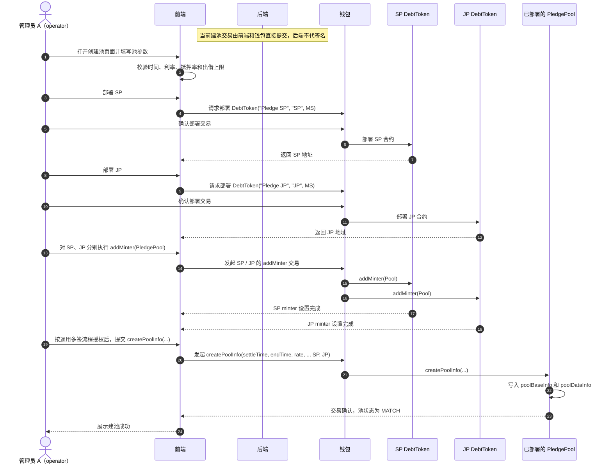
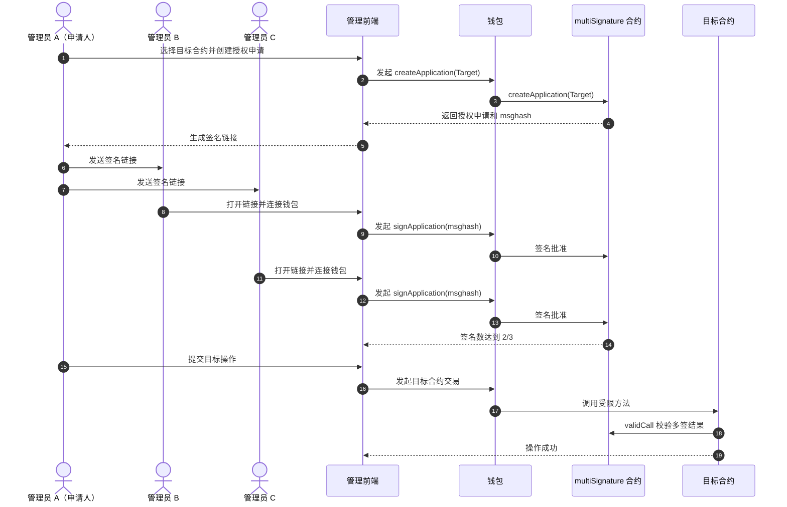
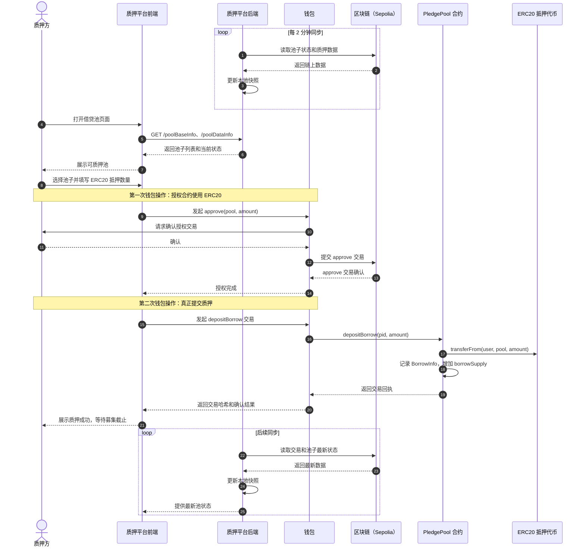
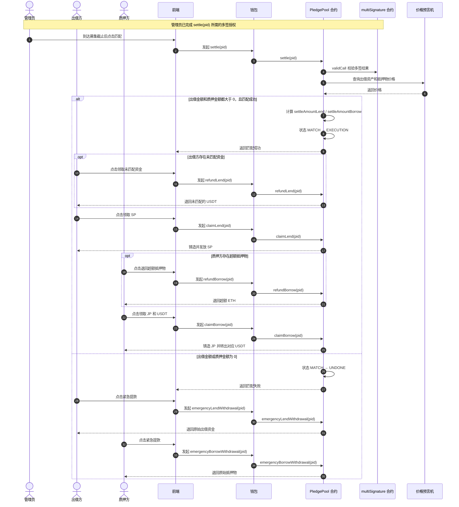
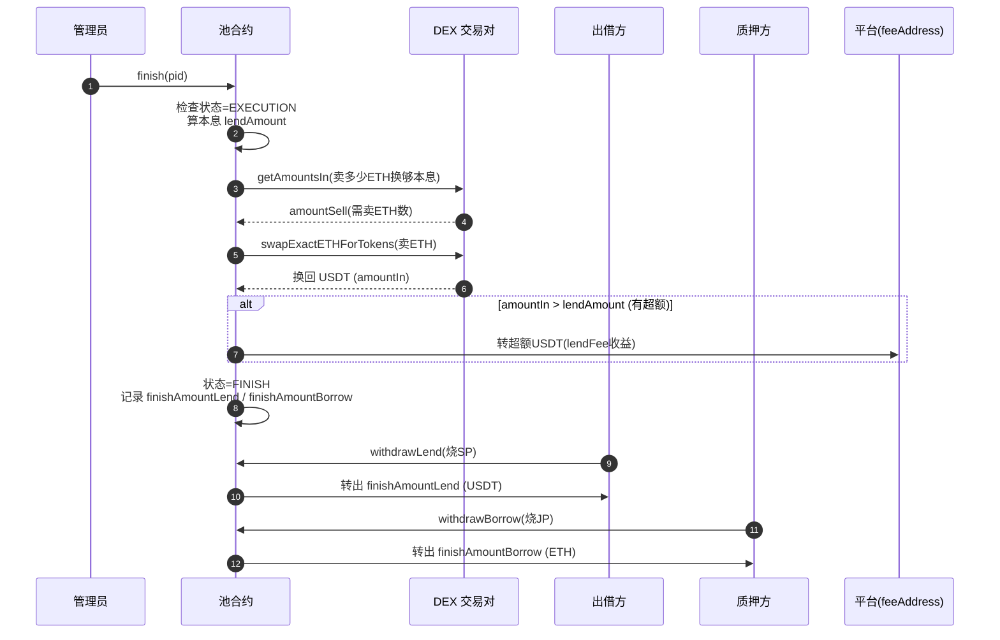

# 学习总结

# 业务理解
  核心是对两类人群的需求进行撮合,平台收取币种上涨带来的收益
  质押方:对当前的持币的未来看好,有其他币种的流动性需求
  出借方:期望获得相对稳定的收益
  质押平台:对质押和出借放进行撮合

# 工程理解

## 项目结构
- admin-fe
   用户管理的前端功能,代码纯AI生成,关键功能点根据 Pledge_PRD.md 进行迭代，人主要关注功能点和测试集
- pledge-fe:
  对客页面的前端功能，整体实现同admin-fe
- pledge-backend:后端功能的实现,主要实现了借贷池和代币信息的查询,从链上把池子的信息同步到链下形成快照供用户查询，目前有2分钟延迟, 还有对多签配置的读取和修改   
- pledgev2:合约实现, 建池、部署JP，SP、出借、质押等一系列涉及资金的数据存入,
- docs
  实践过程中的文档总结,便于AI持续的进行迭代
  

## 关键点实现思路
 用户最关键的几个功能点的交互时序
### 建池

流程核对：管理员 A 在前端填写参数后，先直接部署 SP 和 JP 两个 `DebtToken`
合约。部署完成后，SP、JP 的 `addMinter(PledgePool)`，以及最后
`PledgePool.createPoolInfo(...)` 都要经过多签授权。下面只展开一次通用多签流程，
三个目标分别按这个流程执行。这里创建的是 PledgePool 中的一条新池记录，不是再次
部署 PledgePool 合约。当前建池页面直接使用部署配置并由钱包提交链上交易，后端不
代替管理员签名或转发这些交易。
从合约权限看，`createPoolInfo` 同样带有 `validCall`，因此创建池也属于多签保护的
操作；部署脚本中的预授权只是初始化时提前完成了 A 到 PledgePool 的授权。

SP、JP 的 `addMinter` 和 PledgePool 的 `createPoolInfo` 都参考下面的多签流程。

#### 通用多签授权流程

SP、JP 的 `addMinter` 和 PledgePool 的 `createPoolInfo` 都参考下面的多签流程。

### 质押
钱包认证需要区分抵押资产类型：当前项目的 `PledgePool` 创建池时要求
`borrowToken == address(0)`，因此质押 ETH 时用户确认一次
`depositBorrow` 交易即可。若使用 ERC20 抵押，流程是先授权合约额度，
再提交 `depositBorrow` 完成质押。若使用EIP-2612标准，

其中，真正转移 ETH 和写入质押数据的是钱包发起的链上交易；后端主要负责池子信息查询和链下快照同步，不直接代替用户签名。
 

### 出借
出借的整体流程在技术上和质押类似，区别点在于出借出的是USDT，需要先授权合约额度，再提交 `depositBorrow` 完成质押。
若实现EIP-2612，使用permit可一次性授权加转账
### 匹配
管理员完成多签授权后，调用 `PledgePool.settle(pid)` 执行匹配。匹配成功时，池子
进入 `EXECUTION`，出借方主动领取 SP 和未匹配的出借资金，质押方主动领取 JP 和
对应的 USDT；如果出借方或质押方任一方没有募集金额，池子直接进入 `UNDONE`，
双方通过紧急提款取回原始资金。
这里的 `UNDONE` 对应合约中任一方供应量为 0 的情况；如果价格无效、抵押容量为 0
或抵押物不足，`settle` 会回滚，不会进入 `UNDONE`。

### 结算
借贷时间到期后，管理员调用finish进行结算，平台合约 计算"出借方"需要领取的本金加利息， 质押方后续应该赎回的ETH，计算过程中需要通过预言机感知当前的市场价格，平台计算完成，出借方使用SP提取自己的USDT，质押方使用JP提取自己的ETH，提取完成后，平台销毁SP和JP

### 清算
清算在技术上的整体逻辑和结算类似，不同点是 ETH价格到达了设置的价格增量，同时状态会标记为LIQUIDATION
### 赎回
在结算中已经体现

